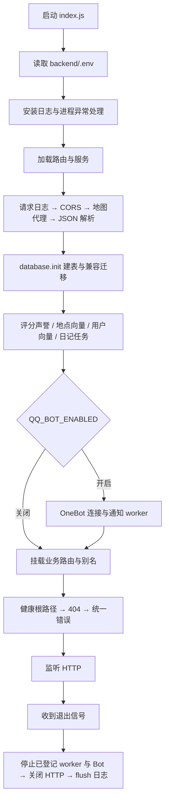
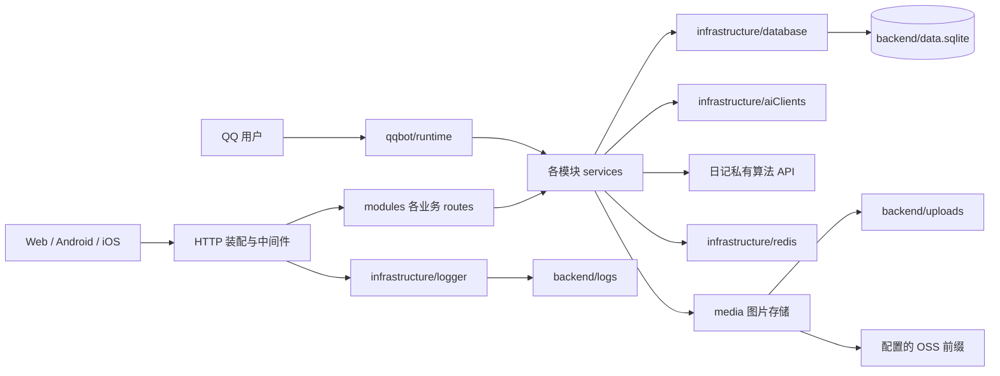

# 架构、选型与维护边界

核对基线：`2bc8c5e`（2026-10-15）。本次是已有系统的目录重组，下面区分当前实现与今后的建议。

## 当前调用与启动流程

注意：database 模块在被 require 时就打开 SQLite；`init()` 在监听前完成。部分路由虽然提前注册，也要等 listen 后才收到请求。当前地点向量 worker 的停止没有纳入 index.js 的退出清单，见待办 INF-02。

图中服务层是逻辑分组，不是新建的统一门面。当前服务可直接访问数据库，也有跨模块调用：places → ratings / preferences / qqbot 配置，ratings → preferences，discovery → ratings / preferences，journeys → places，community → journeys 存储工具 / preferences，accounts → qqbot 私信。这些耦合被保留并记录，没有宣称已做成独立服务。

2026-10-16：日记计算算法与提示词已分离为私有 HTTP 服务。journeys 保留所有持久化、认证、任务和发布事务，通过受限只读回调提供本地地点候选；计算期间不持有 SQLite 写锁。服务配置和部署边界见 [日记算法接入](../modules/journeys/doc/ALGORITHM_SERVICE.md)。

## 旧架构与本次结构对照

| 维度 | 原结构 | 当前结构 | 维护约定 |
| --- | --- | --- | --- |
| 业务定位 | routes 与 services 各自平铺 | modules 按业务收拢路由、服务和文档 | 改评分先进入 ratings，不先搜索整个 services |
| 共用能力 | db.js、redis.js、utils/logger.js 分散 | infrastructure 内集中 | 技术客户端不承载新业务规则 |
| 测试 | scripts 混有 test、维护命令、真实模型探测 | tests 按模块，scripts 按用途 | 新离线测试命名 test_*.js；浏览器测试后缀 _ui.js |
| 文档 | 零散 Markdown + 被忽略的根 docs | backend 下随模块跟踪 | 专题细节不复制；入口链接过去 |
| 资源定位 | 每个文件推算 __dirname | 基础设施 paths 固定 backend 根目录 | DB_FILE 相对 backend；UPLOADS_DIR 保留原 cwd 语义 |
| 历史追踪 | 依赖提交标题与文件记忆 | 路径对照 + 提交证据 + 案例编号 | 文件搬迁后用 git log --follow |

## 选型对照：保留现有技术的原因

这是基于仓库现状的维护判断，不是重新进行供应商评测，也不引用外部产品的实时规格。

| 能力 | 当前采用 | 可替代方案 | 当前取舍 / 重新评估条件 |
| --- | --- | --- | --- |
| 服务组织 | Express + CommonJS 模块化单体 | 分服务 / 全量框架迁移 | 保持 API 和事务边界；跨进程扩容成为明确需求时再拆 |
| 业务数据 | better-sqlite3，WAL、短同步事务、旧回调包装 | 客户端服务器数据库 / ORM | 保留迁移兼容和原子写入；写锁竞争、数据量或多实例需求有实测后重评 |
| 临时会话 | Redis + JWT sid | SQLite 会话 / 完全无状态 JWT | 已有多设备撤销能力；Redis 故障允许 JWT 验证是现有可用性选择，有撤销失效窗口 |
| 搜索 | SQLite 字面召回 + 本地排序；sqlite-vec 语义检索 | 独立全文搜索引擎 | 基础搜索不依赖模型；记录候选规模与耗时后再决定索引或外部服务 |
| 异步任务 | 进程内轮询 + SQLite 持久任务记录 | 独立队列 worker | 不增加部署组件；退出与重启恢复必须回归，多实例需要专门验证 |
| 图片 | sharp + 本地 / OSS 适配 | 全 BLOB / 统一外部媒体服务 | 地点图片沿用公开 URL；头像和日记私图保留数据库权限边界 |
| QQ 协议 | NapCat OneBot + 本地命令，AI 只解释受限字段 | 独立机器人服务 / 全 AI 对话 | 网站与 Bot 共用业务规则；平台发包是兼容点，必须保留降级 |
| 文档 | 仓库内 Markdown + Mermaid | 外部文档站 / 图片流程图 | 随 Git 评审、AI 可读取、图可直接修改；不新增构建链 |

## 修改时必须保持的约定

1. 路由前缀与历史别名由 index.js 装配；物理文件夹名不能改变客户端 URL。
2. 不在 SQLite 事务中等待网络。地点、分类、创建者评价及通知记录的原子性由当前服务维护；提交后再做异步补偿。
3. 模块迁移不能让 DB_FILE、uploads、logs、seeds、.env 随源码移动。运行库、上传文件和日志本次均不搬迁。
4. 保留延迟 require：日记澄清与生成、地点创建与向量刷新有循环依赖风险，不把它们机械提升为顶层导入。
5. 新业务尽量只依赖对方服务接口，避免跨模块写表；现存的直接 SQL 耦合按待办逐步处理。
6. API、数据库、worker、AI 输入发生变化时更新模块案例，完成或新增待办时附上复现命令及真实结果。

参见 [Git 历史与待办](HISTORY_AND_TODO.md)、[路径对照](MIGRATION_MAP.md)、[本次执行计划](REFACTOR_PLAN.md)。
