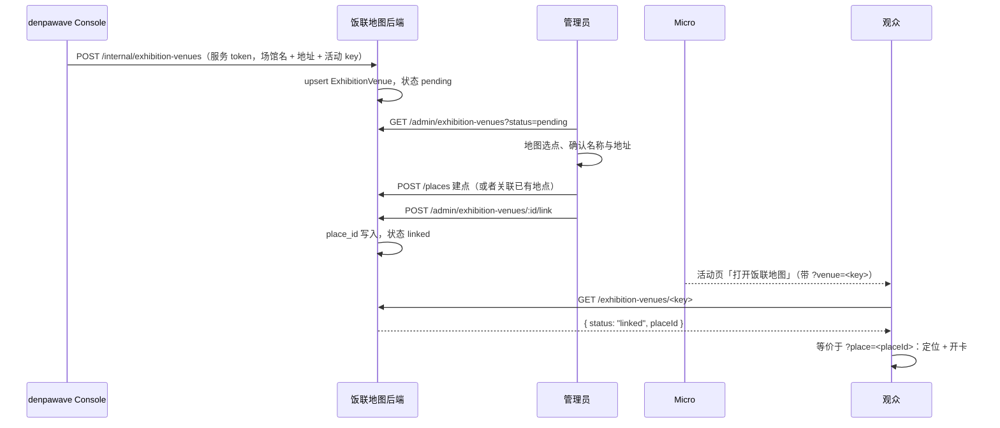

# 展会地点落点：denpawave Micro 跳转饭联地图后的聚焦与建档

状态：方案评审（WIP PR），本文件只定契约与实施顺序，代码在后续提交。

核对基线：`b53d07d`（2026-11-15，origin/main）。对端以 denpawave 的 Micro、Console V2 与 product-backend 仓库当前位置为准，接口字段在 P1 前再核一次。

## 背景

denpawave Micro 的活动页已经有「展馆周边吃」入口（`components/event/page-parts.tsx` 的 `VenueNearbyEat`），点击后打开 `https://www.dinnerparty.cc/`。链接不带参数，落地是地图首页的默认视野：用户看不到自己所在展馆周边，需要再手动定位、缩放、搜索，才会看到周边店铺。

想补的体验是「跳过来就落在展馆」。最简单的做法是把场馆名或地址拼进链接，落地后自动搜索——但这条路不能走：

1. **额度**。饭联地图的对外地点搜索走 `modules/maps/services/amapSearchBudget.js` 的全局预算（默认每月 4000 次，日预算按当月剩余天数分摊）。带地址跳转会让每一次跳转都兑换一次搜索：Micro 入口是人流集中的公开入口，展会期间跳转量不可控，会把用户自己的搜索额度挤掉。
2. **合同**。高德对搜索结果的存储与再分发有限制。用搜索结果回填地点、把结果写进库或展示给第三方，都不在允许范围内。跳转自动搜索恰好同时踩到这两点。

所以本次改为「先建档、再指路」：联网搜索只发生在管理员手工建档时（人工在地图上选点，不落任何高德搜索结果），日常跳转只做一次库内映射查询，零搜索、零外部调用。

## 现状证据（可直接复用的部分）

| 能力 | 现状 | 位置 |
| --- | --- | --- |
| 深链定位并开卡 | `/p/:id` 由导航层归一化为 `/?place=:id`；地图就绪后读地点、`setZoomAndCenter(16)`、打开卡片，`armSkipAutoSearch(800)` 阻止随之而来的搜索 | `frontend/src/map/MapView.jsx` 的分享链接 effect；`frontend/src/platform/navigation.js` |
| 一次性参数 | 处理后 `removeQueryParams(['place','nav'])`，刷新和返回不会重复跳转 | 同上 |
| 展会地点临时标记 | 展会面板点地址后复用高德临时地点标记与卡片（`showExhibitionVenue`），卡片只有导航，关闭或换点即消失 | `frontend/src/map/MapView.jsx` |
| 高德搜索预算 | 月/日双限额、来源白名单只允许 `map_manual` / `journey_address` / `legacy_sdk`；`/api/amap/search` 另有按 IP 的分钟限流 | `backend/modules/maps/services/amapSearchBudget.js`、`backend/modules/maps/routes/amapSearch.js` |
| 管理员建点免初筛 | 具备 `manage_places` 的管理员创建的地点直接 `visible`，不进 AI 初筛 | `backend/modules/places/services/placeModeration.js` 的 `initialModerationStatus` |
| 地图选点 | 全屏选点组件可直接复用 | `frontend/src/map/MapView.jsx` 的 `FullScreenMapPicker` |
| 待探索分类 | 建点时可打「待探索」标签，此时不写创建者评价、地图上先显示问号 | `backend/seeds/categories.json`、`backend/modules/ratings/services/ratingWarning.js` |
| 服务间鉴权先例 | `/internal/*` 用固定 token + 定长摘要比较 | `backend/modules/journeys/routes/algorithmPlaces.js` |
| 管理员后台 | 网页后台按权限分区；iOS 原生后台有一份 section 映射 | `frontend/src/admin/AdminDashboard.jsx`、`frontend/src/admin/nativeAdminController.js` |

还没被任何一方实现的：活动与地点之间的映射表、跨服务的新地点通知、跳转参数 `?venue=` 的处理。

## 目标与非目标

目标：

1. Micro 跳转后，若该展会地点已建档，地图直接定位到它并打开卡片（不消耗任何外部搜索）。
2. 若还没建档，跳转仍然打开地图，但明确告诉用户「这个展会地点还没标记」，不自动搜索、不猜点。
3. 新活动的场馆信息由 console 侧单向送到饭联地图，进入管理员待办，由管理员人工建档后映射生效。

需求四步与本文的对应：

| 需求 | 落点 |
| --- | --- |
| 1. 先加表存展会地址 | `ExhibitionVenue`（见「数据」） |
| 2. console 建活动后把新地点送进 party 管理员待办 | `POST /internal/exhibition-venues` + 管理员「展会地点」面板 |
| 3. 管理员建档，规避高德搜索结果不可存储 | 地图选点 + 现有 `POST /places`；管理员免 AI 初筛，全程不落搜索结果 |
| 4. 跳转时有地点就聚焦、没有就提醒 | `GET /exhibition-venues/:key` + `/?venue=<key>` 分支 |

非目标（本文件不改）：

- 活动信息（时间、场次、摊位）同步；只在需要识别场馆时取最少字段。
- 双端账号或身份打通。
- 搜索额度策略、配额上限、计费口径。
- 展会面板（`SiteExhibition`）本身的展示逻辑与轮播。

## 方案总览



失败与缺失路径：

- `pending`（已收到通知、管理员还没建档）或 `unknown`（没有这条记录）→ 打开地图默认视野，提示「该展会地点还没在饭联地图标记」，不调用 `/api/amap/search`。
- 对端带坐标且明确授权落库时，可以退化为展会地点临时标记（复用 `showExhibitionVenue`），仍然零搜索；是否启用见「待定」。

## 数据

新增一张表，只存「对端给的文字 + 管理员建档结果」，不存任何搜索返回。

```sql
CREATE TABLE IF NOT EXISTS ExhibitionVenue (
    id INTEGER PRIMARY KEY AUTOINCREMENT,
    source TEXT NOT NULL DEFAULT 'denpawave',   -- 来源，便于以后接第二家
    external_key TEXT NOT NULL,                 -- 对端活动的稳定标识（Micro 的 publicKey）
    event_name TEXT NOT NULL,                   -- 活动名，管理员识别用
    venue_name TEXT,                            -- 场馆名，对端填写
    address TEXT,                               -- 地址原文，对端填写（不是搜索结果）
    city TEXT,
    start_date TEXT,                            -- YYYY-MM-DD
    end_date TEXT,
    place_id INTEGER,                           -- 建档后关联的 Place
    status TEXT NOT NULL DEFAULT 'pending',     -- pending / linked / ignored
    note TEXT,                                  -- 管理员备注（合并重复、地点已合并不需要等）
    created_time DATETIME DEFAULT CURRENT_TIMESTAMP,
    updated_time DATETIME,
    linked_by TEXT,
    linked_time DATETIME,
    UNIQUE (source, external_key)
);
CREATE INDEX IF NOT EXISTS idx_exhibitionvenue_status ON ExhibitionVenue (status, id);
```

规则：

- 建表放在 `infrastructure/database.js` 的初始化里，沿用 `CREATE TABLE IF NOT EXISTS` + 列级 `ALTER TABLE ... ADD COLUMN` 的兼容迁移风格。
- 写入边界：`venue_name` / `address` 是对端表单里的原文，允许存；**任何高德搜索返回的名称、地址、坐标一律不落库**。坐标只允许两种来源：管理员在地图上手选，或对端明确确认由其自行录入且非搜索缓存（见待定）。
- 状态机只有三态：`pending` → `linked`（管理员建档并关联）/ `ignored`（重复、或该活动不需要落点）。`linked` 之后地址变更只更新文字字段，不动 `place_id`，需要换点时由管理员重新关联。
- 一个活动一行（`external_key` 唯一）。多场馆活动按「主场馆」一条处理，其余见待定。

跨模块写入：本表只被 places 模块（关联与解析）、admin 模块（待办与建档）、`/internal` 入口（写入）读写；不改 `Place` 表结构。

## 接口契约

### 1. 对端推送（服务到服务）

`POST /internal/exhibition-venues`

```json
{
  "source": "denpawave",
  "events": [{
    "key": "comic-horizon-2026",
    "name": "Comic Horizon 2026",
    "venueName": "上海新国际博览中心",
    "address": "上海市浦东新区龙阳路2345号",
    "city": "上海",
    "startDate": "2026-12-05",
    "endDate": "2026-12-06"
  }]
}
```

- 鉴权：`Authorization: Bearer <EXHIBITION_VENUE_TOKEN>`，定长摘要比较，未配置 token 时返回 503（沿用 `/internal/journeys/...` 的写法）。
- 幂等：按 `(source, external_key)` upsert。`pending` / `ignored` 行更新文字字段；`linked` 行只更新文字字段，保留 `place_id`。
- 校验：`key` 匹配 `^[A-Za-z0-9_-]{1,64}$`；`name` / `venueName` ≤ 80、`address` ≤ 200、`city` ≤ 40，去首尾空白并拒绝控制字符；日期 `YYYY-MM-DD` 且 `start <= end`，可空。单次最多 50 条。
- 响应：`{ "accepted": 1, "updated": 0, "failed": [] }`，部分失败不回滚整批。
- 限流：按来源固定窗口，低于公网接口（例如每分钟 30 次）。日志只记 key 与条数，不记地址全文。

### 2. 跳转解析（公开只读）

`GET /exhibition-venues/:key` → `{ "status": "linked" | "pending" | "unknown", "placeId": 123 }`

- 只返回状态与地点 id，不回传地址、场馆名或坐标，避免把对端数据变成公开接口。
- 不挂 `publicCache` 白名单：管理员刚关联完就要生效，宁可每次一次索引查询（`db/redis` 都不加重缓存；如加，上限 60 秒并带版本号）。
- 出错一律 200 + `unknown`？不。数据库异常返回 503 并记日志，前端按 `unknown` 处理但上报时区分。

### 3. 管理员待办

- `GET /admin/exhibition-venues?status=pending`（`manage_places`）返回列表与 `pendingCount`。
- `POST /admin/exhibition-venues/:id/link`，body `{ "place_id": 123 }`：写 `place_id`、`linked`、`linked_by`、`linked_time`，同时 `insertAdminAction('link-exhibition-venue', ...)`。
- `POST /admin/exhibition-venues/:id/ignore`，body `{ "note": "..." }`。
- 两个写接口都只接受 `pending` 行，重复操作 409。

### 4. 前端跳转参数

`https://www.dinnerparty.cc/?venue=<key>`

- 与 `?place=` 同一个 effect 里处理：先解析 `venue`，拿到 `placeId` 后走既有的定位与开卡分支；参数一次性，处理后 `removeQueryParams(['venue'])`。
- 不传 `nav`、不带任何地址文本，落地不触发搜索（仍然 `armSkipAutoSearch`）。
- 与 `?place=` 同时出现时以 `place` 为准（分享链接优先），`venue` 直接丢弃。

## 管理端：从待办到建档

1. 后台新增「展会地点」面板（`manage_places`，`AdminDashboard.jsx` 注册；iOS 原生是否同步见待定）：列出 `pending`，每条显示活动名、场馆名、地址、活动日期、收到时间。
2. 点「建档」打开 `FullScreenMapPicker`（`context: 'manage'`），地图初始中心优先用城市或已有同城地点，选中点后回到表单，预填 `venue_name` 与 `address`。
3. 提交走现有 `POST /places`：管理员有 `manage_places`，`initialModerationStatus` 直接给 `visible`，不进 AI 初筛。分类建议打「待探索」+ 新分类「展会场地」，当前者存在时不写创建者评价。
4. 同名同坐标已存在时，`POST /places` 会返回 409 `duplicate_place` 与 `place_id`；流程直接转成「关联已有地点」，不要逼管理员改坐标。
5. 建档成功即调 `link` 接口，或由前端在建点成功回调里一并提交。
6. 重复通知（同一 key 二次推送）不新建待办，更新文字即可。

分类与展示口径：饭联地图是餐饮地图，场馆不是餐厅。建议新增一个非通用分类「展会场地」，并在随机美食、推荐、QQ 群新地点推送里排除该分类；是否在普通列表和搜索结果里出现见待定。

## Micro 与 Console 侧（对端仓库，按同一契约跟进）

- Micro：`VenueNearbyEat` 的 `href` 从常量 `NEARBY_EAT_URL` 改为带 `?venue=<publicKey>`（`EventEntry` 已经是 `{ mode: "path", publicKey }`，视图里拿得到）；拿不到 key（host 模式）时退回现行为。文案与「由饭联地图维护」不动。
- Console：活动创建／场馆信息变更后向饭联地图推送（服务端调用，失败重试、幂等）。至少需要 `key`（对外可稳定引用的活动标识）、活动名、场馆名、地址、城市、起止日期；`product-backend` 的 `cons.venue_name` / `cons.address` 已有对应字段。推送时机（草稿、提交、通过）见待定。
- 两边都不改对方的展示：契约只有上面四个接口和一个 URL 参数。

## 分阶段

| 阶段 | 内容 | 验收 |
| --- | --- | --- |
| P0（本仓库） | 建表、`/internal` 推送、解析接口、管理员待办与建档、`?venue=` 落地行为、i18n 文案、测试 | 用 curl 模拟 console 推送即可全链路验收；无对端依赖 |
| P1（Console） | 活动创建后推送，失败重试，token 配置 | 新活动在 1 分钟内出现在待办 |
| P2（Micro） | 入口链接带 `publicKey` | 线上点击后定位到场馆；未建档时看到提示 |

P0 完成即可上线，P1/P2 只增加入口。

## 测试计划

遵循 [测试执行协议](TESTING.md)。新增 `backend/tests/places/test_exhibition_venue.js`（`npm test` 自动发现），案例：

| ID | 前置 | 操作 | 预期 | 自动化 |
| --- | --- | --- | --- | --- |
| EV-01 | 临时库、已配置 token | 同一 key 推送两次 | 只有一行，文字更新，`place_id` 不被清空 | 待自动化 |
| EV-02 | 未配置 token / 错 token | 推送 | 503 / 401，无写入 | 待自动化 |
| EV-03 | 有 pending 行 | 管理员 `link` | 状态 `linked`，审计一条，重复 `link` 返回 409 | 待自动化 |
| EV-04 | 有 `linked` 行 | `GET /exhibition-venues/<key>` | `{status:"linked",placeId}`；`unknown` key 返回 `unknown` | 待自动化 |
| EV-05 | 浏览器 + 临时库 | 打开 `/?venue=<key>` | 定位到关联地点并开卡，地址栏参数被移除 | 待自动化（`test:ui`） |
| EV-06 | 同上，`pending` 行 | 打开 `/?venue=<key>` | 出现「还没标记」提示；`AmapSearchUsage` 不变 | 待自动化 |
| EV-07 | 非管理员 | 访问 `/admin/exhibition-venues` | 403 | 待自动化 |
| EV-08 | 文档与代码改动 | `npm run test:structure` | 相对链接与模块文档全通过 | 随 `npm test` |

前端文案进 `frontend/src/i18n/locales/zh-CN/map.json`，不在组件里写中文。

## 决策与待定

已定：

- 跳转只带活动 key，不带地址；解析走库内映射，不触发任何高德搜索。
- 场馆落点复用 `Place` + 管理员手工选点，不引入新的点位类型。
- 推送是服务到服务的单向通知，饭联地图不反向查询 Console。

待定（需要拍板后再落代码细节）：

1. **场馆在饭联地图上的身份**：新建 Place 打「展会场地」分类（推荐）还是干脆不进 `Place`、只用临时标记？前者能被搜索和列表看到，后者要另做一套点位存储。
2. **管理员待办的形态**：独立面板（推荐）还是并进现有地点申请列表？要不要未读角标／邮件？iOS 原生后台是否同步这个面板？
3. **多场馆活动**：只取主场馆，还是一个场馆一条 `ExhibitionVenue`？后者要定对端怎么给场馆序号。
4. **对端 key 的稳定性**：Micro 的 `publicKey` 改不改？改了要不要保留旧 key 别名？
5. **坐标**：对端要不要一起送场馆坐标（仅当对端自己录入、不是搜索缓存）？送了可以在未建档时先落到展馆位置，不送就只能提示。
6. **推送时机**：活动草稿、提交审核、通过发布，哪一步推送？已推送活动被删／改期怎么通知。
7. **活动结束后**：映射保留（推荐，链接不烂）还是随活动归档清掉？

## 风险

- **合同**：只要坚持「搜索只服务管理员的即时选点、不落库、不再分发」，就不碰高德的结果存储条款；解析接口回传的也只是饭联自己的地点 id。
- **额度**：本方案没有任何新增搜索调用；要防的是前端在 `pending` 状态下自行按场馆名发起搜索，代码里要显式不做。
- **数据质量**：同一展馆会被多场活动重复推送。短期靠 `venue_name + city` 提示「可能已有地点」，长期再谈合并。
- **权限**：`/internal` token 泄露只能写入待办，不能建点；建点仍需管理员登录，影响面可控。
- **回滚**：`?venue=` 分支独立于 `?place=`，前端可单独回退成首页跳转；后端接口先上线也不影响现有页面。
