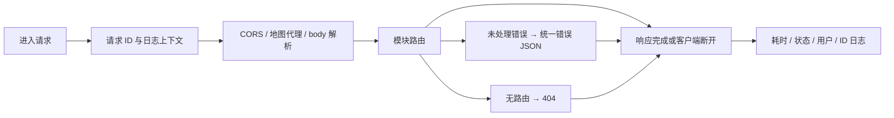

# HTTP 共用边界

middleware/requestLogger.js 导出 requestLogger、notFoundHandler、errorHandler。index.js 在 CORS 与解析请求体之前挂请求日志，路由之后挂 404 与错误处理；因此预检拒绝、JSON 错误及中断请求也有 requestId。每条请求日志带客户端 IP 与源端口 `port`（来源规则与代理配置见 [日志文档](../../infrastructure/doc/LOGGING.md#客户端源端口)）。身份和管理权限中间件分别归 accounts 与 admin。

middleware/publicCache.js 在 `cors()` 之前挂上：与观看者无关的 GET（公告、展会、`/api/amap/js-config`、`/places/regions`、`/places/markers`，以及地图瓦片的清单、字典和聚合瓦片 `PUBLIC_PATTERNS`；z12 明细瓦片不在内）固定回 `Access-Control-Allow-Origin: *` 并跳过按 Origin 回头的 `cors()`（`skipForPublic`），200 / 304 带公共 `Cache-Control`（含 `s-maxage`），出错时 `no-store`；路由自己不要再设 `Cache-Control`。路径清单、ESA 规则与前端约束见 [CDN 缓存](../../doc/CDN_CACHE.md)，测试 `npm run test:place-markers`。

middleware/jsonCompression.js 在地图代理之后、所有路由之前挂上：1 KB 以上的 JSON 响应按 Accept-Encoding 用 br（优先）或 gzip 压缩，并加 `Vary: Accept-Encoding`；流式响应、非 JSON、已带 Content-Encoding 或 `no-transform` 的响应原样发送。线上反向代理不压缩 JSON，地图缩小时 /places/nearby 约 3 MB，压缩后约 0.4 MB。压缩是异步的：`res.json()` 返回时响应头还没发出。执行 `npm run test:compression` 验证。

## 数据访问限流

middleware/rateLimit.js（防爬）：路由在识别观看者之后挂 `rateLimit(策略, { member })`，或在处理函数里调 `consume`。主体是登录的账号（`u:<id>`，瓦片票据认出的账号同样算），游客按 IP 段（IPv4 /24、IPv6 /64）；有管理员等级的不限。规则两种：`distinct` 按时间窗里碰过多少个不同的对象（地点 id、瓦片坐标、住民），反复看同一个不扣额度；计次按请求数。时间窗是秒数或北京时间自然日。策略：`detail`（`/places/:id`、`/places/:id/diaries`）、`share`（`/p/:id`，放宽，聊天软件抓卡片也走这里）、`tiles`（z12 明细瓦片）、`list`、`search`、`people`（`/users/:id/places`）、`legacy`（`/places/nearby`、`/places/markers`）。

- `ANTI_SCRAPE_MODE`：`observe`（默认）只记 `anti_scrape.would_limit` 警告、不拦；`enforce` 超过时回 429 `{ error, code: 'rate_limited', retry_after, guest }`，带 `Retry-After` 与 `no-store`；`off` 不计数。日志同一主体同一规则十分钟记一次。
- `ANTI_SCRAPE_LIMITS`：JSON，按策略与 `guest` / `user` 覆盖默认规则，例如 `{"tiles":{"guest":[{"distinct":true,"limit":30,"per":"day"}]}}`；不合法的回到默认。线上数值只放在 `.env`。
- 计数放在 Redis（SET / INCR，键 `rl:<策略>:<主体>:<x|n>:<窗>`），Redis 不可用时退回进程内计数；计数出错一律放行，限流不能变成新的故障点。
- 客户端 IP 取 `req.ip`，前提是 `TRUST_PROXY`（index.js）配对：不设时保持旧行为 `true`（取 `X-Forwarded-For` 最左边，客户端能伪造）；源站 Caddy 按 [CDN 缓存](../../doc/CDN_CACHE.md#源站-caddy) 覆盖写 `X-Forwarded-For` 后设 `loopback`。先 observe 跑一周、确认日志里的 IP 是真实客户端，再切 enforce。
- 排查：`npm run scrape:report -- --since 14d [--top 20] [--json]`（scripts/diagnostics/scrape_report.js，只读请求日志，保留六个月）按主体列出单日去重详情、分享页、明细瓦片、列表、搜索、住民地点、nearby 次数、撞线记录和 `GET /places` 根路径的调用方；`--user-id <UUID>` 或 `--subject ip:1.2.3.0/24` 按天列出一个主体的用量、用过的 IP 与 UA。住民按日志里的 `userId` 归类（请求日志会记可选登录与瓦片票据认出的用户，见 [日志文档](../../infrastructure/doc/LOGGING.md#记录内容)）；日志里的坐标打码，看不出 nearby 的范围大小。

测试：`npm run test:rate-limit`（中间件本身），`npm run test:place-tiles`（接到路由上的效果）。

当前采用单一请求上下文与错误出口，对照各路由自行生成请求 ID，可避免排障时丢失关联。路由中已有自定义错误响应仍保留，不能假定响应字段完全统一。执行 `npm run test:logging` 验证请求 ID、错误日志数量与凭证脱敏；相关规范见 [日志文档](../../infrastructure/doc/LOGGING.md)。
