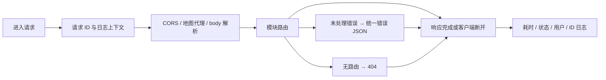

# HTTP 共用边界

middleware/requestLogger.js 导出 requestLogger、notFoundHandler、errorHandler。index.js 在 CORS 与解析请求体之前挂请求日志，路由之后挂 404 与错误处理；因此预检拒绝、JSON 错误及中断请求也有 requestId。每条请求日志带客户端 IP 与源端口 `port`（来源规则与代理配置见 [日志文档](../../infrastructure/doc/LOGGING.md#客户端源端口)）。身份和管理权限中间件分别归 accounts 与 admin。

middleware/publicCache.js 在 `cors()` 之前挂上：与观看者无关的 GET（公告、展会、`/api/amap/js-config`、`/places/regions`、`/places/markers`）固定回 `Access-Control-Allow-Origin: *` 并跳过按 Origin 回头的 `cors()`（`skipForPublic`），200 / 304 带公共 `Cache-Control`（含 `s-maxage`），出错时 `no-store`；路由自己不要再设 `Cache-Control`。路径清单、ESA 规则与前端约束见 [CDN 缓存](../../doc/CDN_CACHE.md)，测试 `npm run test:place-markers`。

middleware/jsonCompression.js 在地图代理之后、所有路由之前挂上：1 KB 以上的 JSON 响应按 Accept-Encoding 用 br（优先）或 gzip 压缩，并加 `Vary: Accept-Encoding`；流式响应、非 JSON、已带 Content-Encoding 或 `no-transform` 的响应原样发送。线上反向代理不压缩 JSON，地图缩小时 /places/nearby 约 3 MB，压缩后约 0.4 MB。压缩是异步的：`res.json()` 返回时响应头还没发出。执行 `npm run test:compression` 验证。

当前采用单一请求上下文与错误出口，对照各路由自行生成请求 ID，可避免排障时丢失关联。路由中已有自定义错误响应仍保留，不能假定响应字段完全统一。执行 `npm run test:logging` 验证请求 ID、错误日志数量与凭证脱敏；相关规范见 [日志文档](../../infrastructure/doc/LOGGING.md)。
