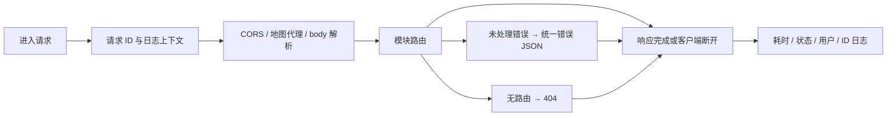

# HTTP 共用边界

middleware/requestLogger.js 导出 requestLogger、notFoundHandler、errorHandler。index.js 在 CORS 与解析请求体之前挂请求日志，路由之后挂 404 与错误处理；因此预检拒绝、JSON 错误及中断请求也有 requestId。身份和管理权限中间件分别归 accounts 与 admin。

当前采用单一请求上下文与错误出口，对照各路由自行生成请求 ID，可避免排障时丢失关联。路由中已有自定义错误响应仍保留，不能假定响应字段完全统一。执行 `npm run test:logging` 验证请求 ID、错误日志数量与凭证脱敏；相关规范见 [日志文档](../../infrastructure/doc/LOGGING.md)。
