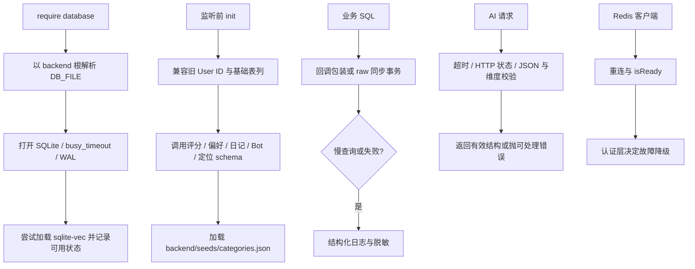

# 基础设施

database.js：better-sqlite3 连接、回调兼容包装、事务工具、旧表迁移和向量扩展。redis.js：ioredis 连接与就绪状态。logger.js：结构化日志、脱敏、请求上下文和进程桥接。aiClients.js：Embedding / Chat HTTP 边界与响应校验。paths.js：BACKEND_ROOT 与 backendPath，供数据位置固定。

| 当前选型 | 替代与维护判断 |
| --- | --- |
| 同步 SQLite + 旧回调接口 | 保留兼容；不要在包装回调中误以为事务可跨异步等待 |
| 可选向量扩展 | 扩展不可用时由消费者降级，基本 CRUD 不能依赖 AI 可用 |
| 单一 backendPath | 比各层 __dirname 推算更稳定；UPLOADS_DIR 已有 cwd 语义不改 |
| 可注入/可替换 HTTP 边界 | 用本机替身验证失败与重试，不用真实模型当回归依赖 |

已有自动化：`test:migration`、`test:transactions`、`test:ai-clients`、`test:logging`、`test:structure`。重要案例：旧库重复 init 不重复迁移；失败事务完整回滚；模型异常/空文本/错误维度被拒；日志不含凭证；资源路径不随 cwd 改变。详细日志用法保留在 [LOGGING.md](LOGGING.md)。

SQLite 在线快照、独立私有 OSS、Windows 每 6 小时备份任务及隔离恢复演练见 [DATABASE_BACKUP.md](DATABASE_BACKUP.md)。`test:backup` 使用临时数据库和 OSS 替身覆盖备份流程；真实云端权限、30 天生命周期和正式恢复需要部署环境验证。

database.js 尚包含较长的基础表迁移，模块化目录不代表已经拆完所有大文件。待办 INF-01 / INF-02 / INF-03 见 [清单](../../doc/HISTORY_AND_TODO.md)。
