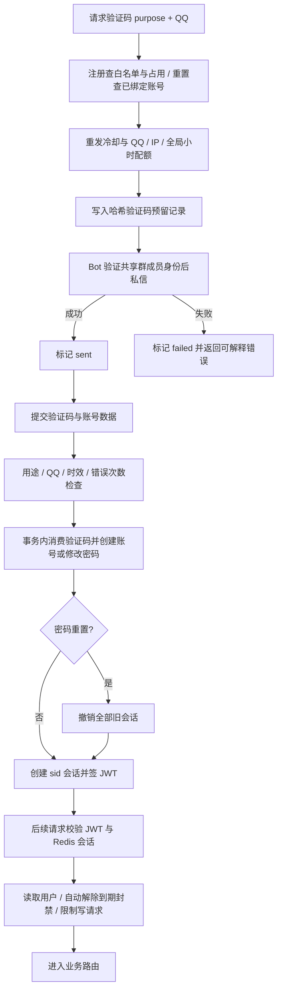

# 账号与访问

住民主页 `GET /users/:id/profile`（`services/userProfile.js`，可选登录）：住民名、是否有头像、`relation`、上次定位所在的城市（`UserLastLocation.city`：`PUT /users/me/location` 保存后在后台用 `maps/services/amapRegeo.js` 逆地理编码，位置又变了就不写旧结果）、六类餐饮偏好 `taste`（[六类餐饮偏好](../../preferences/doc/TASTE_AXES.md)），以及住民选的两个小组件 `widgets`（`collection` 公开收藏夹 / `recent` 最近创建的 5 个 / `favorite` 自己评“均线之上”及以上的 5 个）与其内容 `content`；屏蔽了 Ta 时不返回小组件内容。`PUT /users/me/profile { widgets }` 保存小组件（存在 `User.profile_widgets`），`PUT /users/me/taste { axis, level }` 自己填某一类的喜好（1–4，null 回到自动推断）。`GET /users/me` 另带 `rejected_place_count`（自己被驳回的地点数，前端头像小红点）。

入口：`routes/users.js`（挂载 `/users`）、`middleware/auth.js`。服务包括 sessions、qqVerification、qqWhitelist、userAccess、userLocation、userRelations。`GET /users/:id/places`（可选登录）返回住民名、观看者与这位住民的关系 `relation`（`self`、`blocked`、`can_block`）和这位住民创建的地点（places 模块的 `creatorPlaces.js`），供地图按住民筛选；已屏蔽时不列出地点。`POST` / `DELETE /users/:id/block`（需登录，不能屏蔽自己）屏蔽 / 解除屏蔽并返回新的 `relation`，数据在 `UserBlock`（任一方注销时级联删除）。屏蔽只影响屏蔽者自己看到的内容：`services/userRelations.js` 的 `notBlockedSql` 用在全部地点 / 附近地点（places）、快速搜索（discovery）、地点下的公开日记（journeys）和同好匹配（community）；AI 搜索、随机推荐、顺路和单个地点 / 分享链接不过滤。数据：User、QQWhitelist、QQVerificationCode、UserLastLocation；Redis 保存设备会话。依赖数据库、日志、Redis，以及 qqbot 的私信边界。

| 选择 | 当前实现 | 替代与代价 |
| --- | --- | --- |
| 注册凭证 | QQ 白名单 + 定向私信码，数据库只存 HMAC | 通用邀请码难约束具体 QQ；外部短信会增加服务依赖 |
| 登录状态 | JWT sid + Redis 多设备索引，兼容旧无 sid token | 完全无状态 token 简单，但无法按设备撤销 |
| Redis 故障 | JWT 合法时继续认证，记录降级 | 故障时拒绝更严格，但会影响所有登录用户；当前行为有已撤销 token 暂时有效的取舍 |
| 位置 | 每用户覆盖一条最近定位 | 不保存轨迹；Bot 随机推荐只需要一个中心 |

测试见 [案例库](TEST_CASES.md)。历史：`d285076` 验证码与重置，`13576c8` 最近定位。待办 ACC-01 / ACC-02 见 [维护清单](../../../doc/HISTORY_AND_TODO.md)。
