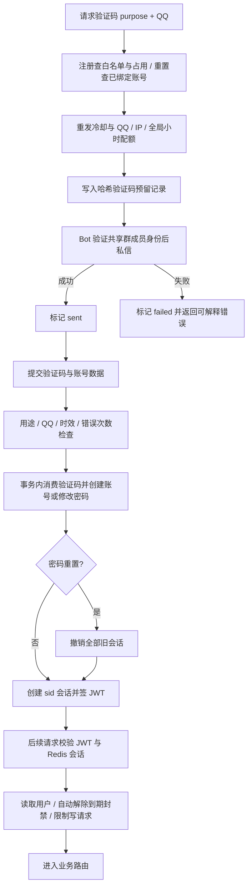

# 账号与访问

入口：`routes/users.js`（挂载 `/users`）、`middleware/auth.js`。服务包括 sessions、qqVerification、qqWhitelist、userAccess、userLocation、userRelations。`GET /users/:id/places`（可选登录）返回住民名、观看者与这位住民的关系 `relation` 和这位住民创建的地点（places 模块的 `creatorPlaces.js`），供地图按住民筛选；`relation.blocked` 是为“屏蔽某人”预留的接缝，上线时在 `services/userRelations.js` 读屏蔽表，目前恒为 false。数据：User、QQWhitelist、QQVerificationCode、UserLastLocation；Redis 保存设备会话。依赖数据库、日志、Redis，以及 qqbot 的私信边界。

| 选择 | 当前实现 | 替代与代价 |
| --- | --- | --- |
| 注册凭证 | QQ 白名单 + 定向私信码，数据库只存 HMAC | 通用邀请码难约束具体 QQ；外部短信会增加服务依赖 |
| 登录状态 | JWT sid + Redis 多设备索引，兼容旧无 sid token | 完全无状态 token 简单，但无法按设备撤销 |
| Redis 故障 | JWT 合法时继续认证，记录降级 | 故障时拒绝更严格，但会影响所有登录用户；当前行为有已撤销 token 暂时有效的取舍 |
| 位置 | 每用户覆盖一条最近定位 | 不保存轨迹；Bot 随机推荐只需要一个中心 |

测试见 [案例库](TEST_CASES.md)。历史：`d285076` 验证码与重置，`13576c8` 最近定位。待办 ACC-01 / ACC-02 见 [维护清单](../../../doc/HISTORY_AND_TODO.md)。
