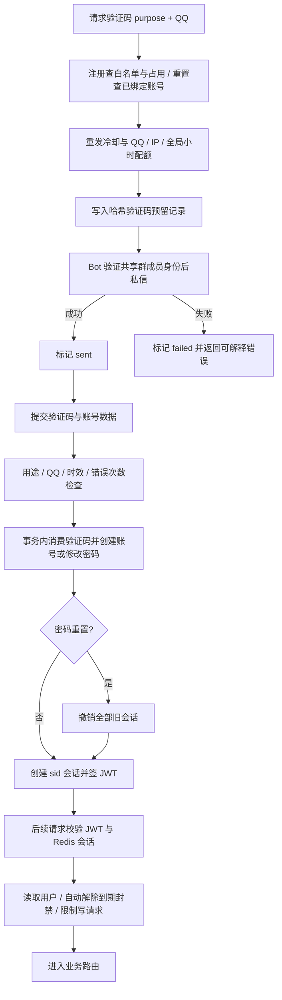

# 账号与访问

`GET /users/:id/profile` 支持匿名访问，返回住民名、头像 URL、观看者关系、城市、六类餐饮偏好，以及 `collection`、`recent`、`favorite` 三类预览，每类最多 5 个地点。收藏按公开设置返回，只有本人收到 `collection_visibility`。`favorite` 来自住民自己评为「均线之上」及以上的地点。`PUT /users/me/profile { widgets, hidden_widgets }` 保存地点栏的显隐。「我创建的地点」（`recent`）不能关闭（2026-11-20）：`hidden_widgets` 只保存 `favorite`，旧客户端发来的 `recent` 照常接受但不保存，旧数据里隐藏的 `recent` 读取时重新显示，访客也总能看到公开的创建地点。缺省设置下两栏都显示。`widgets` 保留旧版第二栏选择，旧客户端只更新这个字段时会保留显隐设置。`PUT /users/me/taste { axis, level }` 保存自己的偏好等级，`null` 恢复自动推断。访客的偏好数据不含收藏明细。屏蔽对象的主页不返回小组件。`GET /users/me` 的 `rejected_place_count` 用于头像和创建地点栏提示。 [六类餐饮偏好](../../preferences/doc/TASTE_AXES.md)

`GET /users/:id/favorites` 读取完整清单，支持匿名查看公开收藏。`GET` 和 `PUT /api/favorites/visibility` 读取与更新本人的 `{ is_public }`。`User.favorites_public` 默认为公开，对既有和新增账户生效。收藏条目来自 `Favorite`，同好匹配开关独立。服务端应用本人身份、屏蔽、封禁和地点审核规则。

主页的 `content.recent` 与创建地点列表共用审核可见性。本人可看到自己创建的待审核地点，访客只看公开地点。`PATCH /users/me/settings` 的 `map_settings.companion_enabled` 保存观察屋开关，缺省开启。

入口：`routes/users.js`（挂载 `/users`）、`middleware/auth.js`。服务包括 sessions、qqVerification、phoneVerification（两者共用 `verificationCodeStore.js` 的哈希、冷却、配额、错误次数与消费逻辑）、qqWhitelist、userAccess、userLocation、userRelations。`GET /users/:id/places`（可选登录）返回住民名、观看者与这位住民的关系 `relation`（`self`、`blocked`、`can_block`）和这位住民创建的地点（places 模块的 `creatorPlaces.js`），供地图按住民筛选；已屏蔽时不列出地点。`POST` / `DELETE /users/:id/block`（需登录，不能屏蔽自己）屏蔽 / 解除屏蔽并返回新的 `relation`，数据在 `UserBlock`（任一方注销时级联删除）。屏蔽只影响屏蔽者自己看到的内容：`services/userRelations.js` 的 `notBlockedSql` 用在全部地点 / 附近地点（places）、快速搜索（discovery）、地点下的公开日记（journeys）和同好匹配（community）；AI 搜索、随机推荐、顺路和单个地点 / 分享链接不过滤。数据：User（含 `phone`）、QQWhitelist、QQVerificationCode、PhoneVerificationCode、UserLastLocation；Redis 保存设备会话。依赖数据库、日志、Redis、qqbot 的私信边界，以及 `infrastructure/aliyunSms.js` 的短信边界。

## 头像

登录、`GET /users/me`、住民主页和更新账号资料的 `user` 对象包含 `avatar_url` 和 `has_avatar`。没有自定义头像时 `avatar_url` 为 `null`。上传通过 `PUT /users/me/avatar`，服务端将图片裁成 200×200 的 WebP，使用已有 `IMAGE_STORAGE=oss` 配置写入 `OSS_PREFIX/avatars/` 下的新对象，再把自有域名 URL 写入 `User.avatar_url`。换图后 URL 随之变化，对象可长期缓存。固定的 `/users/:id/avatar` 为旧客户端解析当前头像，使用 `no-store`。

更换头像和注销账号后，后端会尝试清理旧 OSS 对象，失败时记录 `account.avatar.cleanup_failed`。对应 RAM 子账号需要 `acs:oss:*:*:<bucket>/<OSS_PREFIX>/avatars/*` 上的 `oss:DeleteObject` 权限。旧地址的分发缓存可能保留至过期。 [OSS 对象删除](https://help.aliyun.com/zh/oss/developer-reference/delete-object)

已有 SQLite 头像在迁移前通过 `avatar_url` 指向的 `/users/:id/avatar/legacy` 读取。部署新版后端后，在相同 `.env` 和数据库配置下运行 `npm run avatars:migrate-oss` 只读统计，再用 `npm run avatars:migrate-oss -- --apply` 上传。每次上传成功后，只有原头像仍是当前版本才会写入 URL 并清空该行的旧 BLOB。中途失败可重跑。

## 手机号

注册时绑定手机号，**QQ + 短信双验证**；老住民可以没有手机号，在住民设置“绑定手机号”里绑定或更换（只验证新号码，不验证旧号码）。找回通行密码仍只接受 QQ。一个手机号只能绑定一位住民（`idx_user_phone`）。

- 号码格式：`User.phone` 与 `PhoneVerificationCode.phone` 存规范形式 `+区号 号码`（如 `+86 13800138000`、`+852 61234567`），请求体用 `countryCode`（不带 +，默认 86）+ `phone`。中国大陆必须是 11 位手机号；其他地区 4–14 位、去掉开头的 0、总长不超过 E.164 的 15 位。接口只回传打码号码：`GET /users/me`、登录、注册、找回密码的 `user.phone_masked`（大陆 `138****8000`，境外 `+852 61****67`，没绑定为 null）。
- 短信通道（`infrastructure/aliyunSms.js`，AccessKey 默认沿用 `OSS_ACCESS_KEY_*`）：+86 走号码认证服务 `SendSmsVerifyCode`（赠送签名 `SMS_SIGN_NAME`，模板 100001 注册 / 100004 绑定新手机号）；其他区号走短信服务“国际/港澳台短信”的 `SendMessageToGlobe`（Dysmsapi 2018-05-01，只在 `dysmsapi.ap-southeast-1.aliyuncs.com`；没有签名和模板，正文由 `intlMessage` 拼成一条 UCS-2 短信，`Type=OTP`，可选 SenderID `SMS_INTL_SENDER_ID`）。它按提交计费、运营商回执失败也收费，所以要 `SMS_INTL_ENABLED=true` 才开，关闭时境外号码返回 400“暂不支持”。2026-11-17 实测：+86 赠送签名“速通互联验证码”可发，+1 美国号码不带 SenderID 送达，但手机上只收到固定英文模板“Your verification code is <code>”（阿里云记录的是完整正文，是美国线路替换了内容），所以正文里验证码必须是第一个数字。验证码由本站生成、只存 HMAC，阿里云只负责下发，所以错误次数、单次使用和用途绑定都在本地校验。
- 注册：`POST /users/phone-code { qq, verificationCode, countryCode, phone }` 先核对 QQ 验证码（只核对不消耗，错了照常计次），证明是群成员才发短信，陌生人刷不了短信费；`POST /users/register` 再带 `countryCode`、`phone`、`phoneCode`，事务内先核对两个码再一起消费，短信码错了 QQ 码仍可用；号码是否已被别人绑定只在短信码通过后才检查（409，不消耗验证码），发码前不检查，否则不用收短信就能探测哪些号码注册过；失败响应的 `field` 指出是 `code`（QQ）还是 `phoneCode`。短信码绑定申请它的 QQ（`subject`）。
- 旧客户端：注册表单没有手机号字段的请求，在 `REGISTRATION_PHONE_REQUIRED` 关闭（默认）时仍只凭 QQ 验证码注册，手机号留空，记 `auth.register.without_phone`（带客户端平台与版本）；打开后返回“请更新”提示。带了手机号就必须过短信验证。
- 换绑：`POST /users/me/phone/code { countryCode, phone }` → `PUT /users/me/phone { countryCode, phone, code }`（需登录）。验证码只对申请它的住民有效；新号码已被别人绑定在提交时（验证码通过后）返回 409，和当前号码相同在发码时就返回 400。
- 配额（每小时，`phoneVerification.LIMITS`）：同号码 5、同 IP 10、同申请人（注册时的 QQ / 换绑的住民）5、全站 60，另有全站 24 小时 300；同号码 60 秒冷却，5 次错误作废，5 分钟有效。超时或连接中断时短信可能已发出，验证码保留。

| 选择 | 当前实现 | 替代与代价 |
| --- | --- | --- |
| 注册凭证 | QQ 白名单 + 定向私信码，再加手机短信码（实名登记），数据库只存 HMAC | 只用短信门槛低、费用与轰炸风险高，所以发短信前先要有效 QQ 码；只用 QQ 不满足实名要求 |
| 短信验证码 | 本站生成并校验，阿里云只下发 | 用 dypns 的 `##code##` 与 CheckSmsVerifyCode 可省本地表，但错误次数、用途与申请人绑定不受我们控制，且境外号码走另一个产品 |
| 登录状态 | JWT sid + Redis 多设备索引，兼容旧无 sid token | 完全无状态 token 简单，但无法按设备撤销 |
| Redis 故障 | JWT 合法时继续认证，记录降级 | 故障时拒绝更严格，但会影响所有登录用户；当前行为有已撤销 token 暂时有效的取舍 |
| JWT 密钥 | `services/jwtSecret.js` 统一读取；`index.js` 启动时 `JWT_SECRET` 没设、等于代码里的回退值或短于 32 个字符就拒绝启动；签发与校验都限定 HS256 | 仓库公开，回退值人人可见，加上 Redis 故障时只验 JWT，任何人都能签出管理员 token；回退值只留给测试脚本 |
| 登录失败限流 | `services/loginThrottle.js`：只数密码错误，同一时间窗内按账号 + IP 段、IP 段、账号三个计数，任一到额度即 429（`code: 'login_throttled'`，带 `Retry-After`），正确密码也拒绝；登录成功只清账号 + IP 段的计数。始终拦截，不受 `ANTI_SCRAPE_MODE` 影响；额度用 `LOGIN_FAILURE_LIMITS` 覆盖。计数在 Redis，不可用时退回进程内，出错放行 | 只按账号锁会让别人故意输错就把住民锁在外面，所以账号总计数额度放宽；IP 段计数依赖 `TRUST_PROXY` 配对，否则客户端能伪造 X-Forwarded-For 绕过，这时只剩账号总计数兜底 |
| 位置 | 每用户覆盖一条最近定位 | 不保存轨迹；Bot 随机推荐只需要一个中心 |

测试见 [案例库](TEST_CASES.md)。历史：`d285076` 验证码与重置，`13576c8` 最近定位。待办 ACC-01 / ACC-02 见 [维护清单](../../../doc/HISTORY_AND_TODO.md)。
