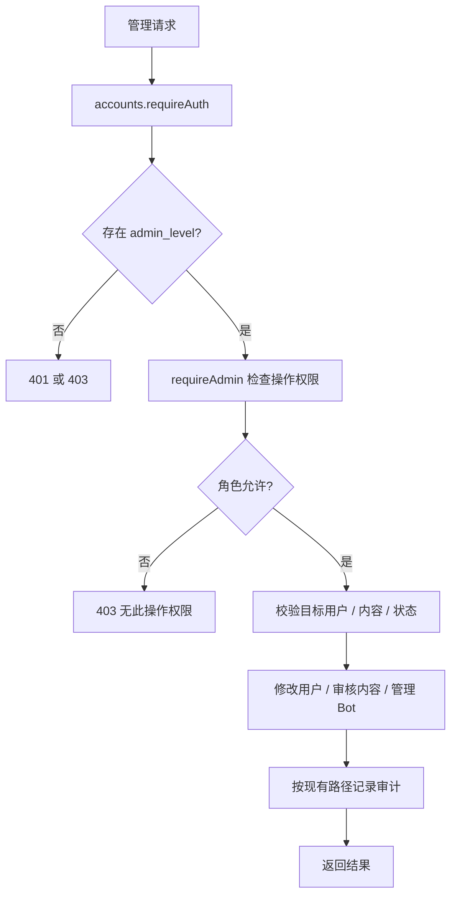

# 管理与审计

adminExhibitions 提供 `/admin/exhibitions` 发布及 `/current` 查询、下架，另有 `/api/admin/exhibitions` 别名，沿用 `manage_announcements` 权限。事务同时更新 SiteExhibition 与审计日志；部分唯一索引约束最多一个当前展会。

入口 routes 下 adminUsers、adminGeneralUsers、adminComments、adminAudit、adminQQWhitelist、adminQQBot、adminNotices；index.js 统一在 `/admin/*` 前挂 requireAuth，部分公告保留 `/api/admin/notices` 别名。middleware/adminAuth 是按权限名检查的工厂，services/adminPermissions 是唯一角色映射，adminAudit 写审计。

| 角色 | 权限范围（以 adminPermissions.js 为准） |
| --- | --- |
| YUYUKO | 所有映射权限 |
| YOUMU | 普通用户、地点、邀请码兼容权限、评论、公告 |
| KOMACHI | 普通用户、评论 |

采用集中权限表 + 中间件，便于核对不同入口；对照每个路由散写角色判断，前者能减少漂移。审计目前不是所有管理行为统一装饰器，不能据此推断所有操作均与日志原子提交。`manage_invites` 是旧权限名，注册现为 QQ 验证码流程，不新增邀请码路由。

文字测试案例：

- ADM-01（待自动化）：同一管理操作依次用游客、普通用户、KOMACHI、YOUMU、YUYUKO；期望符合权限表，拒绝时不写数据。
- ADM-02（待自动化）：普通用户管理接口尝试作用于管理员；核对原有目标限制，避免通过 general-users 绕过高权限接口。
- ADM-03（部分已有）：审核修改申请遇到写入失败；申请状态和地点同时回滚。入口 `npm run test:transactions`；其他管理操作的审计原子性需单独补测。
- ADM-04（部分已有）：Bot 管理路由权限与配置不可用场景，入口 `npm run test:qq-bot`；不是完整角色矩阵。

待办 ADM-T01 见 [清单](../../../doc/HISTORY_AND_TODO.md)。
