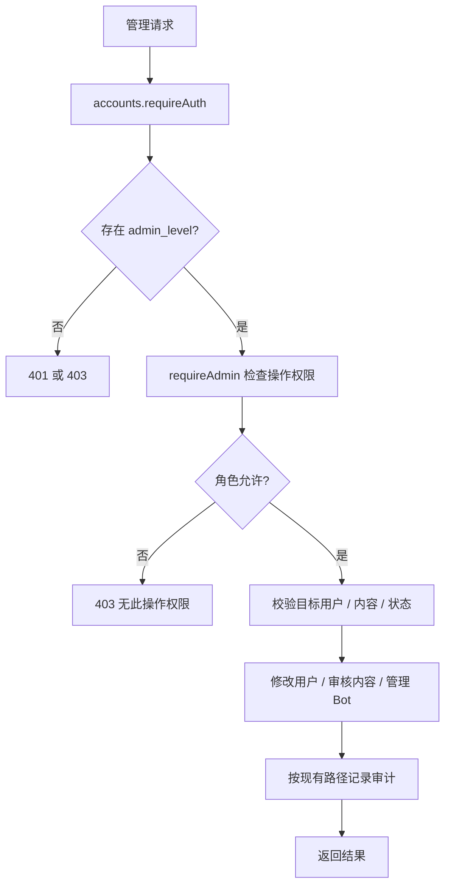

# 管理与审计

adminExhibitions 提供 `/admin/exhibitions` 发布及 `/current` 查询、下架，另有 `/api/admin/exhibitions` 别名，沿用 `manage_announcements` 权限。展会地点选填：`latitude`、`longitude` 要么都留空，要么都是有效坐标（0,0 视为未选），`location_name` 最多 80 字。事务同时更新 SiteExhibition 与审计日志；部分唯一索引约束最多一个当前展会。

入口 routes 下 adminUsers、adminGeneralUsers、adminComments、adminAudit、adminQQWhitelist、adminQQBot、adminNotices、adminSkinCodes；index.js 统一在 `/admin/*` 前挂 requireAuth，部分公告保留 `/api/admin/notices` 别名。middleware/adminAuth 是按权限名检查的工厂，services/adminPermissions 是唯一角色映射，adminAudit 写审计。

| 角色 | 权限范围（以 adminPermissions.js 为准） |
| --- | --- |
| YUYUKO | 全量用户管理、封禁解封、日志、地点、QQ 白名单/Bot、皮肤兑换码、评论、公告/展会 |
| YOUMU | 普通用户查看/删除/封禁解封、日志、地点、QQ 白名单/Bot、评论、公告/展会；不能管理皮肤兑换码或管理员等级 |
| KOMACHI | 普通用户查看/删除、日志、地点、评论；不能封禁解封或管理皮肤兑换码 |

采用集中权限表 + 中间件，便于核对不同入口；对照每个路由散写角色判断，前者能减少漂移。审计目前不是所有管理行为统一装饰器，不能据此推断所有操作均与日志原子提交。`manage_invites` 是旧权限名，注册现为 QQ 验证码流程，不新增注册邀请码路由；它现在管理 QQ 白名单和 Bot。皮肤兑换码独立用 `manage_skin_codes`，仅 YUYUKO（adminSkinCodes 挂载 `/admin/skin-codes`，沿用 InviteCode 表，见 [皮肤模块](../../skins/doc/README.md)）。

`view_audit` 独立控制日志读取，三个等级都有；`manage_bans` 控制 `/admin/users/ban`、`/unban`，YUYUKO、YOUMU 有。YOUMU 的目标只能是普通用户，检查与写入同处事务；YUYUKO 保留原有目标规则。`manage_places` 同时控制地点申请审核和他人地点编辑/删除。角色通过每次鉴权读取数据库，调整后下一次请求立即生效，无需迁移数据库。

文字测试案例：

- ADM-01（部分已有）：`node tests/admin/test_admin_permissions.js` 覆盖游客、普通用户和三个管理员等级的列表权限、地点审核/编辑/删除、兑换码拒绝及封禁解封；仍非所有管理操作的完整矩阵。
- ADM-02（已有自动化）：同一测试检查普通用户删除接口拒绝管理员目标、YOUMU 不能封禁/解封管理员或修改管理员等级，封禁审计失败时业务回滚。
- ADM-03（部分已有）：审核修改申请遇到写入失败；申请状态和地点同时回滚。入口 `npm run test:transactions`；其他管理操作的审计原子性需单独补测。
- ADM-04（部分已有）：Bot 管理路由权限与配置不可用场景，入口 `npm run test:qq-bot`；不是完整角色矩阵。

待办 ADM-T01 见 [清单](../../../doc/HISTORY_AND_TODO.md)。
