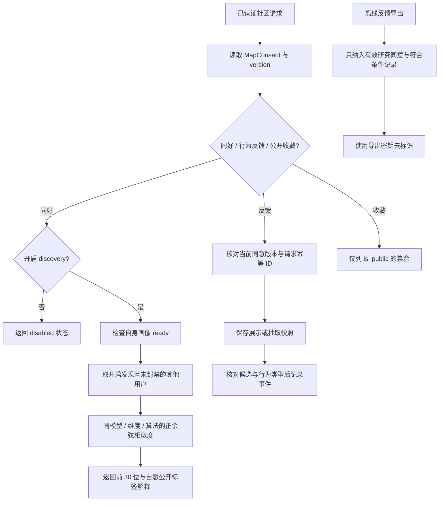

# 社区互动与反馈

exhibitions 提供公开的 `/exhibitions/current`（及 `/api/exhibitions/current`），只返回当前已发布展会的展示信息，无展会时返回 `{ exhibition: null }`。发布、下架及审计由 adminExhibitions 管理。

routes：community（`/api/community`）、comments、dinners、notices；挂载前缀与别名见 index.js。services/communityPreferences 提供同意状态及同好向量匹配；feedbackDataset 为离线导出提供去标识处理与估计工具。评论、聚餐、公告目前仍在各自路由内实现业务，不强行增加空 service 包装。依赖 accounts、preferences、discovery，以及 journeys/Store 的通用 SQL/错误工具。

| 当前实现 | 对照与取舍 |
| --- | --- |
| 现有用户向量 + 显式标签解释 | 不展示私有来源地点；共同标签不伪造为共同收藏 |
| MapConsent 版本随反馈校验 | 仅前端开关无法阻止旧页面继续写行为 |
| 搜索曝光记录 propensity=null | 观察日志不能当已知随机策略概率；离线评估必须区分 |
| 公告/评论/聚餐沿用现有路由 | 当前规模无需增加空抽象；业务增长后再提取服务 |

文字案例（已有自动化：`npm run test:community`、`test:journeys`）：

- COM-01：两人有兼容画像，关闭其中一人 discovery 后重查；预期其不出现在同好中，关闭方返回 disabled。核对数据库开关与响应，不只看 UI。
- COM-02：两人画像模型或算法版本不同；预期不计算混合语义的相似度；私有来源地点不进入解释字段。
- COM-03：持旧 consent_version 提交观察；预期不新增有效快照；同 ID 不同参数重试得到冲突，不能覆盖他人记录。
- COM-04：用户只有私有收藏或对方关闭发现；预期公共列表不泄露收藏。现有公开集合测试在 test:journeys。
- COM-05（待自动化）：为评论、聚餐、公告补独立权限与边界矩阵，见 COM-T01；不把 test:community 的向量测试当作这三个路由的覆盖证明。

待办 COM-T01 / COM-T02 见 [清单](../../../doc/HISTORY_AND_TODO.md)。
