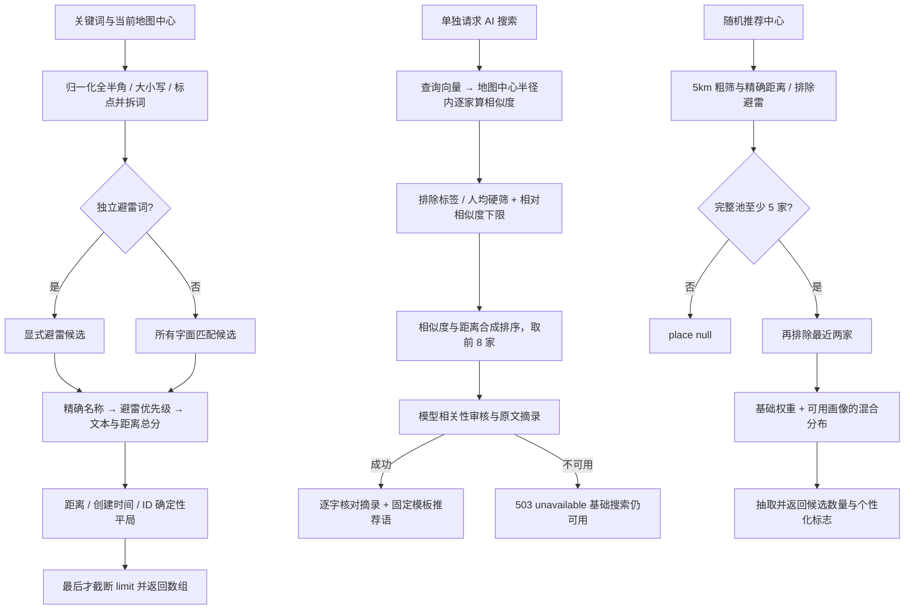

# 搜索、随机推荐与顺路发现

入口：routes/search.js（`/api/places/search*`）、routes/alongRoute.js（`/api/along-route`）；随机路由由 places 模块挂载。AI 搜索（`POST /api/places/search/ai`）需要登录（游客 401，基础搜索不受影响）。模型只判断候选是否相关、给出置信度，并从店铺介绍里逐字摘一段依据；推荐语一律由固定模板拼成（见下文“推荐语模板”），不是 AI 生成内容，前端不标注。每条推荐带 `reason_source: 'template'`（旧版 App 只给 `deepseek` 打“AI 生成”标签，所以旧版也不显示）和 `review_source`（`deepseek` / `local_fallback`：相关性由谁判断）；`status` 为 `ok`（模型审核完成）或 `partial`（退回本地阈值）。服务：placeSearch、semanticSearch、recommendationReason、randomRecommendation、alongRoute。依赖 ratings 统一避雷规则、preferences 用户向量及基础设施 AI / 数据库。

| 选择 | 当前实现 | 对照与约束 |
| --- | --- | --- |
| 基础搜索 | SQLite 所有匹配候选联合排序 | 先截断再算距离会漏附近结果；数据量增长后需评估成本 |
| AI 路径 | 独立接口，可不可用 | 把关键词搜索绑在模型请求上会让网络故障扩大影响 |
| 随机 | 固定 5km + 概率抽样 + 至少 20% 基础分布 | 只取最高相似度会失去探索；不随地图缩放变半径 |
| 地理 | 直线距离 + 顺路几何工具 | 不等同于真实步行/行车时长 |

## AI 搜索的候选与审核

类似检索增强：向量检索只负责粗排，相关不相关由模型审核决定（services/semanticSearch.js）。2026-11-18 之前大多数查询一家都不推荐，原因和改法见下表；拿广州、上海、温州、梧州四地各 8 句常见查询（含“距离不远价格不贵不是冰的正餐”“好吃的寿司”）用真实模型对照，有推荐的从 13/32 升到 26/32，连跑两次结果基本一致。剩下没有推荐的是附近确实没有（这几座城的数据里没有寿司店）或资料证明不了（附近没有写到辣的店）。

| 环节 | 现在 | 以前的问题 |
| --- | --- | --- |
| 候选 | 有地图中心时取半径内（`AI_SEARCH_RADIUS_KM`，默认 50 公里；视野更大时取视野半径的两倍）的全部地点，用 `vec_distance_cosine` 逐家算；没有中心时全国取向量最近的 200 家 | 先在全国取前 100/200 家再按距离筛，地点少的城市常常一家都进不了候选（梧州的大排档、酒楼排在全国 100 名外） |
| 原话里的筛选 | services/searchFilter.js 只读“明确不要的标签”和人均范围，硬筛；想吃什么不做标签筛选，返回的 `filter.tags` 恒为空 | “好吃的寿司”被读成“只要寿司标签”，只标了“日本料理”的大雄寿司、小二寿司全被筛掉 |
| 相似度下限 | 比附近最相似的那家低 `0.12` 以内，且不低于 `AI_CANDIDATE_MIN_SEMANTIC_SCORE`（默认 0.35） | 固定 0.6（意图改写后 0.55）。Qwen3-Embedding 的余弦值随查询整体浮动：附近的寿司店约 0.62，“适合聚餐”时大排档、火锅店只有 0.42–0.44 |
| 排序 | 资料修正后的相似度 × 0.88 + 距离分 × 0.12（`AI_PROXIMITY_WEIGHT`）；距离分在视野半径处为 0.5（视野小于 2 公里按 2 公里算） | 视野内要有一家修正后 ≥ 0.6 才只看视野内，实际几乎从来达不到，于是总按 50 公里内、距离权重 0.06 排，推荐常在十几二十公里外 |
| 审核 | 前 8 家一次交给模型（以前 5 家）。店名或分类直接写出菜品、菜系就算证据；“好吃”这类好评词不需要证据；夜宵、聚餐这类场景可以按常识判断。提示词给了 confidence 的刻度：描述写到 0.8 以上、店名或分类推出约 0.7、按常识推断约 0.6；`relevant` 为真且 confidence ≥ `AI_RELEVANCE_MIN_CONFIDENCE`（默认 0.5）才算通过 | 规则写着“店名本身不能证明相关”，大雄寿司、渔见寿司·寿司船专门店都被否；门槛 0.68 正好卡在模型来回浮动的 0.6–0.7，同一句查询时有时无 |
| 卡片顺序 | 通过审核的最多 3 家，按 相似度 × 0.7 + 距离分 × 0.3 排：都相关时近的在前 | 按检索分排，28 公里外的店排在 3.9 公里的前面 |

模型不可用时退回本地门槛（`AI_FALLBACK_RELEVANCE_MIN_SCORE`，对排序分），这条路很严，通常没有推荐，只保证不给出明显不相关的店。`.env` 里旧的 `AI_SEARCH_MIN_SEMANTIC_SCORE`、`AI_EXPANDED_INTENT_MIN_SEMANTIC_SCORE`、`AI_LOCAL_PREFERENCE_MIN_SCORE`、`AI_LOCAL_MIN_DETAIL_COMPLETENESS`、`AI_REMOTE_SEARCH_RADIUS_KM`、`AI_REMOTE_PROXIMITY_WEIGHT` 已不再读取。

## 推荐语模板

AI 搜索卡片上的推荐语由 services/recommendationReason.js 按 [recommendationTemplates.json](../recommendationTemplates.json) 拼成，只用到固定文案、地点字段、用户原话和逐字核对过的店铺介绍摘录，不含模型写的文字。改文案只改这个 JSON 文件。

| 占位符 | 内容 | 是否一定有值 |
| --- | --- | --- |
| `{name}` | 店名 | 一定有；`withoutExcerpt` 组必须写在方括号外，`withExcerpt` 组可以不写，用“这家”指代 |
| `{query}` | 用户原话，截 36 字 | 一定有 |
| `{excerpt}` | 店铺介绍摘录 | 只在 `withExcerpt` 组，必须写在方括号外；`withoutExcerpt` 组不能用 |
| `{category}` | 分类标签：去掉“其他”“避雷”“待探索”和重复的，最多三个，用顿号连起来，如 `快餐、潮州菜` | 可能没有（只有这几种标签也算没有） |
| `{distance}` | 离地图中心的距离，如 `800 米`、`1.2 公里` | 可能没有（正好在地图中心、四舍五入是 0 米也算没有） |
| `{price}` | 人均整数，如 `45` | 可能没有 |

- `[…]` 是可省略片段：片段里任何一个占位符没有值，整段连同标点一起去掉。可能没有值的占位符只能写在方括号里；方括号不能嵌套，每段至少有一个占位符。
- 先处理片段再一次性填值，店名或原话里本身带 `{}`、`[]` 时原样输出。
- 摘录：模型看到的店铺介绍是去掉 Markdown 后合并空白、截 300 字的纯文字（aiClients `descriptionForReview`）；模型给的 `evidence` 去掉首尾引号和标点后，必须是这段文字的连续子串、4–60 字且不等于店名，否则丢弃并改用 `withoutExcerpt` 组。
- 选用：有摘录用 `withExcerpt`，没有用 `withoutExcerpt`；组内按“卡片序号 + 原话哈希”轮换，同一次搜索的几张卡句式不同，同样的原话每次结果相同。模型不参与选模板。
- 改完模板跑 `npm run test:search`：`validateTemplates` 检查占位符、方括号，并分别用“全部有值”“可选全空”渲染，查残留符号和 `，，`、`～，` 这类断句。

口吻：卡片标题是“幽幽子特别推荐”，推荐语就是幽幽子本人在说话：贪吃、俏皮，说话不急不慢，自称“我”，不用“幽幽子觉得”这种第三人称。

- 店名、人均、距离、标签可以写进句子，但要说成话，接在幽幽子的反应上（“人均 20 元，得按三人份算”“离地图中心 800 米，对我来说也就是飘一会儿的事”），不排成“离地图中心约 800 米，人均约 20 元”这样的清单。除店名外一条最多带一样，组里换着带，相邻两条不带同一样。距离量的是地图中心，不说“离你”。缺数据时方括号整段去掉，剩下的部分自己要成句。
- 长度：去掉占位符后每条 25–50 字，配上摘录、店名和数字，手机上三行上下。字数花在幽幽子自己的反应和小场景上（“筷子都拿在手里了”“给我也带一份回来，可不许偷吃”）。
- 每条模板要对任何一家店都成立：人均和距离只报数，不说贵、便宜、远、近，不说好吃、排队，不说去过、吃过（待探索的店没人去过），不提早饭、晚饭这类时段，不说“还有一家”这类顺序（模板可能落在任意一张卡上）。
- 贪吃写成具体的事（“这句我读了三遍”“给我也带一份”），不写“肚子在叫”这类套话。妖梦、白玉楼、亡灵这类梗每组最多用一次。
- 不用感叹号、波浪号、破折号和表情。用户原话最多一条模板引用，几条都复述原话，读起来就是搜索引擎。
- 同一次搜索的几张卡取组里相邻的模板，相邻两条的开头要不一样。

排序公式与已有实验原文：[地点搜索](placeSearch.md)。推荐公式：[随机美食](randomRecommendation.md)。外部资料沿用原文，不是本次新核验。测试见 [案例库](TEST_CASES.md)。历史 `2566978`，待办 DSC-01 / DSC-02 见 [清单](../../../doc/HISTORY_AND_TODO.md)。
