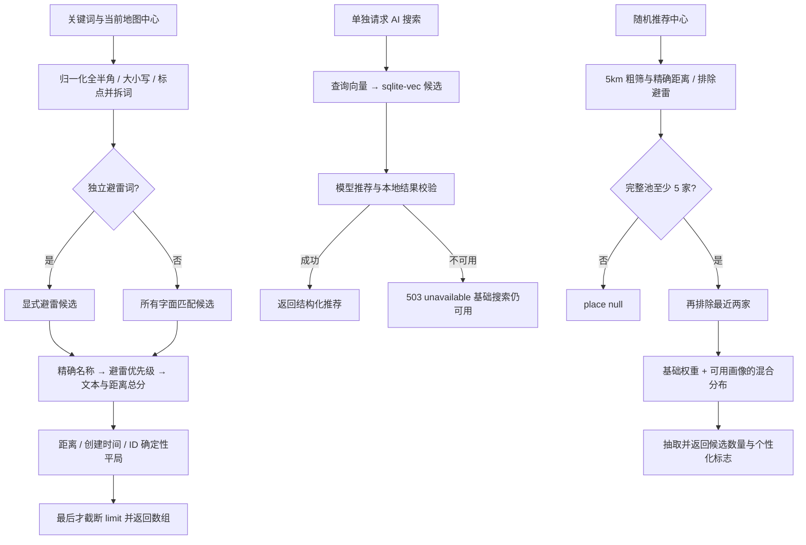

# 搜索、随机推荐与顺路发现

入口：routes/search.js（`/api/places/search*`）、routes/alongRoute.js（`/api/along-route`）；随机路由由 places 模块挂载。AI 搜索（`POST /api/places/search/ai`）需要登录（游客 401，基础搜索不受影响）。每条推荐带 `reason_source`（`deepseek`：模型写的推荐语，前端标注“AI 生成”；`fallback`：本地模板兜底，不标注）；所用已备案模型的名称和备案号公示在用户协议第九部分。服务：placeSearch、semanticSearch、randomRecommendation、alongRoute。依赖 ratings 统一避雷规则、preferences 用户向量及基础设施 AI / 数据库。

| 选择 | 当前实现 | 对照与约束 |
| --- | --- | --- |
| 基础搜索 | SQLite 所有匹配候选联合排序 | 先截断再算距离会漏附近结果；数据量增长后需评估成本 |
| AI 路径 | 独立接口，可不可用 | 把关键词搜索绑在模型请求上会让网络故障扩大影响 |
| 随机 | 固定 5km + 概率抽样 + 至少 20% 基础分布 | 只取最高相似度会失去探索；不随地图缩放变半径 |
| 地理 | 直线距离 + 顺路几何工具 | 不等同于真实步行/行车时长 |

排序公式与已有实验原文：[地点搜索](placeSearch.md)。推荐公式：[随机美食](randomRecommendation.md)。外部资料沿用原文，不是本次新核验。测试见 [案例库](TEST_CASES.md)。历史 `2566978`，待办 DSC-01 / DSC-02 见 [清单](../../../doc/HISTORY_AND_TODO.md)。
