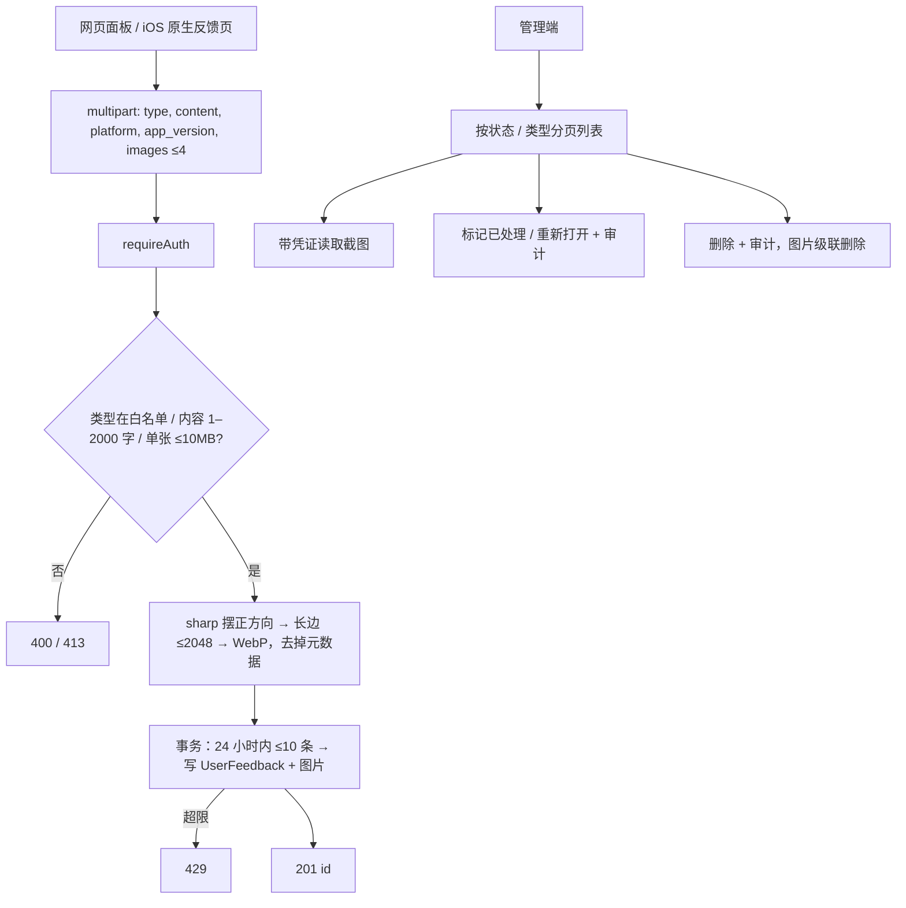

# 住民反馈

入口：`routes/feedback.js`（挂载 `/api/feedback`，需要登录；封禁中的住民只能读，不能提交）、管理端 `../admin/routes/adminFeedback.js`（挂载 `/admin/feedback`，权限 `manage_feedback`，三个管理员等级都有）。服务 `services/feedbackService.js`，建表 `services/feedbackSchema.js`。

一条反馈是类型 + 文字 + 最多 4 张截图。截图可能拍到个人信息，所以不走公开的 `/upload`（本地 / OSS 可下载），而是像日记私人图片一样转码后存 `UserFeedbackImage.data`（BLOB），只有管理员能读。账号删除时反馈与截图随 `User` 级联删除。

| 接口 | 说明 |
| --- | --- |
| `POST /api/feedback` | multipart：`type`（`bug` / `suggestion` / `report` / `account` / `other`，与前端 `src/feedback/feedbackTypes.js` 一致）、`content`（CRLF 统一成 `\n` 后 1–2000 字）、`platform`（`web` / `android` / `ios`，其他按 `web`）、`app_version`；图片字段 `images`，最多 4 张；返回 `201 { id }` |
| `GET /admin/feedback` | `?status=open|resolved|all&type=&page=&pageSize=`（≤50）；`{ items, total, page, pageSize, counts }`，每条带提交者住民名、QQ、处理人与图片 `{ id, width, height }` |
| `GET /admin/feedback/images/:imageId` | WebP，`Cache-Control: private, no-store` |
| `PUT /admin/feedback/:id/status` | `{ status: 'open' | 'resolved' }`，记录处理人与时间，写审计 `resolve-feedback` / `reopen-feedback` |
| `DELETE /admin/feedback/:id` | 删除反馈与截图，写审计 `delete-feedback` |

| 当前实现 | 对照与取舍 |
| --- | --- |
| 截图存私有 BLOB | 公开 `/upload` 会把截图变成可下载链接；反馈量小，库内存储足够 |
| 一次 multipart 提交 | 先传图再提交会留下无主图片；一次请求在同一事务里落库 |
| 每人 24 小时 10 条 | 只要求登录（QQ 白名单注册）即可提交，限流防止刷屏 |
| 只有状态，没有回复 | 住民暂时看不到处理结果；需要时再加“我的反馈”与回复 |

文字案例（已有自动化：`npm run test:feedback`）：

- FB-01：游客提交得到 401；缺类型、未知类型、空内容、超长、超过 4 张、非图片、坏图片都得到 400，且不留记录。
- FB-02：带方向标记的 3000×1200 JPEG 入库后为 819×2048 的 WebP、无 EXIF；管理员能读，普通住民 403。
- FB-03：标记已处理记录处理人与时间，重新打开清空；审计写入失败时状态与删除都回滚。
- FB-04：24 小时内第 11 条得到 429，超过 24 小时后可再提交；删除账号后反馈与截图一并删除。
