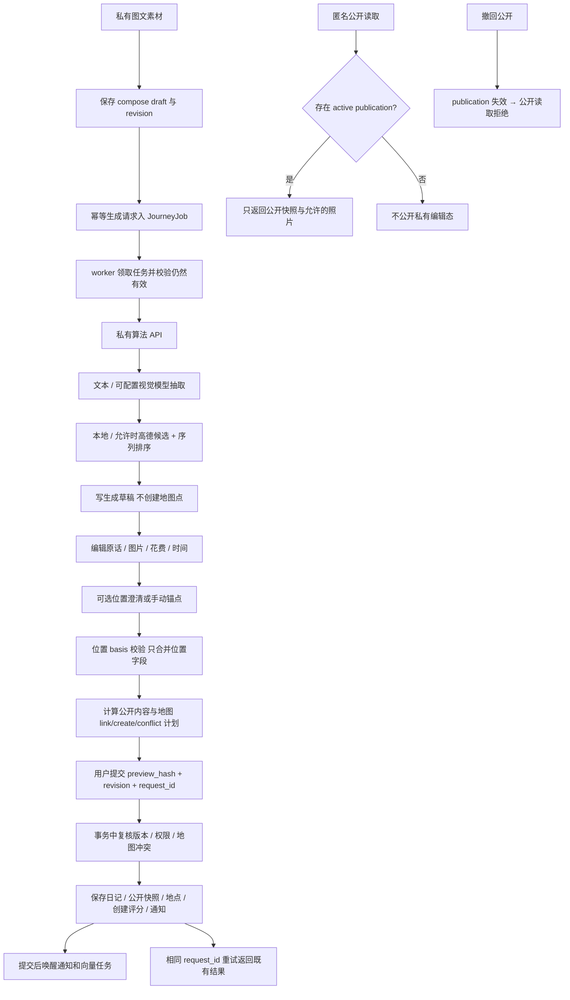

# 日记生成、编辑与公开发布

入口：routes/journeys.js（`/api/journeys`）、publicJourneys.js（`/api/public/journeys`）。服务按生命周期分工：Store/Schema 数据与规范化；Compose 素材；AI 持久任务与抽取；Drafts 草稿修订；Resolution 位置澄清；MapLinks 地图关联；Publication 预览与唯一公开提交；Merge/Corrections 合并与修正。跨模块调用 places 创建规则和数据库，当前 Store 也被 community 复用，见待办 JRN-02。

算法与提示词通过 journeyAlgorithmClient 调用私有服务；本项目保留任务、权限与落库，不包含算法实现。接入、启动及独立测试见 [私有算法服务](ALGORITHM_SERVICE.md)。

| 选择 | 当前实现 | 对照与约束 |
| --- | --- | --- |
| 公私隔离 | 独立 publication 快照，公开提交才更新 | 直接公开编辑态会把未确认内容泄露 |
| 并发 | revision + preview_hash + request_id | 只靠按钮禁用不能防重试与过期预览 |
| 澄清 | basis 约束的位置补丁，保留备注等字段 | 整篇替换会覆盖等待期间用户编辑 |
| 任务 | SQLite 持久化 + worker + 取消检查 | 只在 HTTP 内等待会失去重启恢复；当前多实例需专项验证 |

案例见 [TEST_CASES.md](TEST_CASES.md)。历史：`582e5e3` 初始生成、`cc11a4f` / `01e11a4` 发布与交互完善；待办 JRN-01 / JRN-02 见 [清单](../../../doc/HISTORY_AND_TODO.md)。生成、私有保存、旧 draft publish 与公开 publication commit 的语义不同，修改前必须追踪实际服务，不能仅按接口名字推断公开行为。
