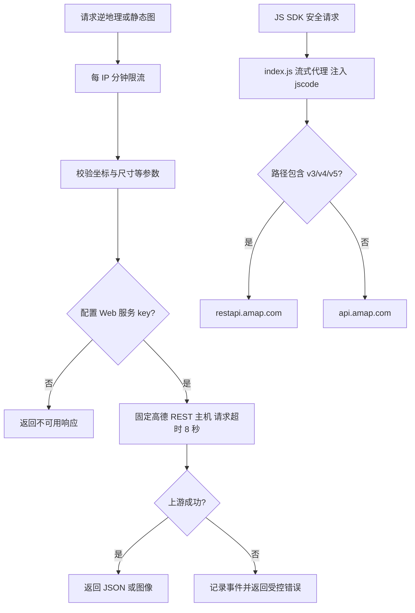

# 地图服务边界

`routes/amap.js` 提供 `/api/amap/regeo` 与 `/api/amap/staticmap`，使用 AMAP_WEB_SERVICE_KEY；另有 `/api/amap/js-config` 下发地图 SDK 的公开 JS API key（AMAP_JS_KEY，不经 Web 服务 key 检查与限流），换 key 不必重新构建前端。JS SDK 的 `/_AMapService` 流式代理目前仍在 backend/index.js，使用 AMAP_JS_CODE；两个凭证和请求链不同。services/fuzzySearch.js 是现有字面模糊匹配工具，保留当前行为。

| 当前选择 | 对照与取舍 |
| --- | --- |
| 服务端持有 Web 服务 key | 前端直调更少转发，但会把凭证放入客户端 |
| 固定上游主机 + 参数验证 | 通用任意 URL 代理会扩大可访问范围；当前不提供通用代理 |
| REST 与 SDK 代理分离 | 直接合并会混淆 key 与 jscode；后续可提取 index 中实现但保留协议 |

文字案例（均待独立自动化，不能用前端 AMap 替身测试充当上游验证）：MAP-01 缺 key 时不给出伪成功；MAP-02 无效/越界/非数坐标被拒绝；MAP-03 超时返回受控错误；MAP-04 模拟 SDK 上游核对 hop-by-hop 头过滤、15 秒超时与客户端取消；MAP-05 已带 jscode 的路径不重复注入。补测方案见 MAP-T01 / INF-01 的 [清单](../../../doc/HISTORY_AND_TODO.md)。
