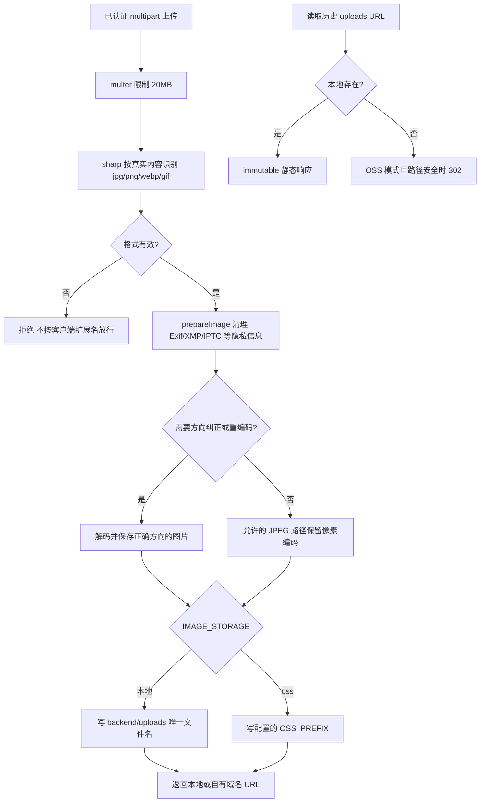

# 图片存储

入口：`routes/upload.js`（`/upload`，认证由 index.js 挂载）、services/imageStorage.js、imageUrls.js。地点图片保存为公开 URL；账号头像、日记私图分别由 accounts / journeys 管理 BLOB，不经过本模块迁移。分享缩略图生成逻辑在 places/placeCard。

| 选择 | 当前实现 | 对照与约束 |
| --- | --- | --- |
| 格式判断 | 内容嗅探，不信任文件名 | 仅扩展名检查不能保证浏览器可显示 |
| 隐私与质量 | 能移除段信息时不重编码，需转向时重编码 | 全部压缩会重复损失画质；全部原样保存会带出元数据 |
| 存储 | local/OSS 适配、自有域名与限定前缀 | 直接把厂商默认域名写库会绑定部署地址；共享 bucket 不能越过本站前缀 |
| 历史迁移 | 预演、备份、显式 apply、幂等 | 启动时自动重写历史数据不便审核与回滚 |

维护命令见 [运维目录](../../../scripts/doc/README.md)，案例见 [TEST_CASES.md](TEST_CASES.md)。历史 `2eadd01`、`d285076`；待办 MED-01 见 [清单](../../../doc/HISTORY_AND_TODO.md)。
