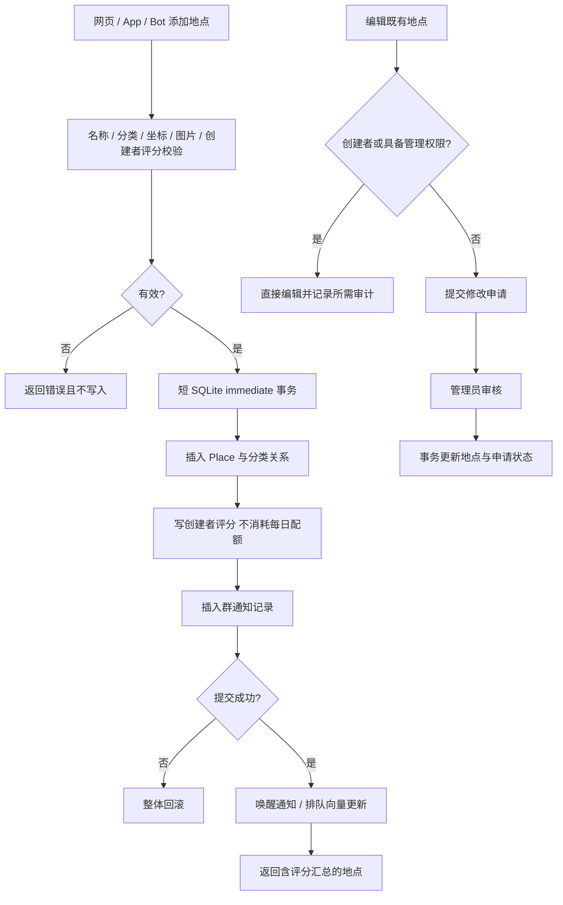

# 地点与修改申请

地点列表 `GET /places/list`（`services/placeList.js`，可选登录）：只给公开地点，可按 `tags`（逗号分隔，命中任一）、`minCost` / `maxCost`（设了范围时没填人均的不显示）与距离（`lat`、`lng`、`radiusKm`，半径只接受 1/3/5/10/20/50 公里）筛选；按综合评价排序：公开平均分以 2 份中性分（2.5）收缩，登录且有口味画像时与口味加权平均（`ratings/services/placeRatings.js` 的 `personalizedAverages`，按观看者缓存 2 分钟）各占一半。返回 `{ items, total, offset, limit, personalized }`，条目只有 id、店名、简介、分类、人均、第一张图和评价，不带经纬度、地址和距离（距离只用来筛选，防止整页抓取拿到坐标）。

入口：routes 下 places、placeRequests、categories、placeShare。新增地点和创建者修改自己的地点都先经 DeepSeek 初筛（文字和图片），明显不合规的新地点只给创建者看、修改先不生效，交管理员在地点申请页复核，流程、提示词与可见性规则见 [placeModeration.md](placeModeration.md)。公共业务入口 `services/placeService.js` 同时服务 Web/App 和 Bot；日记发布通过既有底层地图关联流程复用地点规则。`placeRequestService.js` 处理申请审核，`placeNotifications.js` 写持久通知并唤醒 Bot。`placeCard.js` 负责分享文本与图片规则，实际图像存储由 media 提供。地点描述支持 Markdown（规则见前端 [components 文档](../../../../frontend/src/components/doc/README.md)），后端只在不能显示格式的地方用 `markdownText.js`（marked，与前端锁定同一版本；marked 18 只有 ES 模块，需要 Node 22.12+ 才能 require，更旧的 Node 退回只去标签）转纯文本：分享页 `/p/:id` 的卡片与正文、QQ 机器人的搜索 / 随机 / 新地点推送与图文卡片。描述在所有写入路径上统一由 `normalizePlaceDescription()` 校验（去首尾空白、最多 1000 字、接受 HTML）：新增、编辑 `PUT /places/:id`、提交修改申请、批准修改申请（校验前提交的超长申请不能批准，可驳回）与 QQ 机器人草稿；店名、分类、地址、标签仍只接受纯文本。

`GET /places/random` 的推荐算法在 discovery；`/places/:id/diaries` 的公开日记读取在 journeys。不要因为 URL 包含 places 就在本模块复制这两类规则。位置修改包含前端交互，代码主要位于 frontend，后端仍校验更新输入。

| 选择 | 当前实现 | 对照 |
| --- | --- | --- |
| 多入口创建 | 共享校验、事务内插入与提交后补偿 | 每个路由自行写表容易漏掉创建者评分或通知 |
| 非创建者编辑 | 修改申请，审核后写入 | 直接放开写权限会绕过现有治理；本次不变更权限 |
| 分享 | 服务端 HTML 元信息 + 本站缩略图 + 页面跳转 | 仅 SPA 动态标签不能保证抓取器读到；本机测试不代替 QQ/微信真实抓取 |

数据：Place（含 moderation_status）、Category、PlaceRequest（request_type 区分修改申请与新增复核）、PlaceModeration；跨模块写入涉及 PlaceRating、QQBotNotification。测试：[案例库](TEST_CASES.md)。历史：`2bc8c5e` 位置编辑、`d285076` 分享修复、`ce52848` Bot 共享创建。待办 PLC-01 见 [清单](../../../doc/HISTORY_AND_TODO.md)。
