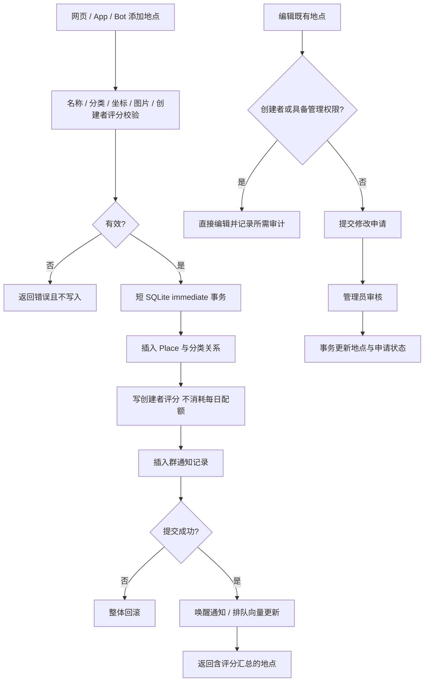

# 地点与修改申请

地点列表 `GET /places/list`（`services/placeList.js`，可选登录）：只给公开地点，可按 `tags`（逗号分隔，命中任一）、`minCost` / `maxCost`（设了范围时没填人均的不显示）与距离（`lat`、`lng`、`radiusKm`，半径只接受 0.5/1/3/5/10 公里）筛选；按综合评价排序：公开平均分以 2 份中性分（2.5）收缩，登录且有口味画像时与口味加权平均（`ratings/services/placeRatings.js` 的 `personalizedAverages`，按观看者缓存 2 分钟）各占一半。返回 `{ items, total, offset, limit, personalized }`，条目只有 id、店名、简介、分类、人均、第一张图和评价，不带经纬度、地址和距离（距离只用来筛选，防止整页抓取拿到坐标）。

地图标记用分层瓦片（见下文“分层瓦片”），没有哪个请求能一次拿到全部店名和坐标；`GET /places/overlay`（`no-store`，可选登录）给出自己审核中 / 未通过的地点与屏蔽的住民创建的公开地点 id，描述、图片等在打开卡片时读 `GET /places/:id`。旧接口（防爬，[数据访问限流](../../../http/doc/README.md#数据访问限流)）：`GET /places`（一次列出全部地点和创建者用户名）停用，回 410；`GET /places/nearby` 只给旧版 App，范围大于 `NEARBY_MAX_FULL_AREA`（默认 0.25 平方度）时只给评价人数最多的 `NEARBY_LARGE_AREA_ROWS`（默认 200）家；整份快照 `GET /places/markers`（`services/placeMarkers.js`，公共缓存）留给 11-15 之后、瓦片之前的 App，旧版 App 更新完后设 `LEGACY_MARKER_SNAPSHOT=off` 回 410，并在 ESA 上刷新这个路径的缓存。`/places/:id`、`/places/:id/diaries`、`/p/:id`、`/places/list`、`/users/:id/places` 与搜索都按观看者限流。

## 分层瓦片

`services/placeTiles.js` + `routes/placeTiles.js`（挂在 `/places/tiles`，在 `/places` 之前），前端 `frontend/src/map/markerTiles.js` 按同样的级别和格式读取，两边一起改（`test:place-tiles` 用前端的展开与筛选函数读真实瓦片对照）：

- 三级聚合瓦片：z2 / z5 / z8 瓦片，格子 z9 / z12 / z14（约 70 / 8.8 / 2.2 km），分别给 z0–7、z8–10、z11–12。每个格子是成员重心（取整到 1/8 格）和每家店匿名的一行 `[标签编号, 人均或 -1, 地区编号或 -1, 图标类型]`（0 普通、1 避雷、2 待探索，`isAvoidedPlace` 与 `hasExploreTag`），按内容排序。**不带 id、店名、单店坐标**：拉齐这些瓦片也对不上具体的店，id 只出现在明细瓦片和单店接口里，两处都有额度。
- 明细瓦片：z12，字段与旧快照相同（id、店名、坐标、标签、人均、省市区、评价汇总），z13 起显示。
- 字典：标签名、地区名（按地点 id 顺序第一次出现编号）；清单：版本、各级参数、每块瓦片的内容哈希（12 位）。

接口：`GET /places/tiles/manifest`（公共缓存 30 / 60 秒）；`/places/tiles/<哈希>/dict` 与 `/places/tiles/<哈希>/<2|5|8>/<x>/<y>`（公共缓存，永不过期，`http/middleware/publicCache.js` 的 `PUBLIC_PATTERNS`）；`/places/tiles/<哈希>/12/<x>/<y>`（明细：`private, max-age=31536000, immutable`，不进 CDN，按 IP / 账号的去重瓦片数限流）；`GET /places/tiles/ticket`（要登录，`no-store`）发 24 小时的明细瓦片票据，前端放在查询串 `?t=` 里认账号（不带 `Authorization`，App 里每块瓦片不用多一次预检），票据用 `TILE_TICKET_SECRET`（不设时由 `JWT_SECRET` 派生）签名。哈希和当前内容对不上时 302 到当前哈希（相对地址，保留 `?t=`），瓦片没有了 404，都是 `no-store`。全部瓦片在内存里建好，`TILE_SNAPSHOT_TTL_MS`（默认 15 秒）内复用，内容没变的瓦片沿用旧的压缩结果；改一家店只换它所在的四块瓦片（每级一块）的哈希。

实测（3720 家）：三级聚合瓦片全部加起来约 15 / 19 / 28 KB，明细 706 块共约 142 KB，字典约 6 KB，清单约 7 KB；一屏通常要 1 到 4 块。

地区（`services/placeRegions.js`，表在 `placeRegionSchema.js`）：省 / 市 / 区存在单独的 `PlaceRegion` 表，不写 `Place`，因为 Place 的任何 UPDATE 都会推进评分算法时钟，补齐几千个地点不能让评分缓存全部失效。表里记下查询时的坐标，地点挪了位置后对不上就重新查。后端启动时开后台任务（`startPlaceRegionWorker`，需要 `AMAP_WEB_SERVICE_KEY`，`PLACE_REGION_WORKER=false` 关闭），每轮取最多 20 个没查过或坐标变了的地点，用高德 Web 服务批量逆地理编码；新地点创建后 `wakePlaceRegionWorker` 立即补一次；QQ 新地点推送发出前用 `ensurePlaceRegions(ids)` 给其中还没查过的地点同步补查（没有 key 时不查）。直辖市的市用省名，省直辖县级市的市用区县名；境外坐标记为已查、省市区为空，其中不在高德境内格子里的（`maps/services/chinaRegion.js`，与前端同一张表）不发请求直接记下，免得消耗高德“海外服务”日配额；高德因海外配额用完整批拒绝（`USER_ABROAD_DAILY_QUERY_OVER_LIMIT`，批里有它算作境外的点，如海参崴）时逐个重查，被拒的点记为没有省市区、其余照常保存，全部被拒时不记录；请求失败不记录、等下一轮（QPS 超限会退避重试）；高德整批 `INVALID_PARAMS` 时逐个重查，被拒绝的坐标记为没有省市区并打日志。`npm run places:regions` 一次补完（`-- --dry-run` 只统计）。`GET /places/regions` 返回有公开地点的地区树（省 → 市 → 区，每层按地点数降序，带 `bounds` 供地图移动到该范围，进程内缓存 5 分钟，走公共 CDN 缓存）；`/places`、`/places/nearby`、`/places/:id`、`/places/list` 带出 `province` / `city` / `district`，`/places/list` 可按这三个参数筛选（下层要有上层）。

标签合并与“待探索”：相同或相近的标签由 `categoryMerges.json`（源标签 → 保留的标签）合并，`services/categoryMerges.js` 在 `placeService.normalizeCategoryList`（所有写入路径）、列表筛选和 `POST /categories` 里换成保留的标签；既有数据用 `npm run categories:merge` 一次性合并（默认预览，`--db <file>` 指定库，`--apply` 先备份；只改 `Place.category` 与待处理申请的 `proposed.category`，不改修改时间和修改人）。“待探索”标签（`ratings/services/ratingWarning.js` 的 `EXPLORE_TAG`，与前端 `places/rating.js` 保持一致；`seeds/categories.json` 里是常用标签）表示还没去过、先标记的地点：创建时不写创建者评分（`rating_input_kind = 'none'`），没人评价前地图上显示问号图标。

入口：routes 下 places、placeRequests、categories、placeShare。新增地点和创建者修改自己的地点都先经 DeepSeek 初筛（文字和图片），明显不合规的新地点只给创建者看、修改先不生效，交管理员在地点申请页复核，流程、提示词与可见性规则见 [placeModeration.md](placeModeration.md)。公共业务入口 `services/placeService.js` 同时服务 Web/App 和 Bot；日记发布通过既有底层地图关联流程复用地点规则。`placeRequestService.js` 处理申请审核，`placeNotifications.js` 写持久通知并唤醒 Bot。`placeCard.js` 负责分享文本与图片规则，实际图像存储由 media 提供。地点描述支持 Markdown（规则见前端 [components 文档](../../../../frontend/src/components/doc/README.md)），后端只在不能显示格式的地方用 `markdownText.js`（marked，与前端锁定同一版本；marked 18 只有 ES 模块，需要 Node 22.12+ 才能 require，更旧的 Node 退回只去标签）转纯文本：分享页 `/p/:id` 的卡片与正文、QQ 机器人的搜索 / 随机 / 新地点推送与图文卡片。描述在所有写入路径上统一由 `normalizePlaceDescription()` 校验（去首尾空白、最多 1000 字、接受 HTML）：新增、编辑 `PUT /places/:id`、提交修改申请、批准修改申请（校验前提交的超长申请不能批准，可驳回）与 QQ 机器人草稿；店名、分类、地址、标签仍只接受纯文本。

`GET /places/random` 的推荐算法在 discovery；`/places/:id/diaries` 的公开日记读取在 journeys。不要因为 URL 包含 places 就在本模块复制这两类规则。位置修改包含前端交互，代码主要位于 frontend，后端仍校验更新输入。

| 选择 | 当前实现 | 对照 |
| --- | --- | --- |
| 多入口创建 | 共享校验、事务内插入与提交后补偿 | 每个路由自行写表容易漏掉创建者评分或通知 |
| 非创建者编辑 | 修改申请，审核后写入 | 直接放开写权限会绕过现有治理；本次不变更权限 |
| 分享 | 服务端 HTML 元信息 + 本站缩略图 + 页面跳转 | 仅 SPA 动态标签不能保证抓取器读到；本机测试不代替 QQ/微信真实抓取 |

`routes/placeVisits.js`（`/api/visits`：状态、查看、到访推断与“是否去过”回答）挂在本模块，规则见 [到访与兴趣信号](../../preferences/doc/INTEREST_V3.md) 与 [评分迁移](../../ratings/doc/RATING_MIGRATION.md)。修改记录只保存描述里新增的文字，见 [编辑文本证据](../../ratings/doc/EDIT_TEXT_EVIDENCE.md)。

数据：Place（含 moderation_status）、PlaceRegion、Category、PlaceRequest（request_type 区分修改申请与新增复核）、PlaceModeration；跨模块写入涉及 PlaceRating、QQBotNotification。测试：[案例库](TEST_CASES.md)。历史：`2bc8c5e` 位置编辑、`d285076` 分享修复、`ce52848` Bot 共享创建。待办 PLC-01 见 [清单](../../../doc/HISTORY_AND_TODO.md)。
