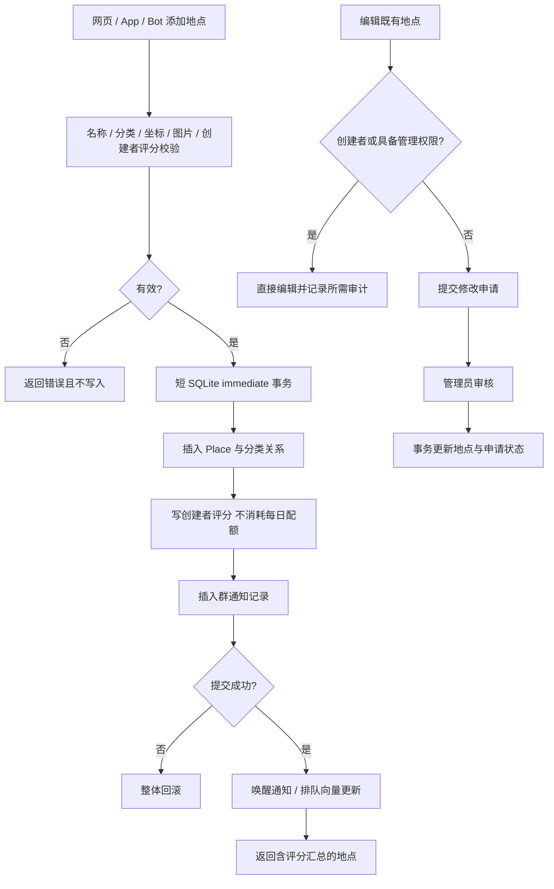

# 地点与修改申请

入口：routes 下 places、placeRequests、categories、placeShare。公共业务入口 `services/placeService.js` 同时服务 Web/App 和 Bot；日记发布通过既有底层地图关联流程复用地点规则。`placeRequestService.js` 处理申请审核，`placeNotifications.js` 写持久通知并唤醒 Bot。`placeCard.js` 负责分享文本与图片规则，实际图像存储由 media 提供。

`GET /places/random` 的推荐算法在 discovery；`/places/:id/diaries` 的公开日记读取在 journeys。不要因为 URL 包含 places 就在本模块复制这两类规则。位置修改包含前端交互，代码主要位于 frontend，后端仍校验更新输入。

| 选择 | 当前实现 | 对照 |
| --- | --- | --- |
| 多入口创建 | 共享校验、事务内插入与提交后补偿 | 每个路由自行写表容易漏掉创建者评分或通知 |
| 非创建者编辑 | 修改申请，审核后写入 | 直接放开写权限会绕过现有治理；本次不变更权限 |
| 分享 | 服务端 HTML 元信息 + 本站缩略图 + 页面跳转 | 仅 SPA 动态标签不能保证抓取器读到；本机测试不代替 QQ/微信真实抓取 |

数据：Place、Category、PlaceRequest；跨模块写入涉及 PlaceRating、QQBotNotification。测试：[案例库](TEST_CASES.md)。历史：`2bc8c5e` 位置编辑、`d285076` 分享修复、`ce52848` Bot 共享创建。待办 PLC-01 见 [清单](../../../doc/HISTORY_AND_TODO.md)。
