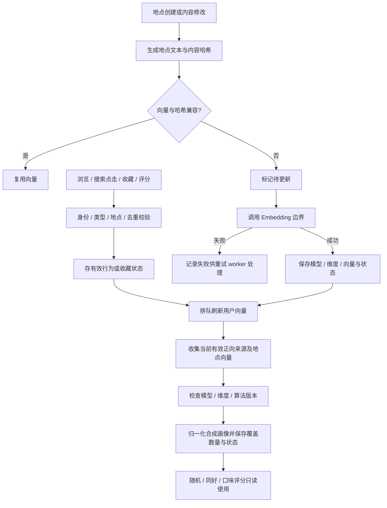

# 偏好、收藏与向量

入口：routes/preferences.js（`/api/preferences`）、routes/favorites.js（`/api/favorites`）。userPreferenceService 记录有效行为并构建用户画像；placeVectorService 同步地点 Embedding、哈希与重试；userPreferenceSchema 建表迁移。模型协议在 infrastructure/aiClients。评分 ≥3 作为兴趣信号，≤2 不作为正向来源；具体权重见现有 [偏好专题](PREFERENCES.md)。

| 选择 | 当前实现 | 对照 |
| --- | --- | --- |
| 用户向量 | 本地合成已有地点向量 | 每次个人推荐调用模型会增加外部延迟与调用量 |
| 更新 | 内容哈希与状态机 + 后台重试 | 无条件重算浪费，失败后不留状态则无法补偿 |
| 不完整画像 | 输出状态与覆盖数，消费者按规则退回基础行为 | 把缺失向量当有效零向量会混淆语义 |

已有自动化：`npm run test:preferences`、`test:random`、`test:ratings`。文字案例：[案例库](TEST_CASES.md)。待办 PRF-01、INF-02 见 [清单](../../../doc/HISTORY_AND_TODO.md)。
