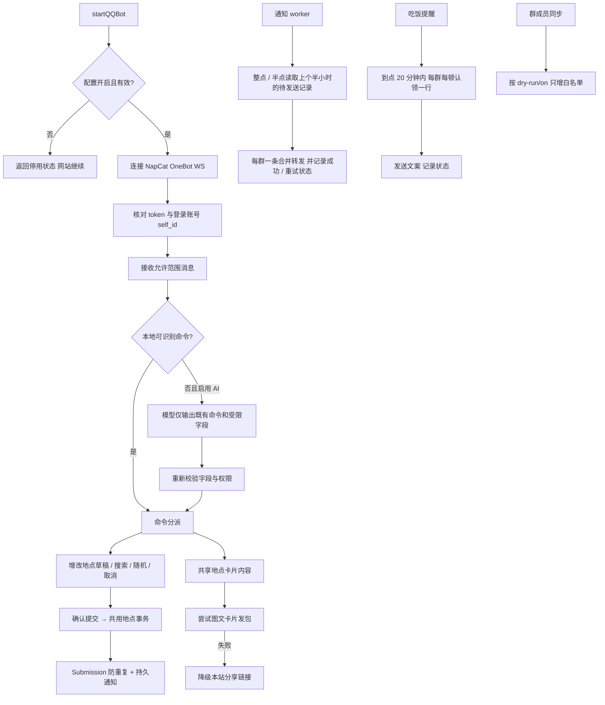

# QQ Bot

## 公开日记推送

`diaryNotifications.js` 在首次公开事务中按公开 ID 和群写入 `QQBotDiaryNotification`。目标沿用 `QQ_BOT_NOTIFY_GROUP_IDS`，稳定链接要求 `QQ_BOT_PUBLIC_WEB_URL` 或 `FRONTEND_BASE_URL` 指向公网 HTTPS。worker 每篇发一条独立图文转发，正文分段并使用公开站点摘录，附前六张可用公开图与完整日记链接。关联已有地点的日记也会推送。私密保存、编辑公开内容及重新公开均不入队，撤回跳过待发任务。如果 QQ 未确认发送结果，保留 `unknown` 供核对。

`runtime/index.js` 导出 startQQBot/getQQBotStatus，由后端入口启动。runtime 内按协议与交互职责拆分：onebotClient 传输；config 配置；messageParser / qqIdentity 解析；commands 分派；commandInterpreter AI 解释；placeConversation 草稿；memberSync 白名单；notificationWorker 新地点推送（每半小时把这半小时新增的地点打成一条合并转发 `send_group_forward_msg`，每个地点一个节点，国内地点带「地区：省市」，取自 places 的 PlaceRegion，推送前用 `ensurePlaceRegions` 补查刚加的地点）；mealReminder 每天早午晚三次吃饭提醒（`QQ_BOT_MEAL_REMINDER_TIMES`，北京时间，文案在 mealReminderCopy.js 按天轮换，表 QQBotMealReminder 保证每群每顿只发一次）；directMessage 私信；randomPick 推荐；randomCenter 每群随机中心（`!随机中心`，表 QQBotGroupRandomCenter，群主 / 管理员或网站管理员设置；有群中心时该群的 !随机 一律以它为中心）；placeCard / tuwenArk 卡片。services/qqBotSchema.js 负责表结构。

| 选择 | 当前实现 | 对照与限制 |
| --- | --- | --- |
| 业务复用 | 调用 places / discovery / accounts | 另写一份添加、随机、验证码规则容易漂移 |
| 解释 | 精确命令优先，模型只做受限解释 | 把模型当任意操作执行器会越过既有校验 |
| 通知 | 数据库记录 + 重试 worker，每半小时一条合并转发 | 仅内存队列会在重启后丢失；不能宣称已验证跨进程恰好一次投递；结果未知的转发按发送时间在群历史里找本 Bot 的转发核对 |
| 吃饭提醒 | 先认领 QQBotMealReminder 行再发送 | 只按内存记已发会在重启后重复；离线错过就跳过，不补发过时的提醒 |
| 卡片 | 图文发包，失败降级 URL | 私有兼容点受平台影响，自动化只能验证替身与编码，需真实平台人工验收 |

数据：QQBotDraft、QQBotSubmission、QQBotNotification、QQBotMealReminder 等；白名单与验证码业务属于 accounts。案例见 [TEST_CASES.md](TEST_CASES.md)。历史 `ce52848`、`13576c8`、`abbfb99`；待办 BOT-01 见 [清单](../../../doc/HISTORY_AND_TODO.md)。
