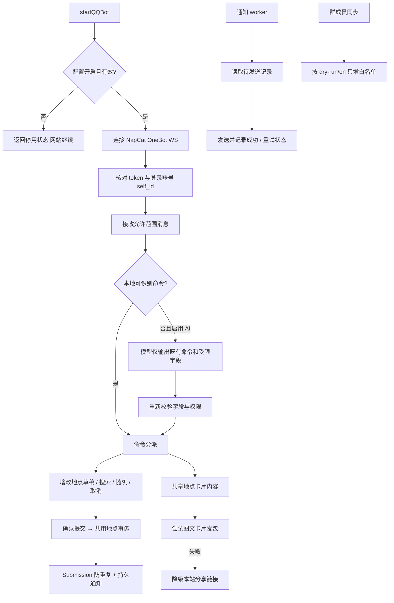

# QQ Bot

`runtime/index.js` 导出 startQQBot/getQQBotStatus，由后端入口启动。runtime 内按协议与交互职责拆分：onebotClient 传输；config 配置；messageParser / qqIdentity 解析；commands 分派；commandInterpreter AI 解释；placeConversation 草稿；memberSync 白名单；notificationWorker 推送；directMessage 私信；randomPick 推荐；placeCard / tuwenArk 卡片。services/qqBotSchema.js 负责表结构。

| 选择 | 当前实现 | 对照与限制 |
| --- | --- | --- |
| 业务复用 | 调用 places / discovery / accounts | 另写一份添加、随机、验证码规则容易漂移 |
| 解释 | 精确命令优先，模型只做受限解释 | 把模型当任意操作执行器会越过既有校验 |
| 通知 | 数据库记录 + 重试 worker | 仅内存队列会在重启后丢失；不能宣称已验证跨进程恰好一次投递 |
| 卡片 | 图文发包，失败降级 URL | 私有兼容点受平台影响，自动化只能验证替身与编码，需真实平台人工验收 |

数据：QQBotDraft、QQBotSubmission、QQBotNotification 等；白名单与验证码业务属于 accounts。案例见 [TEST_CASES.md](TEST_CASES.md)。历史 `ce52848`、`13576c8`、`abbfb99`；待办 BOT-01 见 [清单](../../../doc/HISTORY_AND_TODO.md)。
