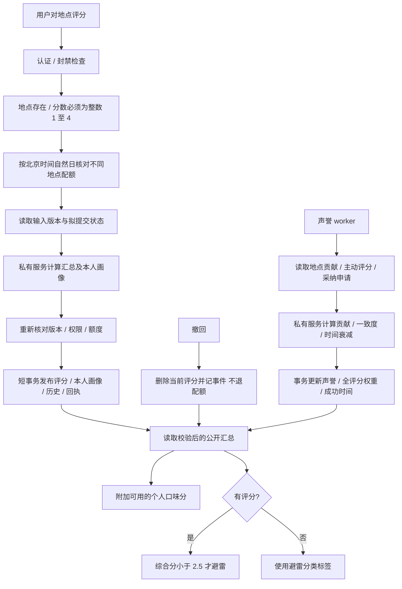

# 评分与声誉

入口：`routes/placeRatings.js`（`/api/ratings`）。`ratingBusiness.js` 保留提交、撤回、确认、配额与版本历史；`ratingReputationAdapter.js` 和 `ratingSummaryAdapter.js` 负责远程计算、校验与原子发布。全部评分公式及口味相似度位于私有服务，公共 SQL 只读已发布结果。部署、故障和测试见 [服务接入](ALGORITHM_SERVICE.md)。

| 选择 | 当前实现 | 对照 |
| --- | --- | --- |
| 交互档位 | 四档词语，数值仅供计算 | 连续打分表达更细但不符合当前产品约定 |
| 汇总 | 公开声誉权重分 + 单独口味分 | 把个性化分覆盖公开分会让不同用户无法交流同一分数 |
| 批处理 | 数学纯函数与持久化分离，原子发布 | 在每个读接口重算会增加开销并产生不一致窗口 |
| 配额 | 不同地点按 UTC+8 记账，撤回不返还 | 按事件次数会误伤改同一家，撤回返还可绕过每日约束 |

业务字段和历史语义见 [评价协议](placeRatings.md)，公式与参数回归已归私有服务。测试见 [案例库](TEST_CASES.md)，本次结果与边界见 [迁移验收](MIGRATION_VERIFICATION.md)；历史 `65ce2d4` 与 `ed3b2f9`。待办 RAT-01 见 [清单](../../../doc/HISTORY_AND_TODO.md)。
