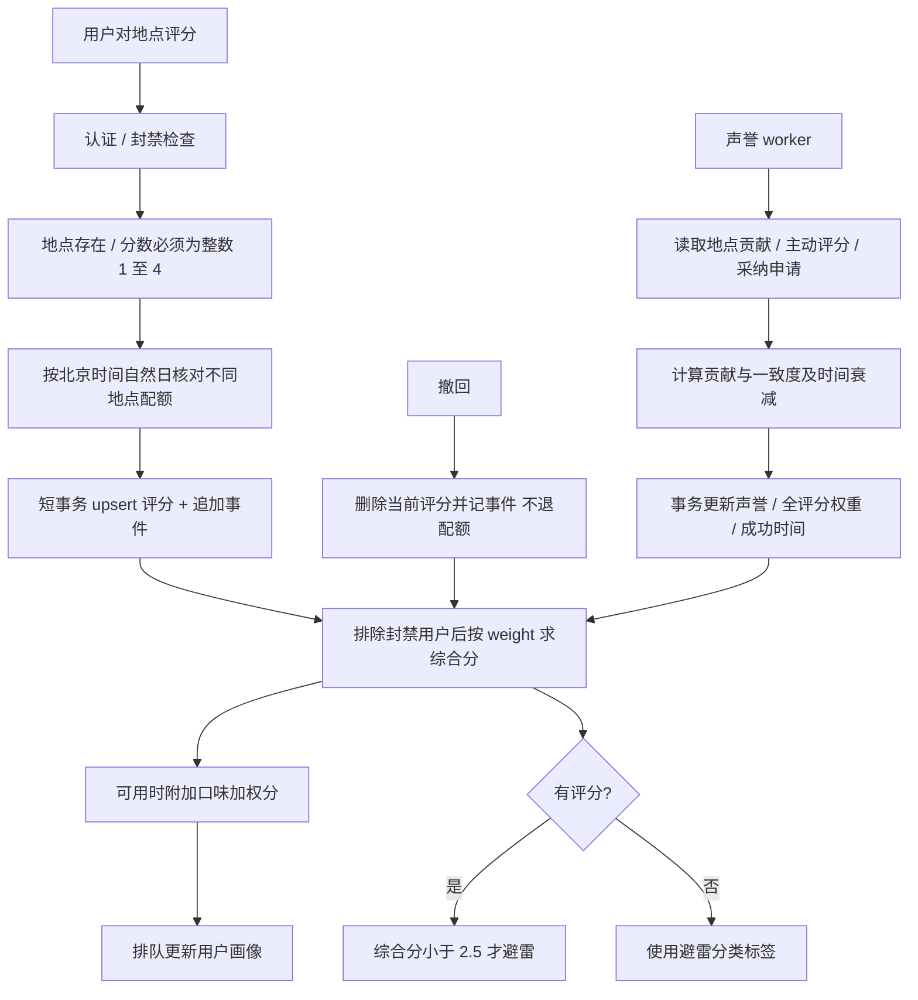

# 评分与声誉

入口：`routes/placeRatings.js`（`/api/ratings`）。`placeRatings.js` 提供提交、撤回、配额与共享 SQL 汇总；`placeRatingSchema.js` 负责兼容迁移；`ratingWeightModel.js` 为纯计算；`ratingReputation.js` 负责批处理与原子持久化；`ratingSimilarity.js` 提供口味相似度。依赖 accounts 权限、preferences 向量、places 资料完整度及数据库。

| 选择 | 当前实现 | 对照 |
| --- | --- | --- |
| 交互档位 | 四档词语，数值仅供计算 | 连续打分表达更细但不符合当前产品约定 |
| 汇总 | 公开声誉权重分 + 单独口味分 | 把个性化分覆盖公开分会让不同用户无法交流同一分数 |
| 批处理 | 数学纯函数与持久化分离，原子发布 | 在每个读接口重算会增加开销并产生不一致窗口 |
| 配额 | 不同地点按 UTC+8 记账，撤回不返还 | 按事件次数会误伤改同一家，撤回返还可绕过每日约束 |

公式、字段、历史产品参考保留在 [原专题](placeRatings.md)，其外部参考不是本次重新核验的结论。测试见 [案例库](TEST_CASES.md)；历史 `65ce2d4` 与 `ed3b2f9`。待办 RAT-01 见 [清单](../../../doc/HISTORY_AND_TODO.md)。
