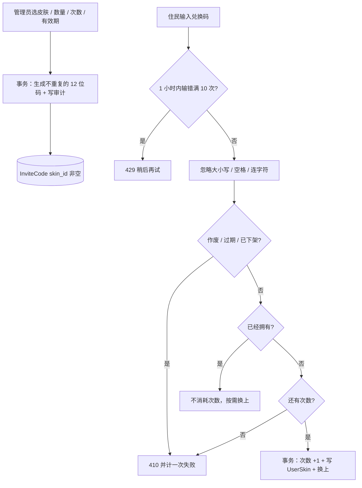

# 主题皮肤与兑换码

入口为 `routes/skins.js`（挂载 `/api/skins`），账号接口需要登录，资源文件通过签名地址获取。管理端 `../admin/routes/adminSkinCodes.js` 挂载于 `/admin/skin-codes`，权限为 `manage_skin_codes`（仅 YUYUKO）。服务 `services/skinService.js`，建表 `services/skinSchema.js`，可兑换皮肤登记在 `catalog.json`。

兑换码沿用旧的 `InviteCode` 表（`code` / `max_uses` / `current_uses` 不变），新增 `skin_id`、`note`、`created_by`、`expires_time`、`revoked` 列：`skin_id` 非空的行才是皮肤兑换码；注册改为 QQ 验证码后留下的旧邀请码 `skin_id` 为空，既不能兑换，也不出现在管理列表里。`UserSkin(user_id, skin_id)` 记录已解锁的皮肤（随账号删除），`User.active_skin` 是正在使用的一套，空表示默认样式。

| 接口 | 说明 |
| --- | --- |
| `GET /api/skins/me` | `{ active, owned: [{ id, name, unlocked_time }] }`；不在目录里的皮肤不返回，正在使用的皮肤下架后回到 `default` |
| `POST /api/skins/redeem` | `{ code, activate? }`，默认解锁后立即换上；返回同上并附 `unlocked`、`already_owned` |
| `PUT /api/skins/active` | `{ skin_id }`，`default` 或已解锁的皮肤 |
| `GET /admin/skin-codes` | `{ catalog, codes }`，最近 200 个，可按 `?skin_id=` 过滤；`status` 为 active / exhausted / expired / revoked |
| `POST /admin/skin-codes` | `{ skin_id, count 1–200, max_uses 1–10000, expires_days?, note? }` |
| `DELETE /admin/skin-codes/:id` | 作废（幂等）；已解锁的住民保留皮肤 |

新增一套皮肤：在 `catalog.json` 的 `skins` 里登记 `{ "id": "小写字母数字与连字符", "name": "显示名" }`，同时在前端 `src/skins/packs/<id>/` 放素材（见前端 [皮肤模块](../../../../frontend/src/skins/doc/README.md)）。前端 `npm run test:skins` 核对两边 id 一致。素材随前端构建发布：已登记但当前 App 版本还没有素材的皮肤也能兑换，界面显示默认样式并提示更新。

## 角色与远程皮肤兑换

管理页发码时选择一个角色或一套皮肤，账号权益仍在兑换事务中与次数一起写入。`InviteCode.companion_id` 及 `UserCompanion` 保存角色的码和持有状态，`CompanionSelection` 与 `CompanionSatiety` 保存当前角色和饱食度。历史皮肤码、`UserSkin` 和原皮肤接口仍可用。共同的 `POST /api/skins/redeem-resource` 返回 `type`、`unlocked`、`already_owned` 及对应资源状态。`GET /api/skins/companions/me` 读取持有、当前角色及饱食度，另带 `fed_at`（上次投喂，ISO，没喂过为 null；`CompanionSatiety.fed_at_ms` 在打卡投喂时写入，旧库补列时按 `PlaceCheckIn` 回填）与 `adopted_at`（内置角色为注册时间、额外角色为兑换时间），只给本人，供底栏小伙伴判断饿和饱，`PUT /api/skins/companions/active` 接受 `companion_id`。内置 `stick-figure` 可直接选用。

## 远程资源包

在资源服务器用 `RESOURCE_PACK_DIR` 指定私有目录，默认是仓库根目录的 `.private/resource-packs`。`catalog.json` 的 `companions` 和 `skins` 接受 `{ "id": "fox", "name": "小狐狸", "version": "1", "entry": "fox.model3.json" }` 结构。角色文件放在 `companion/<id>/<version>/`，包含 `.model3.json`、`.moc3`、纹理和动作。远程主题皮肤放在 `skin/<id>/<version>/`，入口填 `skin.json`，沿用现有皮肤清单格式和位图。修改同一资源时递增 `version`，目录和清单应一起部署。额外角色和皮肤不入公开库。

`GET /api/skins/packs/:type/:id` 先检查登录及账号权益，再签发五分钟有效的资源路径。文件路由再次校验授权、版本、数据文件扩展名和实际目录。签发和读取由同一服务处理，多进程部署使用相同的 `JWT_SECRET`。随包火柴人不通过此接口下载。后端 `test:skins` 覆盖旧码、账号权限、单次扣减及签名下载。

`companions` 的条目可加 `"avatar": "avatar.png"`，指向该版本目录中的 PNG 或 WebP。小伙伴接口用 `avatarUrl(pack)` 签发 `GET /api/skins/packs/avatar/:grant` 的地址，有效期 24 小时，授权绑定版本和单个文件。验签通过即可取图，无需拥有角色。该授权与模型的 `access` 授权使用不同的受众。授权过期或失效返回 403。内置角色和未配置大头照的远程角色返回 `avatar: null`。

| 选择 | 当前实现 | 替代与代价 |
| --- | --- | --- |
| 兑换码存储 | 明文，与旧邀请码相同，管理员需要能再次查看分发 | 只存哈希更安全，但生成后无法补发 |
| 防穷举 | 31 字符 × 12 位 + 每住民每小时 10 次失败上限（进程内） | 多实例部署需改为 Redis 计数 |
| 使用中的皮肤 | 服务端校验拥有后写 `User.active_skin` | 放进可任意写入的 `map_settings` 无法校验是否解锁 |

测试：`npm run test:skins`（旧邀请码迁移、权限、生成校验、兑换各分支、切换、作废、过期、下架、失败限制、审计回滚）。
