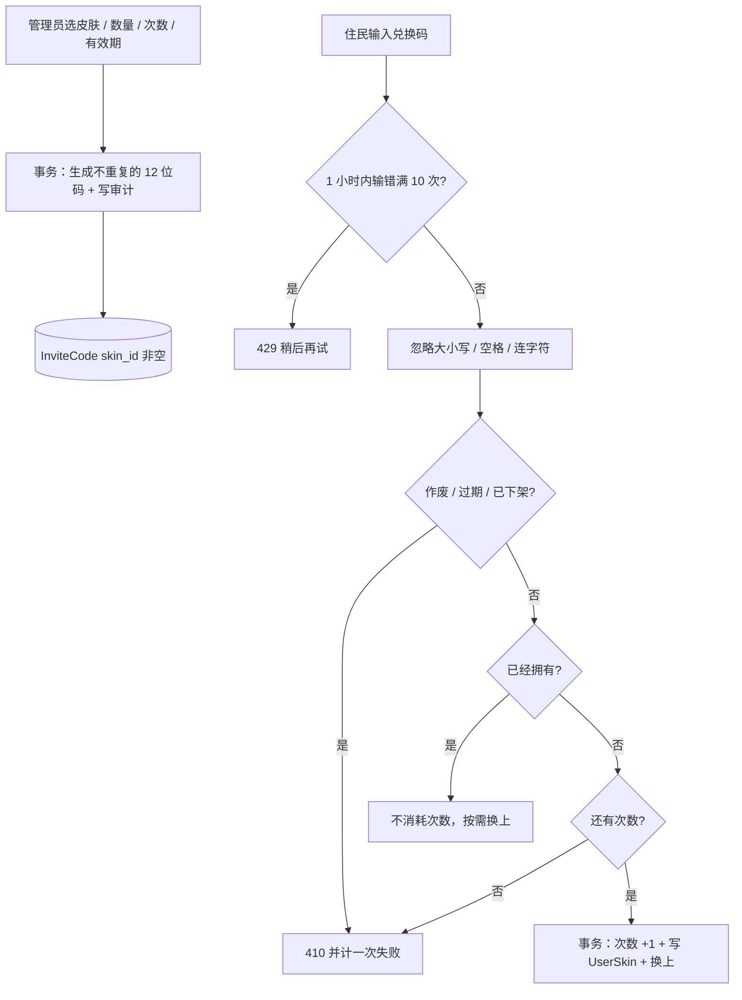

# 主题皮肤与兑换码

入口：`routes/skins.js`（挂载 `/api/skins`，全部需要登录）、管理端 `../admin/routes/adminSkinCodes.js`（挂载 `/admin/skin-codes`，独立权限 `manage_skin_codes`，仅 YUYUKO）。服务 `services/skinService.js`，建表 `services/skinSchema.js`，可兑换皮肤登记在 `catalog.json`。

兑换码沿用旧的 `InviteCode` 表（`code` / `max_uses` / `current_uses` 不变），新增 `skin_id`、`note`、`created_by`、`expires_time`、`revoked` 列：`skin_id` 非空的行才是皮肤兑换码；注册改为 QQ 验证码后留下的旧邀请码 `skin_id` 为空，既不能兑换，也不出现在管理列表里。`UserSkin(user_id, skin_id)` 记录已解锁的皮肤（随账号删除），`User.active_skin` 是正在使用的一套，空表示默认样式。

| 接口 | 说明 |
| --- | --- |
| `GET /api/skins/me` | `{ active, owned: [{ id, name, unlocked_time }] }`；不在目录里的皮肤不返回，正在使用的皮肤下架后回到 `default` |
| `POST /api/skins/redeem` | `{ code, activate? }`，默认解锁后立即换上；返回同上并附 `unlocked`、`already_owned` |
| `PUT /api/skins/active` | `{ skin_id }`，`default` 或已解锁的皮肤 |
| `GET /admin/skin-codes` | `{ catalog, codes }`，最近 200 个，可按 `?skin_id=` 过滤；`status` 为 active / exhausted / expired / revoked |
| `POST /admin/skin-codes` | `{ skin_id, count 1–200, max_uses 1–10000, expires_days?, note? }` |
| `DELETE /admin/skin-codes/:id` | 作废（幂等）；已解锁的住民保留皮肤 |

新增一套皮肤：在 `catalog.json` 的 `skins` 里登记 `{ "id": "小写字母数字与连字符", "name": "显示名" }`，同时在前端 `src/skins/packs/<id>/` 放素材（见前端 [皮肤模块](../../../../frontend/src/skins/doc/README.md)）。前端 `npm run test:skins` 核对两边 id 一致。素材随前端构建发布：已登记但当前 App 版本还没有素材的皮肤也能兑换，界面显示默认样式并提示更新。

| 选择 | 当前实现 | 替代与代价 |
| --- | --- | --- |
| 兑换码存储 | 明文，与旧邀请码相同，管理员需要能再次查看分发 | 只存哈希更安全，但生成后无法补发 |
| 防穷举 | 31 字符 × 12 位 + 每住民每小时 10 次失败上限（进程内） | 多实例部署需改为 Redis 计数 |
| 使用中的皮肤 | 服务端校验拥有后写 `User.active_skin` | 放进可任意写入的 `map_settings` 无法校验是否解锁 |

测试：`npm run test:skins`（旧邀请码迁移、权限、生成校验、兑换各分支、切换、作废、过期、下架、失败限制、审计回滚）。
