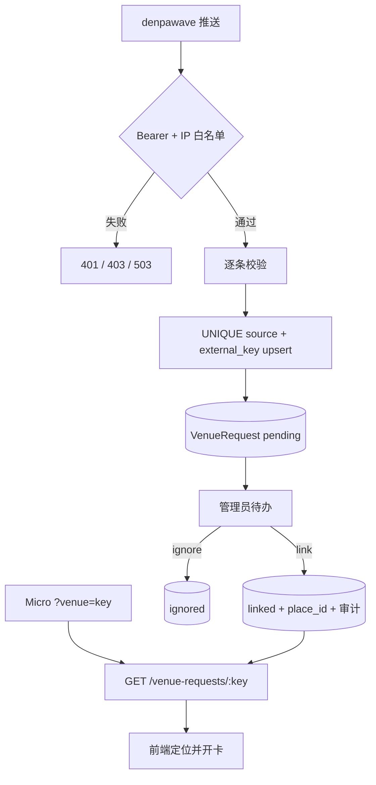

# 场馆请求

denpawave 的活动页有一个「展馆周边吃」入口，跳到饭联地图。为了让用户跳过来就落在那座展馆，需要饭联先知道「这个场馆在地图上的哪个点」。本模块只做这件事：收下对端的一条**场馆请求**，进管理员待办，管理员人工建档后关联到 `Place`，之后跳转按 key 解析。

刻意不做的事：不镜像活动（没有活动日期、改名同步、取消发布）、不存坐标（坐标系未确认）、不发回执（`UNIQUE(source, external_key)` 已经幂等）。讨论见 [方案](../../../doc/EXHIBITION_VENUE_LINK.md)。

## 状态与数据

`VenueRequest`（`services/venueRequestSchema.js`）：`source` + `external_key` 唯一，`label` / `address` / `city` 是对端给的展示文字，`place_id` 是管理员建档后关联的地点。

只有三态，只由我们这边推进：`pending`（等建档）→ `linked`（已关联）/ `ignored`（不需要）。对端再推一次只更新展示文字，`linked` 的 `place_id` 不动；`ignored` 保持不动。

`place_id` 指向的地点可能被删——我们不追生命周期，解析时用 `LEFT JOIN Place ... AND moderation_status = 'visible'` 判存活，没了就返回 `unknown`，前端按「还没标记」处理，和分享链接遇到已删地点的行为一致。



## 接口

| 接口 | 鉴权 | 说明 |
| --- | --- | --- |
| `POST /internal/venue-requests` | Bearer + IP 白名单 | body `{ source?, events: [{ key, label, address?, city? }] }`，单次最多 50 条。返回 `{ accepted, updated, ignored, failed, requestId }`；单条校验失败放 `failed`，不影响同批；数据库异常返回 503 让对端整批重试 |
| `GET /venue-requests/:key` | 无（公开只读） | `{ status: "pending" \| "linked" \| "ignored" \| "unknown", placeId }`，不含任何展示文字，`no-store` |
| `GET /admin/venue-requests` | `manage_places` | `{ pending: [...], count }` |
| `POST /admin/venue-requests/:id/link` | `manage_places` | body `{ place_id }`；只接受 `pending`，重复操作 409，写 `AdminAudit` |
| `POST /admin/venue-requests/:id/ignore` | `manage_places` | body `{ note? }`，同上 |

`key` 限制 `^[A-Za-z0-9_-]{1,64}$`；`label` ≤120、`address` ≤200、`city` ≤40；一律纯文本，拒绝控制字符。

鉴权缺一不可：token 与来源白名单任一为空都返回 503（**白名单留空等于拒绝所有来源**，不是不限制）。限流按来源 IP 计，60 秒 6 次，超出 429 + `Retry-After: 60`；按 IP 而不是请求头，免得换个 `X-Key-Id` 就绕过。

## 为什么不加 HMAC / 回执表

威胁模型：对端是合作方，接口最坏只能往待办里塞几行数据，建点仍需管理员登录，量级是每月几场活动。请求走 HTTPS，Bearer 用于吊销，IP 白名单挡住「token 意外泄漏后被外部使用」。重放没有副作用（幂等）；请求记录由既有的 `requestLogger` 与 `AdminAudit` 覆盖。

真需要时再加：防重放加 `nonce` 唯一表，对账加回执表，都不破坏现有数据。

## 配置

```dotenv
# 未配置 token 时接口返回 503，不会放行
VENUE_REQUEST_TOKEN=
# 逗号分隔的来源 IP 白名单；留空等于拒绝所有来源。本机联调要显式加 127.0.0.1
VENUE_REQUEST_ALLOWED_IPS=
```

## 测试

`node tests/venues/test_venue_requests.js`（`npm test` 自动发现）：鉴权分支（缺 token / 错 token / 未配置 token / 未配置白名单 / 白名单不匹配）、限流第 7 次 429、幂等重复推送、`ignored` 保持、单条失败不影响整批、link 的 400/404/409 与审计、解析的四种状态、已删地点退化为 `unknown`、非管理员 403。
