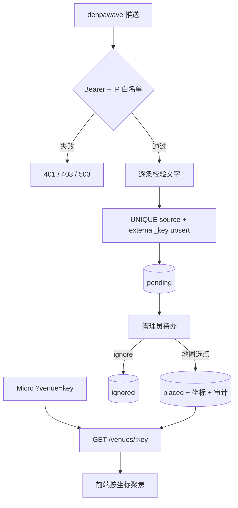

# 场馆

denpawave 的活动页有一个「展馆周边吃」入口，跳到饭联地图。为了让用户跳过来就落在那座展馆，需要饭联先知道**这个场馆在地图上的哪个点**。本模块收下对端的一条场馆记录，管理员在地图上落一个坐标，之后跳转按 key 解析。

## 场馆不是地点

另一个关键取舍：**场馆不进 `Place` 表**。

不建的后果是纯粹的——不写创建者评分、不进地图标记快照、不进随机美食、不进搜索和列表、不进 QQ 群推送。如果硬把场馆塞成 `Place`，它会跟着进入 `placeMarkers.js` 的快照查询（只按 `moderation_status='visible'` 过滤）、`randomRecommendation.js` 的候选池（只排除「避雷」和低分），用户会在随机美食里抽到「上海新国际博览中心」。靠一个分类标签去区分「场地」和「餐厅」，是把语义问题伪装成标签问题。

代价是场馆不能在店里被搜到、不能评价、不能导航。这些恰好都是不需要的：跳转聚焦只需要一组坐标。

## 状态与数据

`Venue`（`services/venueSchema.js`）：`source` + `external_key` 唯一；`label` / `address` / `city` 是对端给的展示文字；`latitude` / `longitude` 是**管理员在地图上选的坐标**（GCJ-02，与地图同一坐标系）。

| 状态 | 含义 | 算不算待办 |
| --- | --- | --- |
| `pending` | 收到推送，等管理员在地图上落点 | 是 |
| `placed` | 已指定坐标，跳转时聚焦到这里 | 否 |
| `ignored` | 不需要（重复、或该活动不需要落点） | 否 |

对端再推一次只更新展示文字，`placed` 的坐标不动；`ignored` 保持不动。

坐标只来自管理员选点：**对端即使硬塞 `latitude`/`longitude` 也一律丢弃**（测试覆盖）。这既是「搜索结果不落库」的合同要求，也避免对端坐标系（可能是 WGS84）直接污染地图。

`placed_by` / `placed_time` 记录是谁落的点、什么时候，与 `AdminAudit` 互为佐证。



## 接口

| 接口 | 鉴权 | 说明 |
| --- | --- | --- |
| `POST /internal/venues` | Bearer + IP 白名单 | body `{ source?, events: [{ key, label, address?, city? }] }`，单次最多 50 条。返回 `{ accepted, updated, ignored, failed, requestId }`；单条校验失败放 `failed`，不影响同批；数据库异常返回 503 让对端整批重试 |
| `GET /venues/:key` | 无（公开只读） | `{ status: "pending" \| "placed" \| "ignored" \| "unknown", latitude, longitude }`；坐标只在 `placed` 时给出，不含任何展示文字，`no-store` |
| `GET /admin/venues` | `manage_places` | `{ pending: [...], count }` |
| `POST /admin/venues/:id/place` | `manage_places` | body `{ latitude, longitude }`；只接受 `pending`，重复操作 409，(0,0) 与超出 ±85.0511° 拒绝，写 `AdminAudit`（`place-venue`） |
| `POST /admin/venues/:id/ignore` | `manage_places` | body `{ note? }`，同上（`ignore-venue`） |

`key` 限制 `^[A-Za-z0-9_-]{1,64}$`；`label` ≤120、`address` ≤200、`city` ≤40；一律纯文本，拒绝控制字符。

鉴权缺一不可：token 与来源白名单任一为空都返回 503（**白名单留空等于拒绝所有来源**，不是不限制）。限流按来源 IP 计，60 秒 6 次，超出 429 + `Retry-After: 60`；按 IP 而不是请求头，免得换个 `X-Key-Id` 就绕过。白名单和限流都按 `req.ip`，只有反向代理覆盖 `X-Forwarded-For` 且 `TRUST_PROXY=loopback` 时才可信；默认配置下白名单只能挡误配，真正的门槛是 token。

## 管理端

面板在网页后台「展会场馆」（`frontend/src/admin/AdminVenues.jsx`），权限沿用 `manage_places`，三个等级都有。点「在地图上定位」打开 `FullScreenMapPicker`（`context="venue"`），选中站内地点或图钉位置后把坐标提交到 `/place`。工具行有「刷新」，推送随时会来。iOS 原生管理后台也有这一页：原生页面引擎没有地图，「在地图上定位」先关闭原生后台，网页打开全屏选点（`NativeAdminHost.jsx`），存好后带着结果重新打开并直接进入场馆页（`NativeAdmin.open` 的 `page`），做法同地点表单的「在地图上修改位置」。

选点器的初始中心取自 `GET /places/regions` 的城市 bounds 中心：零外部调用（不用 `AMap.DistrictSearch`，那会消耗高德行政区查询额度；JS API 2.0 也已没有 `setCity`）。地区树只含**已有公开地点**的城市，查不到就退回地图默认视野，这是有意的降级。

对端传的城市可能只写「上海」，地区树里是「上海市」，比对前剥掉行政区后缀（`市/省/区/县/自治州/地区/特别行政区`），否则会静默退回默认视野。只影响比对，不改存储。

`MapView` 的 `initialCenter` 只在挂载时读一次，所以打开选点器前要先把地区树准备好（`await ensureRegions()` 再 `setPicking`），不能靠挂载后的 effect 补。

## 住民跳转

`/?venue=<key>`（`frontend/src/map/MapView.jsx`）：`placed` 时与展会面板点地址相同，走 `showExhibitionVenue` 插展会图钉（从 15 级起看周边，图钉被聚合时再放大）、开只有「导航」的卡片，标题是通用的「展会场馆」（接口不回场馆名）；其余状态只提示还没标出位置，不搜索。与 `?place=` 同时出现时以 `place` 为准。

## 为什么不加 HMAC / 回执表

威胁模型：对端是合作方，接口最坏只能往待办里塞几行数据，落点仍需管理员登录，量级是每月几场活动。请求走 HTTPS，Bearer 用于吊销，IP 白名单挡住「token 意外泄漏后被外部使用」。重放没有副作用（幂等）；请求记录由既有的 `requestLogger` 与 `AdminAudit` 覆盖。

真需要时再加：防重放加 `nonce` 唯一表，对账加回执表，都不破坏现有数据。

## 配置

```dotenv
# 未配置 token 时接口返回 503，不会放行
VENUE_TOKEN=
# 逗号分隔的来源 IP 白名单；留空等于拒绝所有来源。本机联调要显式加 127.0.0.1
VENUE_ALLOWED_IPS=
```

## 测试

`npm run test:venues`（`npm test` 也会跑）：鉴权分支（缺 token / 错 token / 未配置 token / 未配置白名单 / 白名单不匹配）、限流第 7 次 429、幂等重复推送、`ignored` 保持、单条失败不影响整批、对端硬塞坐标被丢弃、落点的 400/409 与审计、解析四态、公开接口不泄露展示文字、**落点不创建 Place**、非管理员 403。

iOS 原生后台的选点（网页一侧）在 `tests/venues/test_venues_native_admin_ui.js`。后台面板的浏览器回归在 `tests/venues/test_venues_ui.js`（`npm run test:ui` 也会跑，需要 `PLAYWRIGHT_MODULE`）：真实 `AdminVenues` + 临时库，覆盖待办列表、计数与刷新、忽略的确认、落点后离开待办、深色与 360px 不横向滚动；设 `VENUE_UI_SCREENSHOTS=<目录>` 时保存截图。选点器需要真实地图，落点直接走服务。
