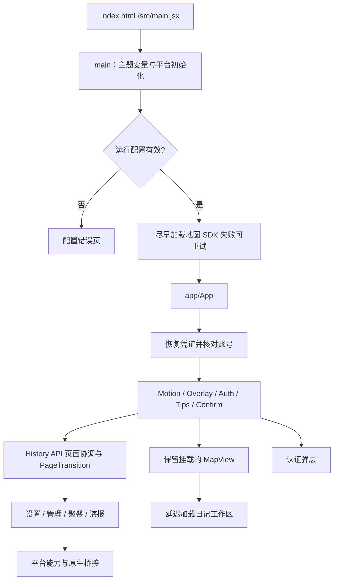
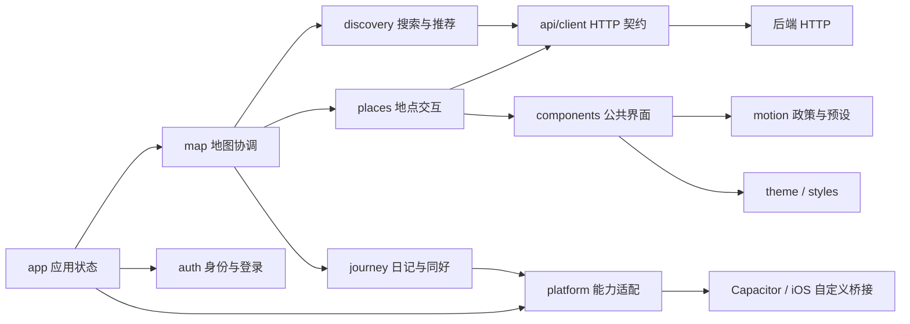

# 前端架构、目录对照与选型

基线 `2bc8c5e`，2026-10-15。本次改变文件组织和测试入口，保持路由、界面、数据规则、桥接协议与异步调用方式。

## 启动与界面装配

main 中的被动事件补丁先于 render 执行；闭包的模块导入和平台事件注册仍按原顺序。上图表达职责，Providers 实际嵌套顺序以 App.jsx 为准。地图保留挂载是为了维护视角与加载状态，不能用按路由条件卸载替代。

当前仍有直接 fetch（如认证、设置、日记）和跨模块协调；api/client 不是已统一所有网络请求的抽象。MapView、MapUI、App 和 AuthPage 仍包含较多状态与展示代码，本轮没有宣称完成它们的内部解耦。

## 旧目录与当前目录

| 原问题 | 本轮组织 | 维护约定 |
| --- | --- | --- |
| 根 src 页面并列 | app/auth/map/dinners/poster/admin/settings 各自收拢 | 根 src 保留 main 启动入口 |
| components 同时放通用按钮与地点业务 | 地点、认证、菜单归相应模块；公共组件按用途分组 | 新组件按使用者决定归属，不因是 JSX 就放公共目录 |
| map 同时放地图引擎和全部地点/搜索面板 | 地图渲染保留，地点进 places，发现进 discovery | MapView 仍协调双方，下一轮再提取状态边界 |
| utils 聚集主题、裁图、海报、认证诊断 | theme/settings/poster/auth 各归其主 | hooks 仅收无业务依赖的可复用 hook |
| scripts 混测试与维护 | tests/unit 与 integration；scripts 保留构建和历史工具 | 既有 JSON loader 路径不动，防跨包测试失效 |
| 模块说明缺失 | doc 跟随模块，跨模块信息集中 frontend/doc | 简单案例内联，复杂模块另拆 TEST_CASES |

## 技术选型对照

根据仓库实际实现解释现状，不是对外部产品最新能力的比较。

| 能力 | 当前方案 | 可替代方案与本轮取舍 |
| --- | --- | --- |
| 界面 | React + 现有 hooks 与 props | 全局状态库可能减少传参，但引入它不能自动解决状态归属；先记录和提取边界 |
| 导航 | platform/navigation 的 History API + App 协调 | 路由框架可声明路由，但需要兼容深链、原生返回、保留地图与草稿离开保护，暂不替换 |
| 网络 | 原 fetch 封装 + 各域专属请求 | 查询缓存库需明确 key、账号隔离、取消与失效语义；本轮保留现有契约 |
| 地图 | AMap + 自定义聚合/缓存/请求闸门 | 简单逐点渲染难覆盖现有聚合与视口缓存；不因整理目录更换地图栈 |
| 多端 | platform + Capacitor + 部分 iOS 原生界面 | 业务里直接判断 UA 会扩散差异；平台和业务状态仍需单独验证 |
| 动效 | 统一 policy、预设、MotionSurface 与 overlayStack | 每面板自定义生命周期会破坏退出、返回优先级和背景 inert |
| 文案 | i18next JSON + AST 检查 | 字符串散落源码难核验；数据取值不因国际化改写，保留白名单 |
| 测试 | Node 逻辑/桥接 + 真前后端浏览器 harness | 源码检查能守住静态约束，不能替代真实交互与真机；按覆盖级别报告 |

## 不可因重组破坏的契约

1. lazy import 仍是 lazy；资源路径与 CSS 顺序有效；平台本地字体和移动构建 HTTPS 检查保留。
2. 旧请求晚到不能覆盖新地图查询、地点、账号或草稿；取消和 request key 语义不能只靠“组件已搬迁”推定正确。
3. 弹层用 open/show 表达显示状态，退出期间保留挂载；返回/Escape/背景触摸走统一栈和关闭逻辑。
4. 凭证恢复未完成不等于游客；网络错误不等于服务端拒绝，不随意清空 token。
5. 原生动作与 requestId 只接收受限字段，Web 继续负责账号请求；本次不改 Swift/Xcode/Android 工程。
6. 本轮文档与迁移都在 frontend 内被 Git 跟踪；现有根 docs 被忽略，不把交付物放在那里。

后续工作与证据见 [历史与待办](HISTORY_AND_TODO.md)。
