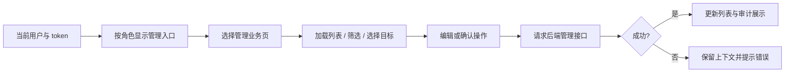

# 管理界面

AdminDashboard.jsx 提供管理入口，AdminUsers/GeneralUsers/Places/Comments/QQWhitelist/Notices 分业务页，BanModal/AuditModal 负责关联弹层。显示权限与当前用户联动，后端才是授权和事务权威；目录整理不新增权限。

现有分页面方式优于一个管理大组件；通用表格在 components/data。列表页面仍存在重复网络与错误处理，可在覆盖充分后抽取。案例（待独立浏览器自动化）：ADM-F01 三种管理员和普通用户看到正确入口；ADM-F02 后端拒绝时不乐观显示成功；ADM-F03 封禁/删除确认取消不发请求；ADM-F04 切目标/账号时旧列表不覆盖当前页。i18n 仅检查文案，不算这些行为覆盖，见 ADM-F01 的 [清单](../../../doc/HISTORY_AND_TODO.md)。
