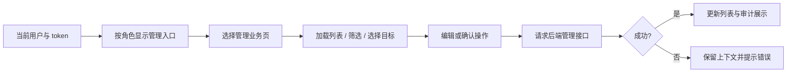

# 管理界面

AdminExhibitions 在后台底部提供展会联动设置，沿用公告发布权限。名称/信息使用 TextInput，简介使用 TextArea；图标复用 `/upload`。展会地点（选填）用场馆名加全屏地图选点（MapView 导出的 `FullScreenMapPicker`，`context="exhibition"`）：选中站内地点时顺带填入场馆名，也可以用图钉位置；有地点时地图上的展会面板才有“展会附近随机美食”。发布后替换当前展会，支持下架。接口与浏览器回归分别在 `backend/tests/community/test_exhibitions.js` 和 `test_exhibition_ui.js`。

AdminDashboard.jsx 提供管理入口，AdminUsers/GeneralUsers/Places/Comments/QQWhitelist/Notices 分业务页，BanModal/AuditModal 负责关联弹层。显示权限与当前用户联动，后端才是授权和事务权威；目录整理不新增权限。

三个等级都显示操作日志和地点审核入口；皮肤兑换码仅 YUYUKO 显示。YOUMU 的普通用户管理面板增加封禁/解封与状态，复用 AdminBanModal 和 `/admin/users/ban`、`/unban`，目标限普通用户。KOMACHI 仍只有普通用户删除操作，不显示封禁按钮。QQ 白名单、公告/展会和隐藏的评论面板沿用原有范围。

普通用户面板提交删除/封禁/解封期间暂停所有行操作和刷新，避免共享列表请求编号使另一个成功响应失效；关闭封禁弹层不取消已提交请求。浏览器用例通过延迟响应验证等待期间的禁用状态与最终封禁结果。

`backend/tests/admin/test_admin_permissions_ui.js` 搭配 `frontend/tests/integration/admin-harness.jsx`，使用真实管理组件、路由与临时数据库，覆盖角色入口、日志弹层、兑换码隐藏、YOUMU 桌面封禁/窄屏解封及重载状态、取消封禁、目标升为管理员后后端拒绝及重试、KOMACHI 没有封禁控件；其余操作的取消/错误/旧响应场景仍待补齐。

现有分页面方式优于一个管理大组件；通用表格在 components/data。列表页面仍存在重复网络与错误处理，可在覆盖充分后抽取。案例：ADM-F01 角色入口已有上述浏览器覆盖；ADM-F02/03 已覆盖封禁后端拒绝、重试与取消，其余操作仍待自动化；ADM-F04 已覆盖提交期间关闭弹层与阻止并发刷新，切账号和其他旧响应场景仍待自动化。i18n 仅检查文案，不算这些行为覆盖，见 ADM-F01 的 [清单](../../../doc/HISTORY_AND_TODO.md)。
