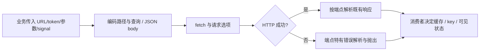

# HTTP 客户端契约

client.js 是旧 map/api.js，导出地点、个人标记叠加、关键词/AI、随机、顺路、当前用户/定位、聚餐、收藏、分类和评分请求。2026-11-15 起地图不再按视野请求 `/places/nearby`（`fetchPlacesNearby` 已删除）：公共快照 `/places/markers` 由 `map/markerSnapshot.js` 自己读取（不带 token），这里的 `fetchPlaceOverlay` 只读登录后的个人叠加 `/places/overlay`；`fetchPlace` 可传 `cache: 'no-cache'`，刚修改后读到最新内容。公共缓存接口（公告、展会、地图标记、地区）请求时不带 `Authorization` 或自定义头，避免预检并让 CDN 缓存同一份。调用签名、响应和错误处理保持原样；该文件还不是全站统一网络层，认证、日记和设置仍有各自请求。

采用函数封装维持原调用契约，对照本轮新引入请求库，可避免同时改变取消、错误与账号隔离语义。当前端点分组尚未拆分，后续 API-01 按领域拆后再考虑共用 transport，不先写吞掉业务错误的统一 catch。

已有 test:rating 验证评分请求；后端 test:random 导入这里验证前端随机封装。其他端点覆盖依其业务集成，不宣称完整。下一步案例：API-C01 signal 与 token 正确传递；API-C02 非 JSON/空响应错误可解释；API-C03 不把 401/403、网络断线和 AI 503 混同。后两类有部分专属实现，但尚无全端点矩阵，见 [清单](../../../doc/HISTORY_AND_TODO.md)。
