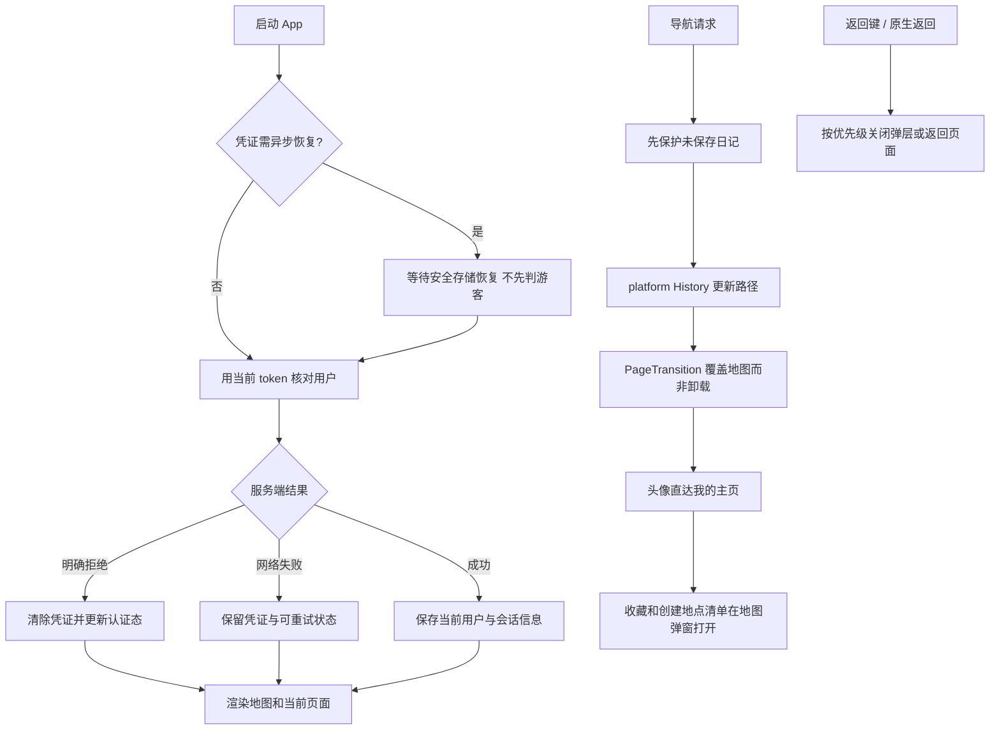

# 应用装配与导航

App.jsx 管理凭证恢复、当前用户、路由、主题同步、原生设置入口与全局弹层；站点公告与展会（`map/useExhibitions.js`）都通过 `platform/polling.js` 低频轮询公共缓存接口（每 5 分钟，后台跳过，管理员修改后 `announcePublicUpdate` 立即重读），新请求开始后旧响应不再生效（公告按请求序号，展会中止上一请求）。`main.jsx` 在同意隐私政策后与高德 SDK 并行预取地图标记快照（见 [地图文档](../../map/doc/README.md)）。components/AuthPanel.jsx 是应用菜单，虽然保留旧名称，但不是登录表单。components/LocationPermissionNotice.jsx 挂在 AppFrame 之外：Android 弹出系统定位授权时（`platform/geolocation.js` 的 `onLocationPermissionPrompt`），在状态栏下方显示位置权限用途，不接收点击，授权答复后收起；地图定位按钮与日记“使用当前位置”共用。业务认证在 auth，平台 History/深链/返回能力在 platform。main.jsx 仍在 src 根以保持 HTML 入口。

| 当前做法 | 对照与维护判断 |
| --- | --- |
| App 集中协调共享状态 | 便于维持现有路由与地图常驻，但文件较大，下一轮按认证/导航/页面装配提取，见 APP-01 |
| 保留地图挂载 | 比路由切换即销毁更能保留地图视角与缓存；需处理覆盖期间交互和原生控件显示 |
| 原生设置失败可回网页 | Web 仍执行账号请求，原生不可用不应阻止设置入口 |

依赖 auth、platform、motion、theme 和公共组件，其他业务页面通过既有 props 协作。文字案例见 [TEST_CASES.md](TEST_CASES.md)。历史 `55bbc18` 返回链、`c19d13b` 原生设置；后续 [APP-01](../../../doc/HISTORY_AND_TODO.md)。
