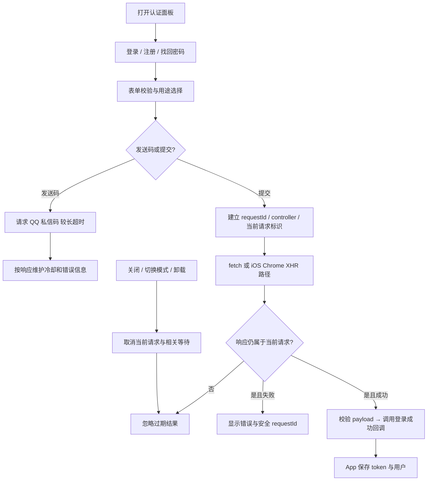

# 登录、注册与身份上下文

AuthPage.jsx 包含登录、QQ 验证码注册与重置的表单/请求生命周期；AuthContext.jsx 提供认证状态；components/AuthModal.jsx 负责响应式面板；BanNotice.jsx 展示封禁信息；services/authDiagnostics.js 上报受限诊断阶段。账号菜单在 app，凭证持久化在 platform。

| 当前方案 | 对照与约束 |
| --- | --- |
| 请求状态保存在组件 refs | 能识别取消与过期响应；不能提取后丢失“当前请求”的身份比较 |
| QQ 发送码独立超时/冷却 | 与普通登录混用一个时限会改变已有慢私信处理；后端仍是配额权威 |
| 兼容 fetch/XHR | 不因目录整理删去浏览器兼容路径；下一轮先抽可测试传输边界，见 AUTH-01 |

已有 i18n 及平台辅助检查不构成完整表单交互自动化；案例明确标覆盖级别，见 [TEST_CASES.md](TEST_CASES.md)。历史 `d285076`；待办 AUTH-01 / AUTH-02 见 [清单](../../../doc/HISTORY_AND_TODO.md)。
