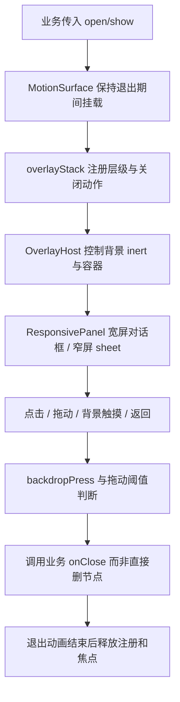

# 公共界面组件

primitives：Button/Tooltip；forms：输入控件；feedback：Notice/Tips/Confirm 与公告颜色；layout：页头、滚动、路由壳和全屏地图容器；data：表格；overlay：弹层、菜单、栈、背景手势、拖动。业务组件归 auth/places/app；公共目录不依赖具体地点或账号业务。

| 当前方案 | 对照与约束 |
| --- | --- |
| 统一 overlay 栈 | 每组件分别监听 Escape/返回会引发多层同时关闭 |
| open/show 驱动生命周期 | 条件挂载会跳过退出和清理过程 |
| 背景手势验证真实起止位置 | 只处理最终 click 会误把来自内容区/地图的触摸当点击背景，历史见 d6af195 |
| 按用途组织公共控件 | 地点管理面板虽有多个调用方，仍是地点业务，不放通用组件 |

案例：OVL-C01（已有逻辑自动化，test:overlay）内容区开始、背景结束与反向手势不误关闭；真正背景点击按规则关闭。OVL-C02（部分逻辑与集成）嵌套面板返回只关闭最顶层并恢复背景状态。OVL-C03（待浏览器自动化）退出中重复关闭、焦点恢复、拖动取消与键盘导航。OVL-C04（人工真机）Android 添加地点点击与 iOS 系统弹层同时存在场景。待办 UI-01 见 [清单](../../../doc/HISTORY_AND_TODO.md)。
