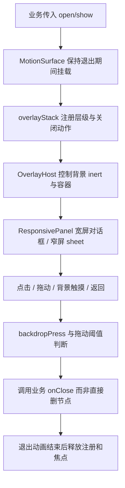

# 公共界面组件

primitives：Button/Tooltip/MarqueeText（放不下的单行长标题来回滚动，减少动态效果时改为手动横滑）；forms：输入控件；feedback：Notice/Tips/Confirm 与公告颜色；layout：页头、滚动、路由壳和全屏地图容器；data：表格；overlay：弹层、菜单、栈、背景手势、拖动。业务组件归 auth/places/app；公共目录不依赖具体地点或账号业务。

| 当前方案 | 对照与约束 |
| --- | --- |
| 统一 overlay 栈 | 每组件分别监听 Escape/返回会引发多层同时关闭 |
| open/show 驱动生命周期 | 条件挂载会跳过退出和清理过程 |
| 背景手势验证真实起止位置 | 只处理最终 click 会误把来自内容区/地图的触摸当点击背景，历史见 d6af195 |
| 按用途组织公共控件 | 地点管理面板虽有多个调用方，仍是地点业务，不放通用组件 |

案例：OVL-C01（已有逻辑自动化，test:overlay）内容区开始、背景结束与反向手势不误关闭；真正背景点击按规则关闭。OVL-C02（部分逻辑与集成）嵌套面板返回只关闭最顶层并恢复背景状态。OVL-C03（待浏览器自动化）退出中重复关闭、焦点恢复、拖动取消与键盘导航。OVL-C04（人工真机）Android 添加地点点击与 iOS 系统弹层同时存在场景。待办 UI-01 见 [清单](../../../doc/HISTORY_AND_TODO.md)。

## Markdown（markdown/）

地点描述、反馈内容与展会简介 / 信息支持 Markdown（GFM：标题、列表、引用、代码、表格、删除线等，单个换行即换行）与 HTML。解析用 marked，安全靠清理：

| 场景 | 用法 |
| --- | --- |
| 能显示格式（地点详情、管理端反馈、输入框预览） | `<Markdown text fallback />`：marked 生成 HTML，独立的 DOMPurify 实例按 `markdownSanitize.js` 白名单清理后插入。只留排版标签；去掉脚本、事件属性、`style` / `class` / `id`、表单、媒体与嵌入；链接只接受 http / https / mailto，并加 `target="_blank"` 与 `rel="noopener noreferrer nofollow ugc"`；App 内点链接交给系统浏览器 |
| 图片 | 不加载（任意外链图片可被用来追踪查看者），marked 渲染成指向图片的链接，`` 也不在白名单里 |
| 裸网址 | 只到第一个非 ASCII 字符为止，句末标点不算（GFM 默认会把紧跟的中文算进链接） |
| 不能显示格式（卡片摘要、搜索列表、随机美食摘要、分享卡片图） | `markdownToPlainText()`：去掉标记与 HTML 标签（脚本内容也去掉），解码实体，保留换行与有序列表序号 |
| iOS 原生地点卡片 | `markdownToNativeInline()` 把块级结构展开（标题加粗、列表加 • / 序号、表格按行），只留行内语法并转义其余字符，经 `detailMarkdown` 交给 SwiftUI 按“仅行内”解析；`detail` 仍是纯文本，给旧版 App |
| 输入（`TextArea markdown`） | 输入框下方提示语法，可切换预览；预览时输入框隐藏但不卸载 |

后端 `backend/modules/places/services/markdownText.js` 用相同的 marked 配置与纯文本规则（分享页、QQ 机器人），两边的 marked 锁定同一版本；`npm run test:markdown` 检查渲染、清理白名单、纯文本与 iOS 输出，并对照两边的纯文本。
