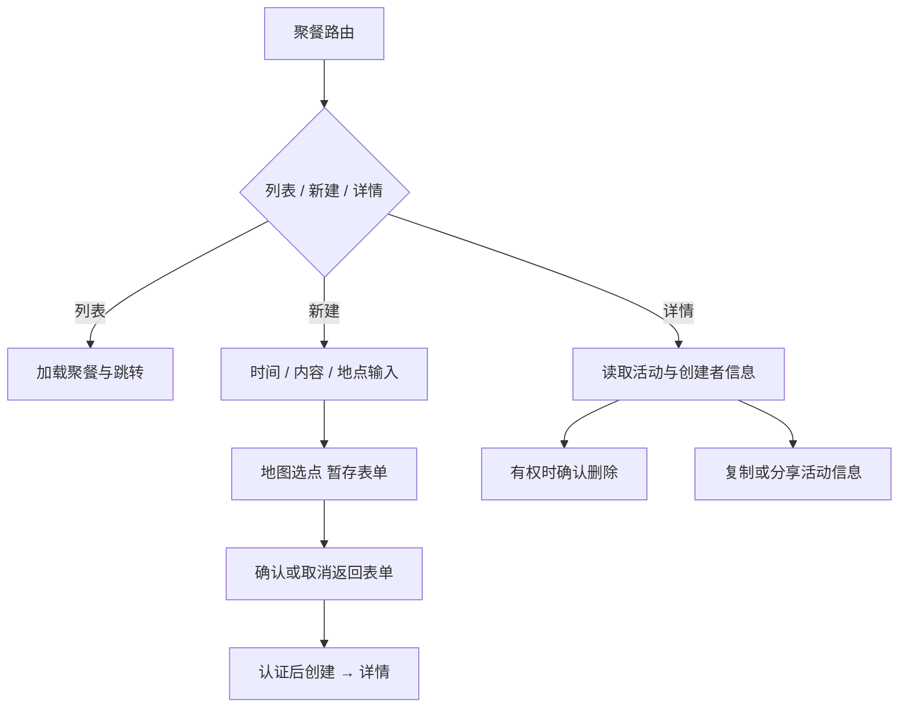

# 聚餐页面

DinnerPages.jsx 导出列表、新建、详情与路径解析，api/client 中保留请求函数。MapView 以 pickerMode 选择地点，公共 FullScreenMapContent 提供全屏容器；不另造地图实例管理规则。

当前多个相关页面共文件便于沿用导出，但下一轮可拆 List/Create/Detail，需保留日期解析和路由函数。案例（待独立浏览器自动化）：DIN-C01 选点取消后文字与时间仍在；DIN-C02 无效时间、空地点、未登录提交有明确结果；DIN-C03 无权删除与取消删除不改变活动；DIN-C04 分享内容与显示日期一致。后端接口测试不代表这些页面状态，见 DIN-01 的 [清单](../../../doc/HISTORY_AND_TODO.md)。
