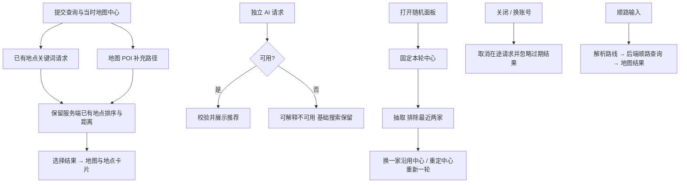

# 搜索、随机美食与顺路

hooks/useSearchPanel 控制搜索面板；components/RandomFoodPanel 与 AlongRoutePanel 管理推荐/顺路交互；alongRoute.js 处理高德路线输入等工具。普通关键词、AI、随机的服务端规则仍由后端决定。MapView/MapUI 继续持有部分搜索状态；api/client 提供请求函数。

| 当前方案 | 对照 |
| --- | --- |
| 后端排序，前端保序 | 前端按旧字段再排序会撤销距离联合排序修复 |
| 随机一轮固定中心和短历史 | 每次悄悄换中心会使“再换一家”含义改变 |
| 取消与 controller 身份判断同时使用 | 单独 abort 不保证已完成或迟到回调不更新状态 |

测试见 [TEST_CASES.md](TEST_CASES.md)。排序/随机算法由后端 test:search / test:random 验证；前端复杂搜索竞态和顺路面板覆盖仍需补充，见 DSC-F01 / DSC-F02 的 [清单](../../../doc/HISTORY_AND_TODO.md)。
