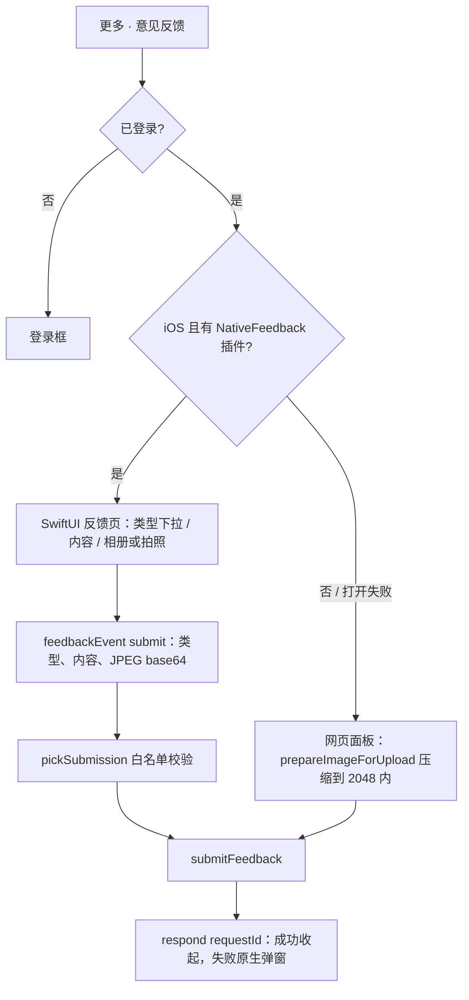

# 意见反馈

住民从“更多”菜单提交反馈：类型 + 内容 + 最多 4 张图片。需要登录，未登录时先打开登录框。后端见 [反馈模块](../../../../backend/modules/feedback/doc/README.md)。

| 文件 | 作用 |
| --- | --- |
| `feedbackTypes.js` | 类型（取值与后端 `FEEDBACK_TYPES` 一致，测试会对照）、iOS 下拉菜单的 SF Symbol、内容与图片上限；预填：`placeReportPrefill()`（地点举报）、`userReportPrefill()`（同好住民举报）、`diaryReportPrefill()`（公开日记举报）、`normalizeFeedbackPrefill()` |
| `feedbackApi.js` | `submitFeedback()`：一次 multipart 提交，附带平台与版本号；网页面板与原生页共用 |
| `FeedbackPanel.jsx` | 网页版（网页、Android、原生不可用时）：`ResponsivePanel`，宽屏居中、窄屏底部面板 |
| `useNativeFeedback.js` | iOS App 呈现原生 SwiftUI 反馈页（`ios/App/App/NativeFeedbackPlugin.swift`），打不开时返回 false |
| `FeedbackHost.jsx` | App 里的落点：原生可用用原生，否则网页面板；原生提交成功后在地图上提示 |

入口：窄屏“更多功能”面板与 iOS 原生抽屉（同一份 `moreMenuEntries`，行 id `feedback`，皮肤图标槽 `expanded.panel.icons.feedback`）、宽屏顶栏“更多”菜单。状态在 `App.jsx`（`feedbackOpen`、`feedbackPrefill`），`openFeedback(prefill?)` 可带预填。

地点举报复用同一张表：网页地点详情（`PlaceDetailPanel` 的 `onReport`）在店名后面有小字“举报”，iOS 原生地点卡片的“举报”按钮（行 id `report`，皮肤图标槽 `cardActions.report`）占了原来“详情”的位置（全屏详情改为上滑）。两处都调用 `openFeedback(placeReportPrefill(place))`：类型预选“不良信息举报”，内容开头预填地点名、编号与 `/p/<id>` 链接，后面是“举报原因：”。后端不变，地点信息就在反馈内容里。高德临时地点（未收录）没有举报入口。

同好与公开日记的举报沿用同一思路：同好页展开某位住民的公开收藏夹后，标题后有小字“举报”（`userReportPrefill(user)`：住民名与编号）；公开日记标题后也有（`diaryReportPrefill(journey)`：标题、作者与 `/?diary=<public_id>` 链接）。入口经 `JourneyWorkspace` 的 `ctx.report`（即 `openFeedback`）打开，反馈面板叠在日记页面之上；自己的日记和名片不显示举报。

- 预填只给初始值：网页面板同一份预填再打开时保留草稿，换了地点就换成新的预填；内容只有预填、没写别的时不能提交（原生同样，且只有预填时不算草稿，下滑直接关闭）。
- 原生反馈页打开期间登记一个 `suspendNative` 浮层，地图原生控件（包括地点卡片这个系统面板）暂时收起，否则反馈页弹不出来；关闭后卡片回来。

- 网页面板常驻不卸载：误关后再打开草稿还在，提交成功才清空。
- 原生页：图片在原生里摆正方向、长边缩到 2048 并编码为 JPEG 0.85 后才交给网页；有草稿时下滑关闭先确认放弃。
- 原生会话只接受本次呈现 id 的 `submit` 事件，类型须在下发的类型里、图片张数与大小有上限（`platform/nativeFeedback.js`），测试 `npm run test:native-chrome`。
