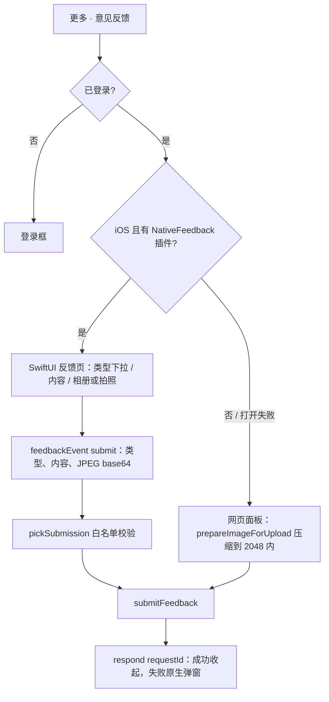

# 意见反馈

住民从“更多”菜单提交反馈：类型 + 内容 + 最多 4 张图片。需要登录，未登录时先打开登录框。后端见 [反馈模块](../../../../backend/modules/feedback/doc/README.md)。

| 文件 | 作用 |
| --- | --- |
| `feedbackTypes.js` | 类型（取值与后端 `FEEDBACK_TYPES` 一致，测试会对照）、iOS 下拉菜单的 SF Symbol、内容与图片上限 |
| `feedbackApi.js` | `submitFeedback()`：一次 multipart 提交，附带平台与版本号；网页面板与原生页共用 |
| `FeedbackPanel.jsx` | 网页版（网页、Android、原生不可用时）：`ResponsivePanel`，宽屏居中、窄屏底部面板 |
| `useNativeFeedback.js` | iOS App 呈现原生 SwiftUI 反馈页（`ios/App/App/NativeFeedbackPlugin.swift`），打不开时返回 false |
| `FeedbackHost.jsx` | App 里的落点：原生可用用原生，否则网页面板；原生提交成功后在地图上提示 |

入口：窄屏“更多功能”面板与 iOS 原生抽屉（同一份 `moreMenuEntries`，行 id `feedback`，皮肤图标槽 `expanded.panel.icons.feedback`）、宽屏顶栏“更多”菜单。状态在 `App.jsx`（`feedbackOpen`）。

- 网页面板常驻不卸载：误关后再打开草稿还在，提交成功才清空。
- 原生页：图片在原生里摆正方向、长边缩到 2048 并编码为 JPEG 0.85 后才交给网页；有草稿时下滑关闭先确认放弃。
- 原生会话只接受本次呈现 id 的 `submit` 事件，类型须在下发的类型里、图片张数与大小有上限（`platform/nativeFeedback.js`），测试 `npm run test:native-chrome`。
