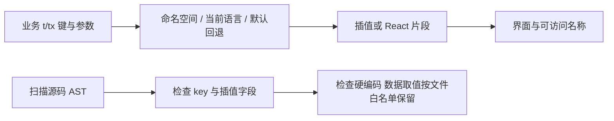

# 文案与数据取值

index.js 提供 t/tx、语言设置与资源注册，locales/zh-CN/*.json 按业务命名空间保存文案。tx 支持 React 插值片段，保留现有行为；key 与参数由 tests/unit/i18n/test-i18n.mjs 用 Babel AST 检查。

选择 JSON + 静态键便于 AI 和维护者核对，对照动态拼 key 更容易漏检；像“避雷”分类、提交模型的风格值是协议数据，不盲目翻译。搬文件需更新白名单路径，不能删除白名单测试。已有 test:i18n 覆盖键/插值/硬编码；翻译自然性、长文案布局和系统语言切换需另验。历史 3b965d5；待办 I18N-01 见 [清单](../../../doc/HISTORY_AND_TODO.md)。
