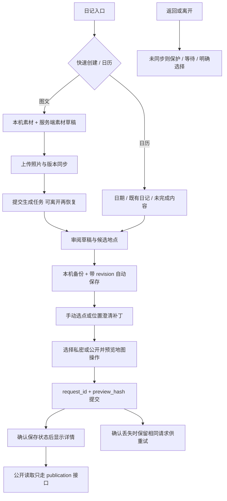

# 日记工作区

地图功能栏的「日记」进入「写日记」或日历。JourneyWorkspace 维护单个浮层内的页面栈。Composer 与 useComposeDraft 处理素材，Generation 管理任务，Review 与 useJourneyDraft 编辑草稿。Resolution 处理位置选择，Detail、PublicJourneyView 和 PlaceDiaryList 展示日记，Share 生成分享内容。同好与收藏从住民主页进入。 [住民主页](../../profile/doc/README.md)

| 选择 | 对照与约束 |
| --- | --- |
| 页面栈内保留下层挂载 | 简单切页销毁会丢编辑状态；active 决定副作用和交互 |
| 本机与服务端草稿协作 | 仅本机易跨设备丢失，仅服务端无法在离线编辑时保护数据；需账号隔离 |
| 公开预览与确认提交分开 | 私有编辑不能自动改公开内容，费用/私图不能进入公开快照 |
| 位置 basis 补丁 | 整文替换会覆盖澄清等待期间备注和费用 |

## 文案与 AI 提示（2026-11-20）

AI 整理是写日记的卖点，但界面只在两处提它：入口副标题讲一次（「拍几张照片、说几句话，AI 帮你整理成一篇日记」），生成出的内容带一个小标签——核对页摘要行前的「AI 整理」、公开日记日期行末的「AI 辅助整理」、分享贴文旁的「AI 生成」，导出贴文仍附「（本文由 AI 辅助生成）」。不再有逐项的「AI 识别 / AI 推测」、核对页的长提示、公开页的说明句，没开 AI 时也不提示“未开启”。按钮用日常说法：整理成日记、自己整理、只根据文字整理；推断的到访时间标「时间待确认」。界面称“地点”不称“站”，搜索中心称「大概在哪」，未完成内容统称「草稿」。

- 可见性只在核对页保存时选择（素材页不再有可见性一行；`intended_visibility` 仍随草稿保存，默认公开）。公开说明写明「在地图上新增 N 个地点，关联 N 个已有地点」。
- 正文：`summary` 在核对页标为「正文」直接编辑（公开时显示）；「自己整理」时把写下的描述带入正文。`public_text` 不再单独提供输入框，旧草稿里有内容时才显示「另一段公开文字」。
- 照片集中在「照片」一处：多选放到地点；公开时，没放到地点的照片下方有「公开 / 不公开」切换（`public_media_ids`），原来单独的公开照片网格已去掉。
- 公开日记与公开预览不再在每段文字下标「原文摘录 / 作者编辑」；核对页的文字框仍标「摘自你的描述 / 已修改」并可恢复原话。
- 草稿页把本机未同步、待确认、整理中、未整理、修改中排成一列，每行以状态开头，点按都是「继续」。
- 生成提示词（私有服务）要求标题像作者自己写的短标题、摘要用第一人称一到三句、贴文不用网络套话；见私有服务 `src/algorithms.js`。

站点位置只有「选择店铺」一个入口（有候选先列候选，“都不是”再进全屏地图），亲自选定即已核对；每站照片由 JourneyStopPhotos 从本篇、私人图片空间或本机添加（每站 12 张，超出明确提示）。摘要、正文、各站文字与素材描述用 MarkdownField 输入、MarkdownText 显示。到访时间可只填日期（`YYYY-MM-DD`）；模型推测的时间带 `at_source: model`，作者改动或确认后清除。
分享（JourneyShare + cover.js）：贴文、图片与生成时的范围是一份分享稿（本机 `share:<日记>` 槽位，含手动修改）；范围收窄或日记已改动即停止导出，其他设置改动标“待更新”；图片按单店 / 多站 / 拼图 / 文字卡模板围绕作者照片自动重画，可换封面与主图、调裁切、重排、删页，文字放不下续页并提示。后端 `unsupported` 列出贴文里找不到依据的价格、时间、排队等内容。公开阅读页打开时地址保留 `?diary=`，照片可放大、失败可重试，未选定店铺的站点标“地点未核实”；地点相关日记带登录身份读取（屏蔽过滤生效）。

案例见 [TEST_CASES.md](TEST_CASES.md)；已有 test:journey-text、后端日记测试与完整浏览器 harness。历史 `01e11a4`、`cc11a4f`；待办 JRN-F01 及已记录的 UI 稳定性问题见 [清单](../../../doc/HISTORY_AND_TODO.md)。

## iOS 原生日记

iOS 的日记使用 SwiftUI 与 `NativePageEngine.swift`。网页构建页面模型并执行草稿、生成及公开请求。 [原生日记](../../../ios/App/App/NativeJourneyPlugin.swift) · [控制器](../nativeJourneyController.js) · [桥接](../../platform/nativeJourney.js)

- 原生页面包括入口、素材、生成状态、核对、日历、详情、未完成、私人图片、公开日记与分享设置。
- 生成进度由网页通过 `update` 主动推送；核对页返回时尽力同步草稿，失败时写入本机草稿。
- 地图选点与分享画布仍由现有网页工具页完成：原生详情页的“在地图中查看”和分享页的“在网页分享编辑器中继续”把流程交回网页工作区；原生打开失败也会回退网页工作区。
- 入口使用半屏面板。写日记与日历用原生 `custom` 页面，沿用 `JourneyComposer` 与 `JourneyCalendar` 的操作逻辑，包含地址页和合并预览。新网页包不再发送素材页的可见性标签，原生素材页随之隐藏可见性一行（旧网页包仍显示）。
- 核对页每一站有「选择店铺」（原生 `shop` 页：先列候选，可按店名搜索地图上已有的店，或「就在这里」用当前位置），选定即为已确认；回到核对页沿用内存中的修改。编辑一站只填店名、到访时间（开关 + 日期时间选择器）和文字，不再手填经纬度或地址。
- 公开保存遇到可能重复的店时推入原生 `duplicates` 页逐个选「就是这家 / 不是同一家」，全部确认后在该页公开；「保存为私密」不再是主色按钮，可见性只由两个保存按钮决定。AI 整理的草稿只在核对页副标题带「AI 整理」。
- 私人图片草稿、逐站照片选择和地图选点由网页工作区完成。桥接测试纳入 `test:native-panels`。 [真机验收](../../../native/doc/README.md)
