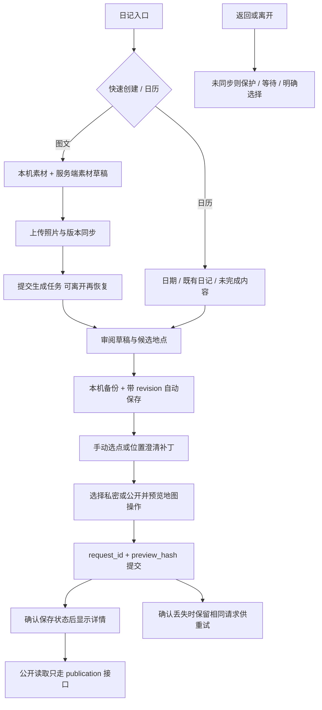

# 日记工作区

地图功能栏的「日记」进入快速创建或日历。JourneyWorkspace 维护单个浮层内的页面栈。Composer 与 useComposeDraft 处理素材，Generation 管理任务，Review 与 useJourneyDraft 编辑草稿。Resolution 处理位置选择，Detail、PublicJourneyView 和 PlaceDiaryList 展示日记，Share 生成分享内容。同好与收藏从住民主页进入。 [住民主页](../../profile/doc/README.md)

| 选择 | 对照与约束 |
| --- | --- |
| 页面栈内保留下层挂载 | 简单切页销毁会丢编辑状态；active 决定副作用和交互 |
| 本机与服务端草稿协作 | 仅本机易跨设备丢失，仅服务端无法在离线编辑时保护数据；需账号隔离 |
| 公开预览与确认提交分开 | 私有编辑不能自动改公开内容，费用/私图不能进入公开快照 |
| 位置 basis 补丁 | 整文替换会覆盖澄清等待期间备注和费用 |

站点位置只有「选择店铺」一个入口（有候选先列候选，“都不是”再进全屏地图），亲自选定即已核对；每站照片由 JourneyStopPhotos 从本篇、私人图片空间或本机添加（每站 12 张，超出明确提示）。摘要、正文、各站文字与素材描述用 MarkdownField 输入、MarkdownText 显示。到访时间可只填日期（`YYYY-MM-DD`）；模型推测的时间带 `at_source: model`，作者改动或确认后清除。
分享（JourneyShare + cover.js）：贴文、图片与生成时的范围是一份分享稿（本机 `share:<日记>` 槽位，含手动修改）；范围收窄或日记已改动即停止导出，其他设置改动标“待更新”；图片按单店 / 多站 / 拼图 / 文字卡模板围绕作者照片自动重画，可换封面与主图、调裁切、重排、删页，文字放不下续页并提示。后端 `unsupported` 列出贴文里找不到依据的价格、时间、排队等内容。公开阅读页打开时地址保留 `?diary=`，照片可放大、失败可重试，未选定店铺的站点标“地点未核实”；地点相关日记带登录身份读取（屏蔽过滤生效）。

案例见 [TEST_CASES.md](TEST_CASES.md)；已有 test:journey-text、后端日记测试与完整浏览器 harness。历史 `01e11a4`、`cc11a4f`；待办 JRN-F01 及已记录的 UI 稳定性问题见 [清单](../../../doc/HISTORY_AND_TODO.md)。

## iOS 原生日记

iOS 的日记使用 SwiftUI 与 `NativePageEngine.swift`。网页构建页面模型并执行草稿、生成及公开请求。 [原生日记](../../../ios/App/App/NativeJourneyPlugin.swift) · [控制器](../nativeJourneyController.js) · [桥接](../../platform/nativeJourney.js)

- 原生页面包括入口、素材、生成状态、核对、日历、详情、未完成、私人图片、公开日记与分享设置。
- 生成进度由网页通过 `update` 主动推送；核对页返回时尽力同步草稿，失败时写入本机草稿。
- 地图选点与分享画布仍由现有网页工具页完成：原生详情页的“在地图中查看”和分享页的“在网页分享编辑器中继续”把流程交回网页工作区；原生打开失败也会回退网页工作区。
- 入口使用半屏面板。快速创建与日历用原生 `custom` 页面，沿用 `JourneyComposer` 与 `JourneyCalendar` 的操作逻辑，包含地址页和合并预览。
- 私人图片草稿、逐站照片选择和地图选点由网页工作区完成。桥接测试纳入 `test:native-panels`。 [真机验收](../../../native/doc/README.md)
