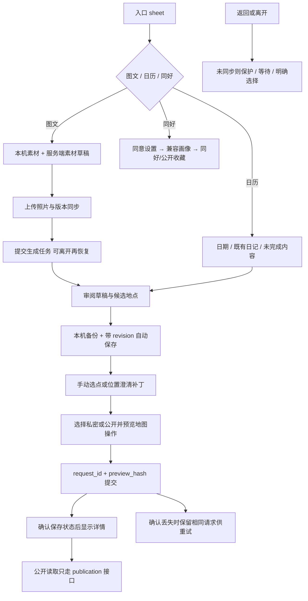

# 日记与同好工作区

JourneyWorkspace 维护单个 overlay 内页面栈；EntrySheet 提供图文生成/日历/同好；Composer 与 useComposeDraft 处理素材；Generation 管理任务；Review 与 useJourneyDraft 编辑草稿；Resolution/地图选择解决位置；Detail/PublicJourneyView/PlaceDiaryList 展示私有与公开；Share/cover 生成分享；Community 与 feedback 处理同好及同意反馈。

| 选择 | 对照与约束 |
| --- | --- |
| 页面栈内保留下层挂载 | 简单切页销毁会丢编辑状态；active 决定副作用和交互 |
| 本机与服务端草稿协作 | 仅本机易跨设备丢失，仅服务端无法在离线编辑时保护数据；需账号隔离 |
| 公开预览与确认提交分开 | 私有编辑不能自动改公开内容，费用/私图不能进入公开快照 |
| 位置 basis 补丁 | 整文替换会覆盖澄清等待期间备注和费用 |

案例见 [TEST_CASES.md](TEST_CASES.md)；已有 test:journey-text、后端日记测试与完整浏览器 harness。历史 `01e11a4`、`cc11a4f`；待办 JRN-F01 及已记录的 UI 稳定性问题见 [清单](../../../doc/HISTORY_AND_TODO.md)。
