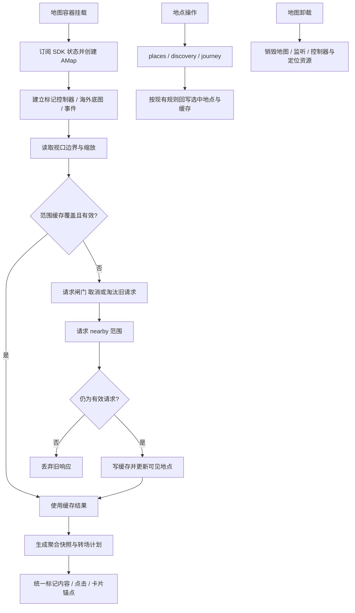

# 地图协调、渲染与缓存

MapExhibition 的 `useCurrentExhibition` 由 App 调用（只在地图页轮询），入口按钮由 App 挂载以避让公告；展会面板由 MapUI 渲染：网页为 `ExhibitionPanel`，iOS 原生控件接管时改为原生两段停靠卡片（协议 v7 的 `exhibition` 面板，快照由 `exhibition.js` 的 `exhibitionChromeSheet` 生成，纳入 `test:map`）。展会设置了地点时面板有“展会附近随机美食”：收起面板，以展会地点为本轮中心打开随机面板（RandomFoodPanel 的 `origin`）。原生卡片第一段时地图仍可点选，选中其他地点会收起展会卡片。窄屏入口距顶部 30px，详情全屏展示；宽屏入口位于右下角，详情参照顺路吃的侧板尺寸（宽 370px、顶部 68px、底部 42px）。44px 图标缺失或加载失败回退 favicon；窄屏由 ResizeObserver 根据公告实际矩形避让，公告关闭恢复原位。`exhibitionLayout.js` 负责矩形相交计算，纳入 `test:map`。

MapView.jsx 是旧 src/Map.jsx，仍是地图协调者；MapUI.jsx 负责地图 UI 与面板编排，二者尚未拆完。MarkerLayerController、markerContent 与 cluster 下引擎/快照/转场/缓存负责标记；viewport、pinchGuard、overseasTileLayer 各自处理视口、手势与境外底图。MapPanel/MapAnchoredCard 是地图布局容器，不是通用页面组件。locationReport 记下最近一次定位，按最新登录状态上报 `PUT /users/me/location`（QQ Bot `!随机` 的中心），App 启动时的自动定位早于登录恢复时在登录后补报。

| 当前实现 | 对照 |
| --- | --- |
| 视口缓存 + 请求版本闸门 | 只缓存列表不能阻止旧响应覆盖；移动后要同时核对范围与请求身份 |
| 引擎/快照/转场分离 | 直接在 React 列表逐点管理难维护现有聚合成员与动画中断不变量 |
| 海外 tile overlay 与 SDK 分工 | CARTO 是配置可选覆盖，不替换国内坐标和高德区域判断 |
| MapView/MapUI 继续协调 | 本轮先归位地点与发现面板，状态拆分见 MAP-01，不假定文件移动已解除耦合 |

已有 `test:map` / `test:platform` 逻辑测试；真实地图相关交互覆盖一部分在位置与日记浏览器回归。案例见 [TEST_CASES.md](TEST_CASES.md)。历史 `d944e8a`、`2bc8c5e`；待办 MAP-01 / MAP-02 见 [清单](../../../doc/HISTORY_AND_TODO.md)。
