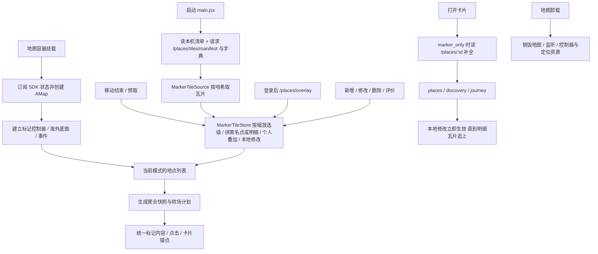

# 地图协调、渲染与缓存

分享链接 `/p/:id` 经导航层转换为 `/?place=:id`，MapView 读取单个地点、立即完成地图定位后自动打开地点卡片，宽屏为地图卡片、窄屏为底部面板、iOS 接管时为原生地点卡片，无需再点标记。处理后移除一次性参数；`nav=amap` 仍直接走高德导航。地点坐标允许经度或纬度为零，缺失、非有限值及超出地图范围的坐标不打开；过期加载在退出时取消。

已收录地点的打卡入口随卡片首屏显示，距离和地点状态由服务端在提交时核验。网页入口位于评价和更多之间，iOS 原生入口位于操作栏末尾。打开打卡表单时地点卡暂时让位，关闭后回到当前地点。iOS 原生控件接管时，店卡的评价与打卡是原生玻璃面板（协议 v19 的 `rating` / `checkIn`，从右侧按钮组展开，同筛选、收藏），在 `openSheetId` 里排在店卡之前，关闭后店卡重新出现；网页面板只在网页工具栏时打开。iOS 的举报位于展开详情的最后一行。 [打卡规则](../../../../backend/modules/places/doc/README.md#地点打卡)

展会入口跳转 `/?venue=<key>`（来自 denpawave Micro）是独立分支：读 `GET /venues/<key>`，`placed` 时与展会面板点地址相同，走 `showExhibitionVenue` 插展会图钉、开只有「导航」的卡片，起始缩放固定 15（首次打开的默认视野是最大缩放，不能沿用；图钉被聚合时再放大）（不是店卡，标题用通用的「展会场馆」，接口不回场馆名）；`pending` / `ignored` / `unknown` 只提示还没标出位置，**不按场馆名搜索**、不猜测位置。参数一次性消费；与 `?place=` 同时出现时以 `place` 为准——分享链接的 effect 先执行，会一并删掉 `venue`，否则两边都会处理。

列表与随机美食的中心选择共用 `MapCenterMenu.jsx`（我的位置、地图中心、已选位置、在地图上选）；随机面板把中心按钮放在详情与底部操作之间，切换后重新开始抽取。所有弹层与店卡的关闭 X 放右上，导航返回箭头仍在左上；细则见 [设计参考](../../../doc/DESIGN_SYSTEM.md)。

iOS 液态玻璃聚合点（2026-10-28）：个性化地图中的“聚合点液态玻璃效果”（`clusterGlass`）默认关闭，独立于原生玻璃按钮偏好，只保存在本机。启用后，`nativeClusterLayer.js` 将默认聚合图及退出残影的真实 DOM 动画矩形、缩放后字号和透明度镜像到原生 SwiftUI，聚合引擎、合并/拆分/回弹/中断、点击与读屏仍由 `MarkerLayerController` 统一管理。协议 v2 发送相对每个图形的可见矩形片段：地图边缘与公告、搜索结果、展会入口、定位点、选中点等只裁切被遮挡区域，其余部分保持玻璃；新增网页浮动控件可用 `data-native-cluster-occluder` 声明遮挡。数字明确采用地图主题的黑/白实色并加反色细晕，原生内容与玻璃同步读取地图明暗。首次确认帧后隐藏网页图形，点击区域保留；同一会话已确认的默认聚合图在空几何、裁切、网页浮层和离页返回中保留玻璃所有权，临时性能降级只调整动效。移动和转场逐帧发送，静止 200ms 保活，桥接最多一帧在途且只保留最新积压帧；超时等待与 800ms 原生租期一致。旧系统/v1 旧壳、关闭聚合玻璃、减少透明度、自定义皮肤聚合图或桥接明确故障使用 PNG。逻辑入口 `test:map`；真实控制器及 Web Animations 的浏览器替身回归入口 `test:native-clusters-browser`；系统玻璃与帧率需真机检查，见 [原生案例](../../../native/doc/README.md)。

iOS 原生底图（2026-11-17）：iOS App 的主地图（不是选点器）用 MapKit，不再用高德网页地图与 CARTO 海外叠图。MapView 在 iOS 且插件 `NativeMap` 可用时创建 `nativeMapView.js` 的 `NativeMapView`（不等高德 SDK），它实现 MapView、MapUI、顺路吃、日记用到的那部分 `AMap.Map` 接口：相机读写（先更新本地缓存再按顺序发给原生）、`getBounds` / `lngLatToContainer` / `containerToLngLat`（Web Mercator 256 瓦片，与 `viewport.js` 同一公式，MapKit 的 MKMapPoint 也是）、`movestart` / `dragstart` / `mapmove` / `moveend` / `zoomend` / `click` / `complete` 事件、`add` / `remove` / `setFitView` / `setBounds`，以及 `setMapStyle`（高德样式按 `nativeMapAppearance` 映射为 MapKit 的深浅色与柔和配色）。标记由 `nativeMarkerLayer.js` 的 `NativeMarkerLayer` 负责（与 `MarkerLayerController` 同一入口与同一套聚合规则）：与网页共用的 Worker 使用聚合引擎、快照与转场计划（`cluster/engine.js`、`snapshot.js`、`transitions.js`）按当前缩放生成快照（缓冲区上下左右各一屏）与上一份比出计划，连同节点交给原生（`setNodes`）：相机移动中（捏合、松手后的减速、点聚合后的放大动画）原生每 50ms 发一次 change，聚合层级（含滞回）一变或视野出了缓冲区就立即提交，不等 MapKit 在减速结束后才发的 moveend（2026-11-18，此前要等松手动画结束才合并 / 拆分）；节点没变（平移在缓冲区内）不重发，相机移动中的数据变化等静止后一起提交。桥接只允许一份快照在途，合并等待中的更新，用原生已确认的快照计算下一次转场。图标、聚合点、数量与店名都是 MapKit 标注视图，拖动缩放时与底图同帧移动；合并 / 拆分由原生按计划用 Core Animation 播放，时长与 `MARKER_TIMING` 相同（拆分 320ms 从父聚合位置飞出、由小长大；合并 260ms 吸向父聚合并缩小淡出，父聚合延迟 110ms 回弹出现；沿用的节点滑到新位置、数量变化轻微回弹），新手势开始时进行中的转场收敛到终态。点聚合回传 `clusterTap`，走与网页同一个 `handleClusterClick`（放大到展开层级，拆不开时打开成员列表，见下文“点聚合与打开地点的缩放”）。相机写入先乐观更新缓存；原生没动时（目标与当前相同，或超出 MapKit 在该地区能到的缩放）没有相机事件来纠正，`setCamera` 回执里的实际相机覆盖缓存。样式与 `marker-motion.css` 同一套取值（`buildNativeMarkerStyle`）。添加地点的图钉、我的位置、顺路吃路线与起终点、日记「在地图中查看」的编号与虚线用 `NativeMarkerOverlay` / `NativePolylineOverlay`（与 `AMap.Marker` / `AMap.Polyline` 同样的 `setMap`、`setOptions`、`CLASS_NAME`）。触摸：`NativeMapTouch` 按 12px 网格在地图画布上调用 `elementFromPoint`，命中画布或它的祖先的位置交给原生，命中其他网页元素时把该元素的矩形作为网页区域（与网页自己的点击判定一致，新控件不用登记）；会走动的元素（标 `data-native-touch-live`，如底栏小伙伴）不进网格，每 150ms 单独量它的实时矩形（`liveTouchHoles`）；模态浮层打开时立即全部交给网页，地图页被盖住时关闭。接管后 `:root[data-native-map]` 去掉页面底色（`overlay.css`）。原生握手失败时 MapView 销毁替身、回到高德网页地图。坐标校准（`nativeMapFrames.js`）：苹果按手机所在位置选底图版本（手机在大陆是高德版，大陆、港澳台为 GCJ-02；在港澳台或境外是全球版，港澳台为 WGS-84；没有接口可查），所以握手后与切到后台超过 30 分钟回来时，用苹果地点搜索查大陆、香港、澳门、台湾各两个地标（`FRAME_PROBES`），返回坐标离地标的 GCJ-02 还是 WGS-84 明显更近，就是这台手机上该地区的底图坐标；同一地区两个地标矛盾或都没搜到时不下结论。店铺坐标（高德境内格子里是 GCJ-02）在底图用 WGS-84 的地区交给原生前转成 WGS-84（`gcj02ToWgs84Raw`，迭代反算，毫米级），点地图、相机读回时换回；结果存本机 6 小时作为下次启动的初值，变化时重发节点、覆盖物与相机缓存（`framechange`）。香港与深圳按沿深圳河的多边形区分，澳门避开横琴，台湾不含金门、马祖（按大陆处理）。选点器与日记小地图仍是高德网页地图。逻辑与 Swift 白名单对照在 `test:map` 的 `test-native-map.mjs`，真机清单见 [原生案例](../../../native/doc/README.md)。

窄屏地点卡片（底部面板，`ResponsivePanel` 的 `expanded` / `onExpandedChange`）有收起 / 展开两档：上拉或点把手展开为全屏详情，下拉只收回小卡、不直接关闭；高德临时地点、展会地点和选点模式不可展开。地图上点开地点时（交互反馈 kind `click`、surface `map`），MapView 附带当时的可见范围与缩放级别（`viewport.js` 的 `readMapViewport`）、标记模式 `markerQueryMode`（附近 / 搜索 / 沿途 / 住民）与筛选快照（`placeFilterSnapshot`），后端校验规则见 [社区文档](../../../../backend/modules/community/doc/README.md)，隐私政策已列出这些字段。

浮动按钮（2026-10 起）：定位旁边多了“筛选”（标签 / 人均 / 地区，选了地区时地图移到该地区范围，`places/components/PlaceFilterPanel.jsx`，面板不挡地图，改动立即作用到标记；选中的地点即使不符合也保留）与“列表 / 地图”切换（`MapListMode.jsx`：地点列表盖在地图上，图标变成地图；中心与距离合成一个无边框按钮（“我的位置 · 3 公里内”），点开后在同一个菜单里选中心（我的位置 / 地图中心 / 在地图上选，`FullScreenMapPicker`，context `listCenter`）与距离（500 米与 1/3/5/10 公里，默认 3 公里）；中心默认是定位到的位置，没定位时是打开列表时的地图中心；点列表里的地点退出搜索 / 沿途 / 住民筛选，回到地图并打开卡片，列表不卸载、只隐藏，关掉卡片后回到列表并保留滚动位置与范围）。宽屏筛选位于搜索按钮右边，右侧按钮列保留定位与列表，顺路吃移入顶栏“更多”；窄屏是列表、筛选、定位，搜索结果覆盖在这组按钮之上；iOS 原生三个按钮共用一个竖向圆角矩形（协议 v12 的 `listView`、`filter` 浮动按钮）。iOS 原生工具栏的随机美食与日记 · 同好互换（日记收进上滑的更多功能），iOS 不再提供聚餐活动与导出海报入口。

展会地点：点展会面板里的地址后，复用高德临时地点的标记与卡片（MapView 的 `venuePlace`），卡片只有“导航”；普通的高德临时地点卡片只留“创建地点”。卡片关掉或选了别的地点后，展会地点的标记随之消失。展会卡片开着时在展会列表里换成另一个展会，卡片内容立即换掉（否则列表浮层退场时 iOS 原生控件先恢复旧展会的卡片）。

账号菜单（网页、iOS 原生账号面板、桌面顶栏）多了“我创建的地点”（地图只显示自己的地点，含审核中、未通过的）与“我的主页”。有被驳回的地点时头像右上角、“我创建的地点”右侧都有小红点（`GET /users/me` 的 `rejected_place_count`；看自己的地点列表时按列表同步），列表里被驳回的地点行尾有“未通过”标识（协议 v12 面板行的 `badge`）。住民地点列表的“屏蔽并举报”改为“查看主页”，屏蔽与举报在住民主页里。

`useExhibitions` 由 App 调用（只在地图页轮询），每 5 分钟刷新列表（`platform/polling.js`：页面在后台时跳过，回到前台距上次超过 1 分钟补一次，管理员改了展会后带一次性参数立即刷新；接口由 CDN 缓存，见 backend [CDN 缓存](../../../../backend/doc/CDN_CACHE.md)）并保留当前活动 ID。多活动时随机初始化起点，每 10 秒按活动时间循环轮换；MapExhibition 用 48px 正方形图标交错叠放并显示“有 X 个活动”；ExhibitionDeck 在轮换时将顶部卡片侧移后抽到底部，保留各卡片身份。点击后 ExhibitionSpread 在黑色透明蒙版上向下弹开纵向活动列表，不使用弹窗容器；图标仅放大 10% 至 52.8px，标题和时间置于图标左侧并右对齐。点击某项聚拢后打开详情，点击空白、Escape 或应用返回聚拢并恢复入口焦点。列表可滚动；收拢时使用实时入口位置并补偿滚动量，支持窗口变化；减少动态效果时只淡入淡出。详情选择独立于轮播，已打开的内容不会随轮播跳转。单活动直接打开详情。入口由 App 挂载以避让公告；展会面板由 MapUI 渲染：网页为 `ExhibitionPanel`，iOS 原生控件接管时改为原生两段停靠卡片（协议 v7 的 `exhibition` 面板，快照由 `exhibition.js` 的 `exhibitionChromeSheet` 生成，纳入 `test:map`）。简介与信息支持基础 Markdown：网页面板用 `Markdown` 组件显示，原生卡片的每段正文带纯文本 `text`（旧版 App）与行内 `markdown`。展会名可长达 80 字：入口标签与面板标题都用 `MarqueeText` 单行来回滚动（减少动态效果时改为可手动横滑），原生卡片标题同样滚动（`MapChromeMarqueeText`）。展会设置了地点时面板有“展会附近随机美食”：收起面板，以展会地点为本轮中心打开随机面板（RandomFoodPanel 的 `origin`）。展会有坐标时地址可点（网页面板的地址行；原生卡片的副标题与详情地址行，协议 v9 `subtitleAction` / `captionAction`，回传行 id `venue`；没填地点名时显示“查看位置”）：收起面板，地图移到展会地点并打开复用高德临时地点标记的卡片（只有导航，见上文）。原生卡片第一段时地图仍可点选，选中其他地点会收起展会卡片。窄屏入口距顶部 30px，详情全屏展示；宽屏入口位于右下角，详情参照顺路吃的侧板尺寸（宽 370px、顶部 68px、底部 42px）。单活动 44px 图标、堆栈 48px 图标缺失或加载失败回退 favicon；窄屏由 ResizeObserver 根据公告实际矩形避让，公告关闭恢复原位。`exhibitionLayout.js` 负责矩形相交计算，纳入 `test:map`。

操作指引（MapOnboarding.jsx + onboarding.js）：第一次打开地图时，地图就绪、没有其他浮层、没有选中地点且原生控件握手结束后自动出现，看完、跳过或返回都记入 localStorage `foodmap.onboarding`（带 `ONBOARDING_VERSION`，内容大改时加一让老用户再看一次）；网页与安卓“更多”、iOS 原生上滑抽屉、桌面顶栏“更多”都能再次打开。步骤的相对顺序各布局相同（欢迎、入乡、搜索、定位、收藏、添加、顺路吃、日记），之后是“更多”，最后是该布局里收在“更多”里的功能（窄屏的日记、iOS 网页工具栏的顺路吃和日记、iOS 原生工具栏的顺路吃）。网页按钮用 `data-tour="<步骤 id>"` 标记；收在“更多”里的功能高亮“更多”按钮，卡片里写明「在哪里」。iOS 原生工具栏（协议 v10 `tour`）：指引打开时原生控件不收起，原生把其余控件变暗、给目标画高亮圈、不接收触摸，并把目标位置作为 `tour` slot 回传；网页遮罩挖空目标下方的地图，卡片避开全部原生控件，每一步都写明位置（如“底部工具栏最右边的头像”）。“更多功能”一步原生播放上滑示意（手指往上划、工具栏露出一截更多功能），并允许真的拖动工具栏，展开后自动进入下一步（展开的更多功能里高亮顺路吃）。新增或移动主要按钮时同步步骤表、`data-tour` 与原生目标，步骤表和卡片位置纳入 `test:map`，桥接字段纳入 `test:native-chrome`。

按住民筛选（`userPlaces.js`，纳入 `test:map`）：地点卡片“最近修改”的名字可点（修改过的是最后修改人，否则是创建者；账号已注销的不能点），点开后 MapView 读取 `GET /users/:id/places`（最近创建在前，最多 200 个，自己还能看到审核中的），地图只显示这位住民的地点并调整视野。筛选与搜索、沿途互斥：提交搜索、选建议、沿途出结果、随机美食、分享链接、新增地点都会退出筛选。列表是临时面板（宽屏与收藏同一位置、地图可操作；窄屏底部面板，选中地点后让位给卡片；iOS 原生控件接管时为协议 v11 的 `userPlaces` 列表面板，卡片里“最近修改”是全屏详情中的一行），关闭列表不退出筛选；地图上的筛选条（窄屏在定位按钮左侧同一行，宽屏底部居中）重新打开列表或退出。接口返回的 `relation`（`self`、`blocked`、`can_block`）随筛选状态保存；`userPlacesActions` 按它给出“屏蔽并举报”（红色）或“解除屏蔽”，以及退出筛选，网页按钮与原生面板行共用 id，在 MapUI 的 `runUserPlacesRow` 分发、由 MapView 的 `setUserPlacesBlocked` 执行：屏蔽前确认，成功后重读个人叠加（屏蔽的住民的地点从地图上去掉）、重新读取列表（已屏蔽时不列出地点，只显示说明和解除屏蔽），再打开预填 `userReportPrefill` 的举报表单（iOS 为原生反馈页）。

导航（MapUI 的导航选择面板、MapView 处理的 `nav=amap` 分享链接）里的高德链接由 `amapNavigation.js` 生成（纳入 `test:map`）：`uri.amap.com` 不是 Universal Link / App Link，所以 App 内直接用高德 scheme（iOS `iosamap://path`，Android `amapuri://route/plan/`，坐标本来就是 GCJ-02，`dev=0`），没装高德时 `openExternal` 的 `fallbackUrl` 改开网页版；网页端（以及后端分享页 `placeShare.js`）用 `uri.amap.com` 加 `callnative=1`，由高德网页尝试唤起 App。只直接打开、不用 `canOpenUrl` 探测，所以 iOS 不需要 `LSApplicationQueriesSchemes`，Android 也不需要在 `<queries>` 里登记。

MapView.jsx 是旧 src/Map.jsx，仍是地图协调者；MapUI.jsx 负责地图 UI 与面板编排，二者尚未拆完。标记数据（`markerTiles.js`，纳入 `test:map`）用分层瓦片（2026-11-18 起，防爬：没有哪个请求能一次拿到全部店名和坐标；后端见 [地点模块](../../../../backend/modules/places/doc/README.md#分层瓦片)）：

- 共享的 `MarkerTileSource`（一个后端地址一份，首页地图与全屏选点共用）：启动时（`main.jsx`）与高德 SDK 并行读清单 `GET /places/tiles/manifest` 和字典，上一份存在 IndexedDB（`platform/cacheStore.js`）先用；瓦片按内容哈希取（内存 → IndexedDB → 网络），清单、字典和聚合瓦片的请求不带任何头（CDN 一份、App 里不发预检）。明细瓦片登录后带 `GET /places/tiles/ticket` 发的票据（`?t=`，不带 `Authorization`）；回 429 时当天不再请求明细、提示一次（游客提示登录）。清单超过 5 分钟才在地图移动时后台刷新，失败后 15 秒内不重试，一份数据都没有时才提示加载失败。
- 每个地图一份的 `MarkerTileStore`：移动结束时按逻辑缩放选级。z0–7 / z8–10 / z11–12 用三级聚合瓦片（视野加 35% 缓冲），z13 起用视野内的 z12 明细瓦片。聚合瓦片的每一行展开成没有店名和 id 的匿名点（`aggregate: true`，key 为 `agg:<格子级>/<x>/<y>#<序号>`），交给现有引擎聚合。z9、z12 两级同一格的点都在格子重心；z14 一级的行带 1/16 小格，点放在小格中心，`aggregateCell` 第 4 项为小格级别 18。换到明细时转场按小格对应匿名点与明细（`transitions.js` 的 `bandMatchZoom`；数据量超过成员预算时的 `planMarkerCells` 仍按格子对应），`revealZoom` 不计匿名点。筛选照常作用于匿名点的标签、人均、地区，图标类型由后端计算（`placeGlyphKind` 读 `glyph`）。
- 跨级时保留原聚合，等新一级的请求结束，数据和缩放一起提交。跨级转场按共同成员和匿名粗格的覆盖关系合并或拆分。一个细节点涉及多个粗节点时，沿重叠成员最多的一条路径移动，票数相同时用距离决定。成员完全对应的一对一标记保留换档前的地理锚点，继续放大时随相机更新到更精细的坐标，选中地点时使用明细坐标。没有对应来源的节点用短渐变。同一级内正常合并、拆分或补瓦片。明细请求超额或失败时，用城市级聚合里落在缺块里的匿名点补位，补位瓦片最多等待 1.5 秒。
- 点匿名点或全由匿名点组成的聚合：放大到下一级（`nextBandZoom`），要到街区级时先预取那里的明细瓦片；已经在街区级还是匿名点，说明那块明细拿不到，只提示。匿名点不进"此处有 N 家店"列表。
- 预取明细瓦片（只在附近模式，每次最多 2 块、同时在飞最多 2 个、`priority: 'low'`，省流量模式 / 2G / 超额时不预取，预取同样计入服务端额度）：停在 z12 以上的城市级时取视野中心；放大过程中越过 z12.3（`mapmove` / `zoomchange`，原生底图没有 `zoomstart`）取视野中心；点聚合时取目标；打开某家店（`showPopup`）时取它所在的那块。

明细瓦片里的地点带 `marker_only`，打开卡片时 MapView 的 `ensurePlaceDetail` 读 `GET /places/:id` 补全描述、图片、创建者（同一地点同时只请求一次，一分钟内复用；回 429 时提示一次）；打开编辑、选点交给饭局 / 日记 / 海报前先等补全，补全失败不打开编辑（否则保存会清空描述和图片）。登录后再读个人叠加 `GET /places/overlay`：自己审核中的地点各级都显示，屏蔽的住民的地点在明细级去掉（聚合级的店数不扣，聚合级不显示任何店名）。新增、修改、删除和评价汇总在明细级本地立即生效，直到明细瓦片追上（标记字段一致）或 10 分钟；聚合级不叠加本地修改。换账号时叠加、本地修改、票据与补全过的详情一起作废。旧版 App 仍用 `/places/markers` 或 `/places/nearby`（后端限量、限流）。

MarkerLayerController、markerContent 与 cluster 下引擎/快照/转场负责标记（聚类在 Worker 里算，标记的增删改按每帧约 4ms 分帧调和：相机开始移动时只收敛进行中的动画，调和继续完成、剩余节点直接就位，不退回上一份快照；新的相机或数据结果到达时从当前已显示的标记接着调和。退回旧快照会让连续缩放时已显示的标记被撤回、重建，表现为一闪一闪，2026-11-24 去掉）；单个地点的图标由 `markerContent.js` 的 `placeGlyphKind` 决定：避雷用避雷图，“待探索”且还没人评价用 `src/img/unverified.png`（问号），地图上显示的高德未收录地点（可创建）用 `src/img/add.png`，展会地点与其余地点用普通图标；读屏标签随之加后缀。默认聚合图使用 `src/img/union.png`（白底蓝边水滴形），CSS 按素材的可见边界裁去透明留白，数量居于图形的 50%、35% 位置；皮肤聚合图沿用完整画布与原有默认数字位置，加载失败后回退到新默认图。viewport、pinchGuard、overseasTileLayer 各自处理视口、手势与境外底图（iOS 原生底图不用后两个）。MapPanel/MapAnchoredCard 是地图布局容器，不是通用页面组件。locationReport 记下最近一次定位，按最新登录状态上报 `PUT /users/me/location`（QQ Bot `!随机` 的中心），App 启动时的自动定位早于登录恢复时在登录后补报。启动自动定位在 Android 只用已授予的定位权限（`prompt: false`，没有权限时静默跳过、不弹系统授权，应用市场隐私检测要求），iOS 仍会在首次启动请求授权；没有权限时由定位按钮申请，Android 申请时顶部显示用途说明（见 [平台文档](../../platform/doc/README.md)）。

| 当前实现 | 对照 |
| --- | --- |
| 分层瓦片（聚合不带店名和 id）+ 筛选在前端 + 个人叠加 + 本地修改 | 整份快照一个请求就能被拿走；按视野带筛选现查（Zillow、Redfin 的做法）CDN 无法缓存；服务端按级聚合再把筛选放进 URL，302 个标签的组合会把缓存切碎。瓦片和筛选分开（deck.gl、搜索引擎位图分面的思路），聚合格子里放匿名行，筛选不碎缓存、也给不出 id |
| 引擎/快照/转场分离 | 直接在 React 列表逐点管理难维护现有聚合成员与动画中断不变量 |
| 海外 tile overlay 与 SDK 分工 | CARTO 是配置可选覆盖，不替换国内坐标和高德区域判断 |
| MapView/MapUI 继续协调 | 本轮先归位地点与发现面板，状态拆分见 MAP-01，不假定文件移动已解除耦合 |

已有 `test:map` / `test:platform` 逻辑测试；真实地图相关交互覆盖一部分在位置与日记浏览器回归。案例见 [TEST_CASES.md](TEST_CASES.md)。历史 `d944e8a`、`2bc8c5e`；待办 MAP-01 / MAP-02 见 [清单](../../../doc/HISTORY_AND_TODO.md)。

点聚合与打开地点的缩放（2026-11-18，`clusterZoom.js`，纳入 `test:map` 的 test-cluster-zoom）：点聚合放大到它真正拆开的层级（Supercluster 的展开层级取整）。手机上点按后浏览器补发兼容鼠标事件，高德收到其中的 mousedown 会停下进行中的动画（安卓模拟器实测 13→14 停在 13.13，聚合拆不开），所以 `MarkerLayerController` 对聚合上的触摸取消 pointerdown（不再补发鼠标事件；高德的拖动、捏合用触摸事件，从聚合上开始拖动照常平移；单点不取消，仍由高德的点击打开卡片）。MapView 另外跟进这次放大（`clusterZoomOutcome`）：相机停下时聚合层级没到展开层级就再放大（第一次总是补，之后要有进展，最多补两次）；相机放不大（发出后 600ms 没动、或补放大没进展，如 MapKit 在部分地区到不了 20 级）而聚合还在时打开成员列表；用户新的触摸、滚轮、拖动或别处移动相机时放弃跟进。iOS 原生底图（第二轮）：MapKit 会把 `setVisibleMapRect` 的请求放进自己的可见区域再显示（实际缩放比请求的小、中心偏移，真机上表现为只放大一点点、补放大落在同一处后出现成员列表），`NativeMapController` 在视图尺寸、边距、安全区变化后同步试探一次并修正每次请求；网页在原生底图上补放大时多要差掉的那一截（`nextClusterZoom`），作为修正失效时的后备。成员列表（`clusterMembers.js`）在 iOS 原生控件接管时是原生玻璃列表面板（协议 v18 的 `clusterMembers`），与收藏、住民的地点列表外观一致，网页面板只在网页工具栏时显示。列表模式、收藏、日记里点地点（`focusPlaceById`，至少 17 级）与随机、顺路吃、展会地点（`handleSelectAlongRoutePlace`，至少 16 级）都按 `revealZoom` 放大到这个地点不再被聚合、能单独显示的层级（地点还不在标记数据里时按“现有地点 + 它”算；坐标重合、到最大缩放也分不开时保持基准层级）。

添加地点模式在顶部用 Notice 提示‘点击地图或搜索添加地点’。iOS 底部复用展开的搜索栏，左侧取消按钮在输入时也保留，取消后恢复工具栏；网页保留原搜索框。添加模式输入停顿 400ms 后默认预览高德结果，提交立即查询；普通模式仍只自动预览站内地点，高德由用户手动查询。验证入口为 npm run test:add-pick-browser（地图、HTTP 与原生桥使用替身，Swift 外观需真机检查）。
