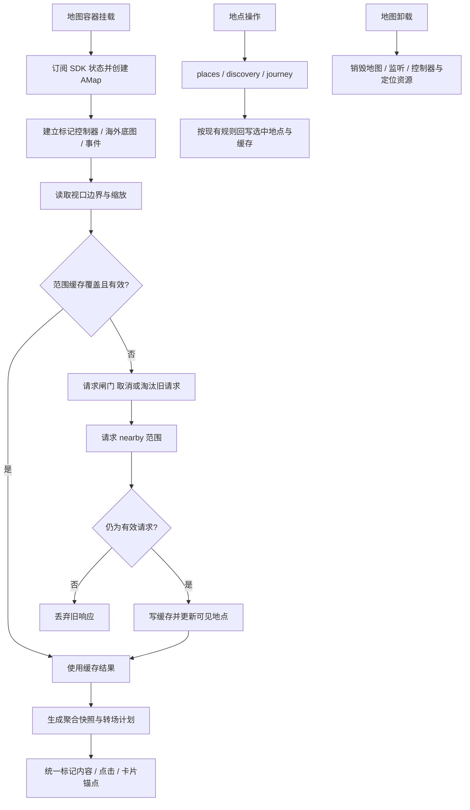

# 地图协调、渲染与缓存

iOS 液态玻璃聚合点（2026-10-28）：个性化地图中的“聚合点液态玻璃效果”（`clusterGlass`）默认关闭，独立于原生玻璃按钮偏好，只保存在本机。启用后，`nativeClusterLayer.js` 将默认聚合图及退出残影的真实 DOM 动画矩形、缩放后字号和透明度镜像到原生 SwiftUI，聚合引擎、合并/拆分/回弹/中断、点击与读屏仍由 `MarkerLayerController` 统一管理。协议 v2 发送相对每个图形的可见矩形片段：地图边缘与公告、搜索结果、展会入口、定位点、选中点等只裁切被遮挡区域，其余部分保持玻璃；新增网页浮动控件可用 `data-native-cluster-occluder` 声明遮挡。数字明确采用地图主题的黑/白实色并加反色细晕，原生内容与玻璃同步读取地图明暗。首次确认帧后隐藏网页图形，点击区域保留；同一会话已确认的默认聚合图在空几何、裁切、网页浮层和离页返回中保留玻璃所有权，临时性能降级只调整动效。移动和转场逐帧发送，静止 200ms 保活，桥接最多一帧在途且只保留最新积压帧；超时等待与 800ms 原生租期一致。旧系统/v1 旧壳、关闭聚合玻璃、减少透明度、自定义皮肤聚合图或桥接明确故障使用 PNG。逻辑入口 `test:map`；真实控制器及 Web Animations 的浏览器替身回归入口 `test:native-clusters-browser`；系统玻璃与帧率需真机检查，见 [原生案例](../../../native/doc/README.md)。

浮动按钮（2026-10 起）：定位旁边多了“筛选”（标签 / 人均，`places/components/PlaceFilterPanel.jsx`，面板不挡地图，改动立即作用到标记；选中的地点即使不符合也保留）与“列表 / 地图”切换（`MapListMode.jsx`：地点列表盖在地图上，图标变成地图；列表距离为 500 米与 1/3/5/10 公里（默认 3 公里），中心改为单个大下拉按钮，默认是定位到的位置，没定位时是打开列表时的地图中心，也可以在全屏地图上自选（`FullScreenMapPicker`，context `listCenter`）；点列表里的地点退出搜索 / 沿途 / 住民筛选，回到地图并打开卡片）。宽屏筛选位于搜索按钮右边，右侧按钮列保留定位与列表，顺路吃移入顶栏“更多”；窄屏是列表、筛选、定位，搜索结果覆盖在这组按钮之上；iOS 原生三个按钮共用一个竖向圆角矩形（协议 v12 的 `listView`、`filter` 浮动按钮）。iOS 原生工具栏的随机美食与日记 · 同好互换（日记收进上滑的更多功能），iOS 不再提供聚餐活动与导出海报入口。

展会地点：点展会面板里的地址后，复用高德临时地点的标记与卡片（MapView 的 `venuePlace`），卡片只有“导航”；普通的高德临时地点卡片只留“创建地点”。卡片关掉或选了别的地点后，展会地点的标记随之消失。展会卡片开着时在展会列表里换成另一个展会，卡片内容立即换掉（否则列表浮层退场时 iOS 原生控件先恢复旧展会的卡片）。

账号菜单（网页、iOS 原生账号面板、桌面顶栏）多了“我创建的地点”（地图只显示自己的地点，含审核中、未通过的）与“我的主页”。有被驳回的地点时头像右上角、“我创建的地点”右侧都有小红点（`GET /users/me` 的 `rejected_place_count`；看自己的地点列表时按列表同步），列表里被驳回的地点行尾有“未通过”标识（协议 v12 面板行的 `badge`）。住民地点列表的“屏蔽并举报”改为“查看主页”，屏蔽与举报在住民主页里。

`useExhibitions` 由 App 调用（只在地图页轮询），每 30 秒刷新列表并保留当前活动 ID。多活动时随机初始化起点，每 10 秒按活动时间循环轮换；MapExhibition 用 48px 正方形图标交错叠放并显示“有 X 个活动”；ExhibitionDeck 在轮换时将顶部卡片侧移后抽到底部，保留各卡片身份。点击后 ExhibitionSpread 在黑色透明蒙版上向下弹开纵向活动列表，不使用弹窗容器；图标仅放大 10% 至 52.8px，标题和时间置于图标左侧并右对齐。点击某项聚拢后打开详情，点击空白、Escape 或应用返回聚拢并恢复入口焦点。列表可滚动；收拢时使用实时入口位置并补偿滚动量，支持窗口变化；减少动态效果时只淡入淡出。详情选择独立于轮播，已打开的内容不会随轮播跳转。单活动直接打开详情。入口由 App 挂载以避让公告；展会面板由 MapUI 渲染：网页为 `ExhibitionPanel`，iOS 原生控件接管时改为原生两段停靠卡片（协议 v7 的 `exhibition` 面板，快照由 `exhibition.js` 的 `exhibitionChromeSheet` 生成，纳入 `test:map`）。简介与信息支持基础 Markdown：网页面板用 `Markdown` 组件显示，原生卡片的每段正文带纯文本 `text`（旧版 App）与行内 `markdown`。展会名可长达 80 字：入口标签与面板标题都用 `MarqueeText` 单行来回滚动（减少动态效果时改为可手动横滑），原生卡片标题同样滚动（`MapChromeMarqueeText`）。展会设置了地点时面板有“展会附近随机美食”：收起面板，以展会地点为本轮中心打开随机面板（RandomFoodPanel 的 `origin`）。展会有坐标时地址可点（网页面板的地址行；原生卡片的副标题与详情地址行，协议 v9 `subtitleAction` / `captionAction`，回传行 id `venue`；没填地点名时显示“查看位置”）：收起面板，地图移到展会地点并打开复用高德临时地点标记的卡片（只有导航，见上文）。原生卡片第一段时地图仍可点选，选中其他地点会收起展会卡片。窄屏入口距顶部 30px，详情全屏展示；宽屏入口位于右下角，详情参照顺路吃的侧板尺寸（宽 370px、顶部 68px、底部 42px）。单活动 44px 图标、堆栈 48px 图标缺失或加载失败回退 favicon；窄屏由 ResizeObserver 根据公告实际矩形避让，公告关闭恢复原位。`exhibitionLayout.js` 负责矩形相交计算，纳入 `test:map`。

操作指引（MapOnboarding.jsx + onboarding.js）：第一次打开地图时，地图就绪、没有其他浮层、没有选中地点且原生控件握手结束后自动出现，看完、跳过或返回都记入 localStorage `foodmap.onboarding`（带 `ONBOARDING_VERSION`，内容大改时加一让老用户再看一次）；网页与安卓“更多”、iOS 原生上滑抽屉、桌面顶栏“更多”都能再次打开。步骤的相对顺序各布局相同（欢迎、入乡、搜索、定位、收藏、添加、顺路吃、日记），之后是“更多”，最后是该布局里收在“更多”里的功能（窄屏的日记、iOS 网页工具栏的顺路吃和日记、iOS 原生工具栏的顺路吃）。网页按钮用 `data-tour="<步骤 id>"` 标记；收在“更多”里的功能高亮“更多”按钮，卡片里写明「在哪里」。iOS 原生工具栏（协议 v10 `tour`）：指引打开时原生控件不收起，原生把其余控件变暗、给目标画高亮圈、不接收触摸，并把目标位置作为 `tour` slot 回传；网页遮罩挖空目标下方的地图，卡片避开全部原生控件，每一步都写明位置（如“底部工具栏最右边的头像”）。“更多功能”一步原生播放上滑示意（手指往上划、工具栏露出一截更多功能），并允许真的拖动工具栏，展开后自动进入下一步（展开的更多功能里高亮顺路吃）。新增或移动主要按钮时同步步骤表、`data-tour` 与原生目标，步骤表和卡片位置纳入 `test:map`，桥接字段纳入 `test:native-chrome`。

按住民筛选（`userPlaces.js`，纳入 `test:map`）：地点卡片“最近修改”的名字可点（修改过的是最后修改人，否则是创建者；账号已注销的不能点），点开后 MapView 读取 `GET /users/:id/places`（最近创建在前，最多 200 个，自己还能看到审核中的），地图只显示这位住民的地点并调整视野。筛选与搜索、沿途互斥：提交搜索、选建议、沿途出结果、随机美食、分享链接、新增地点都会退出筛选。列表是临时面板（宽屏与收藏同一位置、地图可操作；窄屏底部面板，选中地点后让位给卡片；iOS 原生控件接管时为协议 v11 的 `userPlaces` 列表面板，卡片里“最近修改”是全屏详情中的一行），关闭列表不退出筛选；地图上的筛选条（窄屏在定位按钮左侧同一行，宽屏底部居中）重新打开列表或退出。接口返回的 `relation`（`self`、`blocked`、`can_block`）随筛选状态保存；`userPlacesActions` 按它给出“屏蔽并举报”（红色）或“解除屏蔽”，以及退出筛选，网页按钮与原生面板行共用 id，在 MapUI 的 `runUserPlacesRow` 分发、由 MapView 的 `setUserPlacesBlocked` 执行：屏蔽前确认，成功后作废附近地点缓存、重新读取列表（已屏蔽时不列出地点，只显示说明和解除屏蔽），再打开预填 `userReportPrefill` 的举报表单（iOS 为原生反馈页）。

导航（MapUI 的导航选择面板、MapView 处理的 `nav=amap` 分享链接）里的高德链接由 `amapNavigation.js` 生成（纳入 `test:map`）：`uri.amap.com` 不是 Universal Link / App Link，所以 App 内直接用高德 scheme（iOS `iosamap://path`，Android `amapuri://route/plan/`，坐标本来就是 GCJ-02，`dev=0`），没装高德时 `openExternal` 的 `fallbackUrl` 改开网页版；网页端（以及后端分享页 `placeShare.js`）用 `uri.amap.com` 加 `callnative=1`，由高德网页尝试唤起 App。只直接打开、不用 `canOpenUrl` 探测，所以 iOS 不需要 `LSApplicationQueriesSchemes`，Android 也不需要在 `<queries>` 里登记。

MapView.jsx 是旧 src/Map.jsx，仍是地图协调者；MapUI.jsx 负责地图 UI 与面板编排，二者尚未拆完。MarkerLayerController、markerContent 与 cluster 下引擎/快照/转场/缓存负责标记；默认聚合图使用 `src/img/union.png`（白底蓝边水滴形），CSS 按素材的可见边界裁去透明留白，数量居于图形的 50%、35% 位置；皮肤聚合图沿用完整画布与原有默认数字位置，加载失败后回退到新默认图。viewport、pinchGuard、overseasTileLayer 各自处理视口、手势与境外底图。MapPanel/MapAnchoredCard 是地图布局容器，不是通用页面组件。locationReport 记下最近一次定位，按最新登录状态上报 `PUT /users/me/location`（QQ Bot `!随机` 的中心），App 启动时的自动定位早于登录恢复时在登录后补报。

| 当前实现 | 对照 |
| --- | --- |
| 视口缓存 + 请求版本闸门 | 只缓存列表不能阻止旧响应覆盖；移动后要同时核对范围与请求身份 |
| 引擎/快照/转场分离 | 直接在 React 列表逐点管理难维护现有聚合成员与动画中断不变量 |
| 海外 tile overlay 与 SDK 分工 | CARTO 是配置可选覆盖，不替换国内坐标和高德区域判断 |
| MapView/MapUI 继续协调 | 本轮先归位地点与发现面板，状态拆分见 MAP-01，不假定文件移动已解除耦合 |

已有 `test:map` / `test:platform` 逻辑测试；真实地图相关交互覆盖一部分在位置与日记浏览器回归。案例见 [TEST_CASES.md](TEST_CASES.md)。历史 `d944e8a`、`2bc8c5e`；待办 MAP-01 / MAP-02 见 [清单](../../../doc/HISTORY_AND_TODO.md)。
