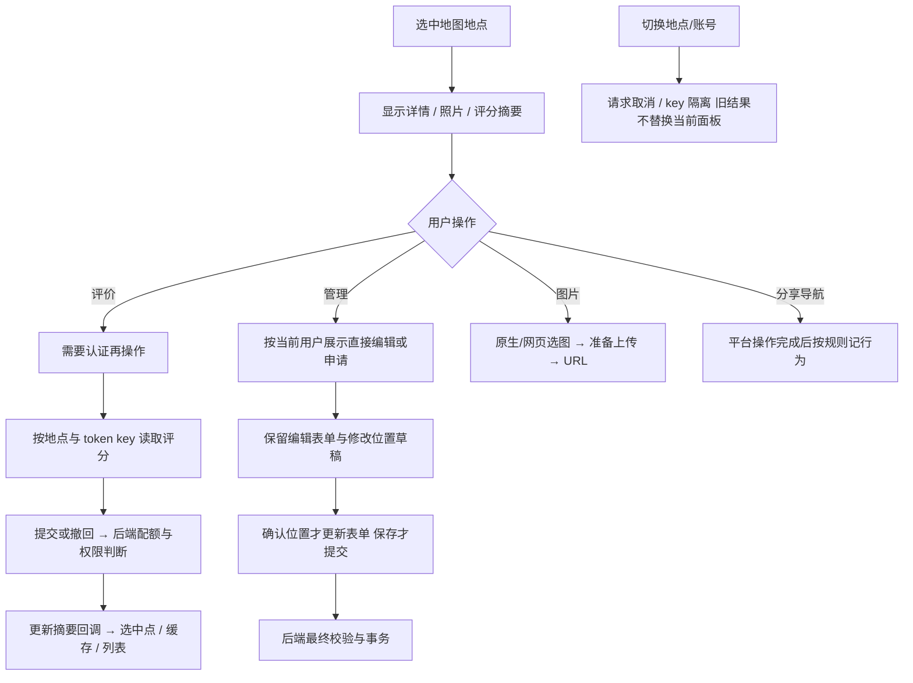

# 地点详情、编辑与评分

地点列表（`PlaceListView.jsx`，`GET /places/list`）：店名、简介（Markdown，CSS 只显示前三行）、第一张图与评价，按综合评价（评价少时向均线收缩）排序，登录后再结合口味相近的人的评价。条目不带坐标、地址和距离，只链接 `/p/:id`，点开在地图上打开。地图上的列表模式（`map/MapListMode.jsx`）与可直接打开的 `/places` 页（`PlaceListPage.jsx`）共用它。

筛选（`placeFilter.js` + `components/PlaceFilterPanel.jsx`，规则与后端 `placeList.js` 的 `matchesFilter` 一致）：标签命中任一即可；人均用双滑块拉杆（`components/forms/RangeSlider.jsx`，0–200 元，拉到最右为不限），设了人均范围时没填人均的地点不显示。地图筛选、列表模式与 AI 搜索共用 MapView 里的同一份筛选：AI 搜索返回的 `filter`（后端 `discovery/services/searchFilter.js` 从原话里读出的标签 / 人均）直接作用到地图，筛选按钮高亮，面板里注明是按搜索设置的。分类目录由 `categoryDirectory.js` 整页只读一次。

图片（`components/PlaceImageInputs.jsx`）可一次多选，逐张处理、上传，失败的可一键重试。iOS App 的添加 / 修改地点改为原生 SwiftUI 表单（`hooks/useNativePlaceForm.js` + `platform/nativePlaceForm.js` + `ios/App/App/NativePlaceFormPlugin.swift`）：新增地点时先停在屏幕下方三分之一，用户往上拉开；图片用系统相册（可多选）或相机，原生缩到 2560 内编码后逐张交给网页上传；提交、删除也交回网页，走 MapView 原有的流程。“在地图上修改位置”结束原生表单（带回填写内容），网页打开全屏选点，选好后重新打开。添加地点的本机草稿与网页表单相同（关掉时存回 `addPlaceDraft`）。网页的添加地点面板在窄屏同样先只露出下方三分之一（`ResponsivePanel` 的 `snap="third"`）。添加地点时，首次有效点选立即结束选点模式，标记固定在所选坐标（`map/addingPin.css`）；打开表单不再自动平移地图，表单打开后的地图点击也不会改写坐标。取消后可以重新选点。浏览器回归：`node scripts/testing/test-add-place-pick-browser.mjs`（AMap / HTTP 边界替身，实际 iOS 触摸另验）。

components 下 AddPlaceForm、ManagePanel、CategorySelector、PlaceDetailPanel、PlaceImageInputs、PlaceRatingPanel、CommentPanel 收拢地点交互；hooks/usePlaceRating 处理评分状态与请求；rating.js 是展示与避雷纯逻辑；placeBehavior.js 记录有效用户操作与分享；addPlaceDraft.js 是添加地点表单的本机草稿（每次改动写入 localStorage，按账号隔离，面板怎么关都不丢，提交成功或清空才删除；坐标和地址跟这次打开的位置走，从另一个高德地点收录时只提示可恢复，App 内同样走这份网页表单）。shareCard.js 画地点分享卡片（以静态地图为中心、外围信息框与二维码，横竖两版），hooks/useShareCard 管生成/缓存/分享；地图来自后端 `/api/amap/staticmap`，输出走 platform/share 的图片分享与保存。地图渲染仍在 map，网络封装在 api/client，照片选择和压缩在 platform/mediaPicker。

| 方案 | 对照与约束 |
| --- | --- |
| 评分展示规则集中 rating.js | 须与后端 <2.5/无分看标签保持一致，不能各组件写一套 |
| 编辑暂存与服务端提交分开 | 取消选点不应修改服务器，也不应清空其他字段 |
| 身份决定可用操作，后端授权 | 隐藏按钮不能作为真正权限检查 |
| 行为只记有效结果 | 点击菜单/取消分享不等于导航成功或收到分享，不补造反馈 |

案例见 [TEST_CASES.md](TEST_CASES.md)，已有 `test:rating`、`test:place-draft` 与位置浏览器集成；后端另测评分、申请、图片和分享。历史 `65ce2d4`、`ed3b2f9`、`2bc8c5e`；待办 PLC-F01 见 [清单](../../../doc/HISTORY_AND_TODO.md)。
